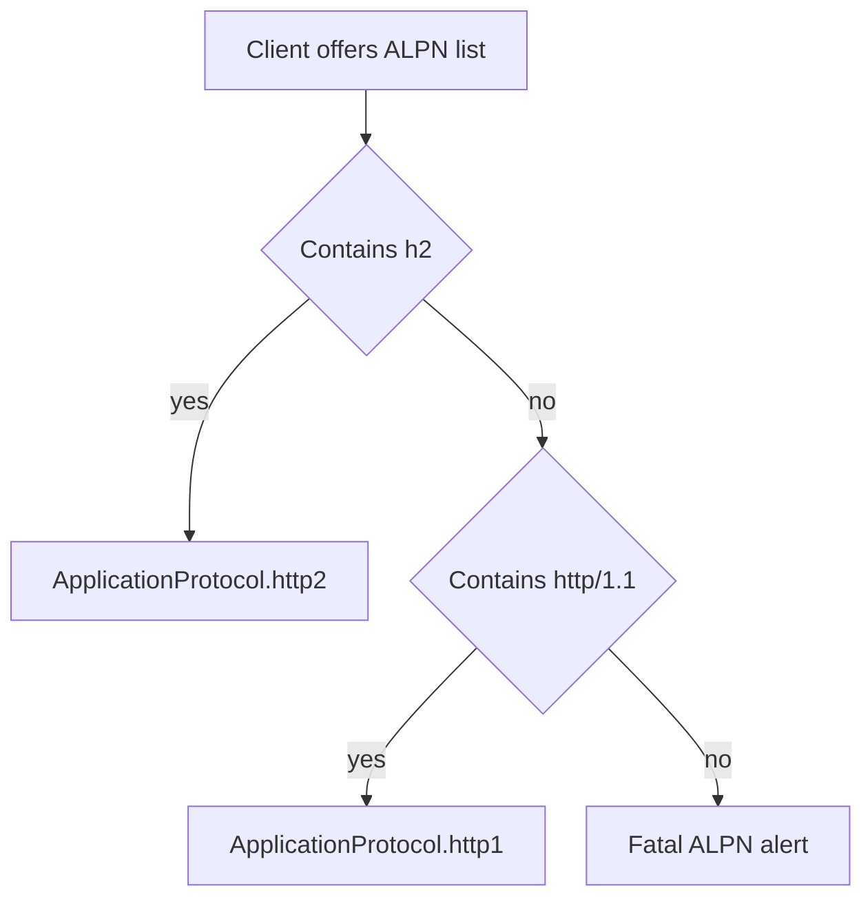

µWebZockets terminates TLS with BoringSSL. Every HTTPS context is TLS 1.3 only
and chooses the application protocol through ALPN. HTTP/3 uses a separate
context that advertises `h3`, so a TCP handshake never selects it.

## Protocol policy

| Property            | Value                                                       |
| ------------------- | ----------------------------------------------------------- |
| TLS version         | 1.3 only; older versions are rejected at the context        |
| TCP ALPN preference | `h2`, then `http/1.1`                                       |
| QUIC ALPN           | `h3` only                                                   |
| TLS 1.2 fallback    | None                                                        |
| TCP 0-RTT           | Enabled unless client certificates are requested            |
| QUIC 0-RTT          | Disabled until the lsquic replay policy is wired end to end |

The minimum and maximum protocol versions are both set to TLS 1.3 while the
context is created. A client that offers only TLS 1.2 fails the handshake
instead of negotiating a weaker version.

## Context entry points

| Entry point                                         | ALPN             | Early data              |
| --------------------------------------------------- | ---------------- | ----------------------- |
| `TlsContext.init(cert_path, key_path)`              | `h2`, `http/1.1` | Safe-method 0-RTT       |
| `TlsContext.init_mtls(cert_path, key_path, config)` | `h2`, `http/1.1` | Disabled unless `.none` |
| `TlsContext.init_http3(cert_path, key_path)`        | `h3`             | Disabled                |
| `TlsContext.init_ephemeral(names)`                  | `h2`, `http/1.1` | Safe-method 0-RTT       |
| `TlsContext.init_http3_ephemeral(names)`            | `h3`             | Disabled                |

The application wrappers `App.init_https`, `App.init_https_mtls`,
`App.init_http3`, `App.init_https_ephemeral`, and `App.init_http3_ephemeral`
build the same contexts and attach them to the server. `init_http3` creates two
contexts: one for TCP and one for QUIC, both loaded from the same PEM files.

## ALPN selection

`ApplicationProtocol` has three values: `.http2`, `.http1`, and `.none`.

- `select_http_protocol(offered)` reads an ALPN wire-format list and returns
  `.http2` when `h2` is present, otherwise `.http1` when `http/1.1` is present,
  otherwise `null`. Malformed length-prefixed input also returns `null`.
- `negotiated_protocol(ssl)` reads BoringSSL's selected value after the
  handshake and returns `.none` when no protocol was selected.

The live server callback fails the handshake with a fatal alert when the client
offers neither name. `select_http_protocol` reports that same no-match case as
`null` when you call the helper directly.

## TLS 1.2 is not a fallback

There is no configuration switch for an older version. A handshake that cannot
agree on TLS 1.3 fails, and the failure is a protocol error rather than a
downgrade. This matches the deployment baseline: modern clients, a single
protocol floor, and no legacy cipher negotiation surface.

## Errors

| Error                         | Cause                                                        |
| ----------------------------- | ------------------------------------------------------------ |
| `CertificateLoadFailed`       | The PEM chain could not be read or parsed                    |
| `PrivateKeyLoadFailed`        | The PEM key could not be read or parsed                      |
| `KeyMismatch`                 | Defensive check; a mismatched key already fails at load      |
| `TlsContextCreationFailed`    | BoringSSL could not allocate the context                     |
| `ProtocolConfigurationFailed` | The TLS 1.3 bounds could not be applied                      |
| `InvalidClientAuthConfig`     | A client-auth mode other than `.none` had an empty `ca_path` |
| `TrustStoreLoadFailed`        | The client CA bundle could not be read or parsed             |

Generated credentials add the `Ephemeral*` errors listed on
[Ephemeral certificates](/docs/security/ephemeral-certificates).

## Related

- [Ephemeral certificates](/docs/security/ephemeral-certificates) shows the
  in-memory path and its generated contents.
- [Production certificates](/docs/security/production-certificates) shows PEM
  loading and the startup checklist.
- [Protocol negotiation](/docs/concepts/protocol-negotiation) places ALPN next
  to the plaintext HTTP/2 preface.
