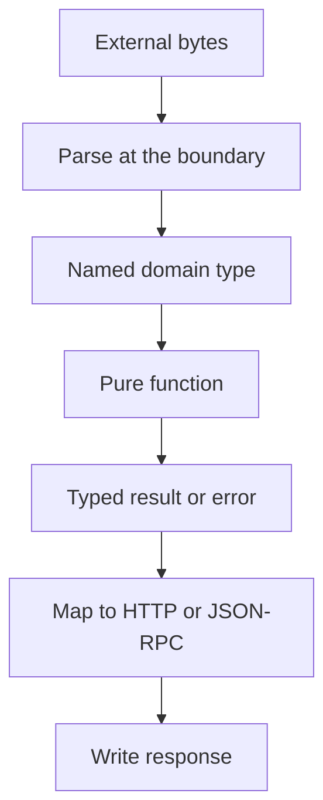

The framework supplies the types; the application still decides whether the
boundary stays honest. These rules keep a service small, explicit, and testable.
They apply to Zig consumers, not to the framework's own build.

## Rules

| Rule                                                    | Why                                                          |
| ------------------------------------------------------- | ------------------------------------------------------------ |
| Choose capacities at compile time                       | They size the generated type and the startup slab            |
| Name every parameter and result type                    | Inline anonymous structs hide the contract                   |
| Pass state through an explicit context                  | A hidden global cannot be scoped to one worker               |
| Keep one owner per event loop                           | Services, clients, and response buffers are not synchronized |
| Make the allocator explicit                             | The request path has no ambient allocator                    |
| Release `Parsed(T)` exactly once                        | The parsed value owns nested allocations                     |
| Map errors at the boundary                              | A domain function should not choose an HTTP status           |
| Keep `Aborted` distinct                                 | A gone peer is not an internal failure                       |
| Use `anytype` only for a genuinely polymorphic contract | A broad signature hides the type contract                    |
| Test pure logic without a socket                        | Faster and more precise than an end-to-end test              |
| Treat HTTP 200 JSON-RPC as a protocol result            | The error member decides success, not the status             |

## Boundaries



Parsing, domain logic, and presentation are separate steps. A handler that parses,
queries, formats HTML, and chooses a status in one function is four modules
pretending to be one.

## Prefer named types

```zig
const UserId = struct {
    value: u64,
};

const User = struct {
    id: UserId,
    name: []const u8,
};

fn label(user: User) []const u8 {
    _ = user.id;
    return user.name;
}
```

A named `UserId` prevents passing a session id or an account id by mistake. An
inline `struct { value: u64 }` at each call site does not.

## Avoid forwarding wrappers

| Anti-pattern                                        | Problem                                       |
| --------------------------------------------------- | --------------------------------------------- |
| `fn json(comptime T: type, value: anytype)` wrapper | Adds a layer but no bound or invariant        |
| A runtime registry of handlers                      | Duplicates the router and hides the signature |
| A global `var service: Service` for all workers     | Races on the response buffer                  |
| `catch {}` on a response write                      | Hides a truncated response                    |
| Storing `req.text()` in a struct field              | Borrowed slice dies with the handler          |
| Returning HTTP 500 for `Aborted`                    | Reports a failure the peer cannot receive     |
| Raising `ServerConfig` from a runtime value         | The type cannot be sized after compilation    |

One indirection layer is enough, and it must add a bound, an invariant, or a type
guarantee.

## Capacity checklist

- Does every `App` or `ServerConfig` value use a compile-time constant?
- Is `max_body_size` at least as large as the largest accepted JSON document?
- Does `max_connections` cover the worker count and load-balancer fan-in?
- Is the JSON-RPC response buffer larger than the largest result?
- Does the write queue hold the largest fixed response?
- Does the cluster create one service per worker?

## Ownership checklist

- Is every `Parsed(T)` released with `deinit`?
- Does any value outlive the callback that borrowed it?
- Is the service value at a stable address after `app.rpc`?
- Is the client value at a stable address after `init`?
- Is every callback completed on its owning event loop?
- Is an async token copied before the callback returns?

## Error checklist

- Does each handler map a domain error to one status?
- Is `OutOfMemory` distinct from a parse failure?
- Is `Aborted` allowed to propagate?
- Does a JSON-RPC procedure use `Call.fail` for application codes?
- Does a test assert the exact error object, not only the HTTP status?
- Does a load test inspect bodies, not only 200 responses?

## Test checklist

- Is the domain function callable without a server?
- Does a dispatcher test cover a valid call, a notification, and a batch?
- Does a schema test cover the happy path and one rejected rule?
- Does a client test cover a failure kind and a successful fetch?
- Does a cluster test hit every worker?

## Next

- [Typed handlers](/docs/type-safety/handlers) applies the callback rules.
- [Error sets and failures](/docs/type-safety/error-sets) maps the failures.
- [Testing a JSON-RPC service](/docs/json-rpc/testing) turns the checklists into
  tests.
