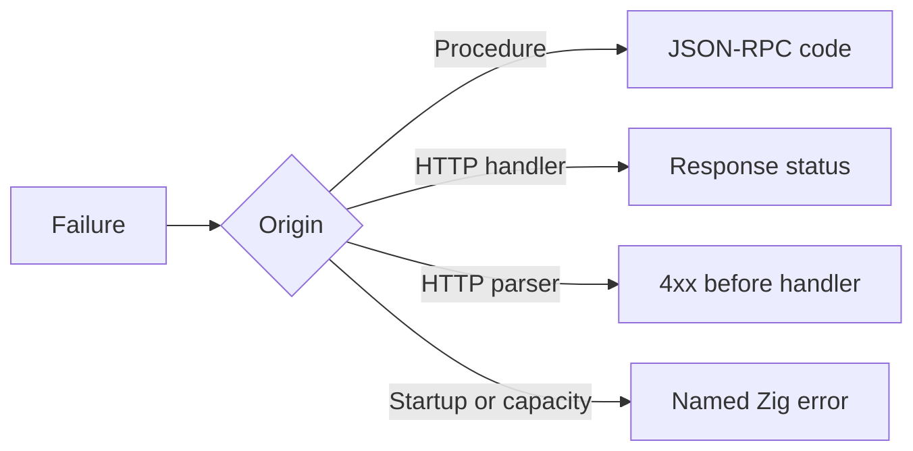

µWebZockets reports failures through Zig error sets, not status codes hidden in
a response object. The error name says what failed, and the boundary decides how
to present it: an HTTP status in a route, a JSON-RPC code in a procedure, or a
startup failure before the listener binds.

## Public error sets

| Error set                       | Members                                                                                                                  | Boundary        |
| ------------------------------- | ------------------------------------------------------------------------------------------------------------------------ | --------------- |
| `uz.json_rpc.HandlerError`      | `Aborted`, `ApplicationError`, `InternalError`, `InvalidParams`, `OutOfMemory`, `ResultAlreadyWritten`, `ResultTooLarge` | Procedure       |
| `uz.json_rpc.RegistrationError` | `DuplicateProcedure`, `InvalidMethodName`, `MethodStorageCapacityReached`, `ProcedureCapacityReached`, `RegistryLocked`  | Startup         |
| `uz.json_rpc.DispatchError`     | `Aborted`, `ResponseTooLarge`                                                                                            | Dispatch        |
| Schema validation               | `MalformedJson`, `ConstraintViolation`, `SchemaMustBeStruct`, `OutOfMemory`                                              | Request decode  |
| `uz.cluster.MessageError`       | `EmptyTopic`, `TopicTooLong`, `ClusterMessageTooLarge`                                                                   | Cluster publish |
| `uz.cluster.QueueError`         | The message errors plus `ClusterQueueFull`                                                                               | Cluster inbox   |
| `uz.cluster.PublishError`       | The message errors plus lifecycle rejection                                                                              | Cluster publish |
| `uz.cluster.RunError`           | Lifecycle, spawn, `InvalidWorkerCount`, and `ClusterWorkerFailed`                                                        | Cluster run     |

Route registration, response writes, and client calls use inferred error sets.
Read the method signature for the exact names; do not assume a single global
error type.

## Map a failure



| Failure                             | Present as                                  |
| ----------------------------------- | ------------------------------------------- |
| `HandlerError.InvalidParams`        | `-32602 Invalid params`                     |
| `HandlerError.ApplicationError`     | The `Call.fail` code and message            |
| `HandlerError.Aborted`              | No response; do not convert to a fault      |
| `HandlerError.ResultTooLarge`       | `-32603 Internal error` when it fits        |
| `RegistrationError.*`               | Startup failure; log and exit               |
| `DispatchError.ResponseTooLarge`    | HTTP `500`; the document cannot be finished |
| `ConstraintViolation`               | `422 Unprocessable Entity` in the example   |
| `MalformedJson`                     | `400 Bad Request` in the example            |
| `WouldBlock`                        | Backpressure; retry after drain             |
| `ResponseAlreadyStarted`            | Programming error; do not write twice       |
| `InvalidStatus` or `InvalidHeaders` | Programming error; fix the response call    |

The HTTP statuses for schema failures are application choices. The framework
does not select `400` or `422` for you.

## Handle at the boundary

```zig
fn load(req: *uz.Request, res: *uz.Response) void {
    const parsed = req.json(Query, std.heap.page_allocator) catch |err| switch (err) {
        error.OutOfMemory => {
            res.end_best_effort("500 Internal Server Error", "");
            return;
        },
        else => {
            res.end_best_effort("400 Bad Request", "invalid json");
            return;
        },
    };
    defer parsed.deinit();

    res.text(parsed.value.name) catch |err| {
        std.log.err("response failed: {}", .{err});
    };
}
```

The `switch` makes the allocation failure explicit and groups every parse failure
under `else`. Do not use an empty `catch {}`; either map the error, translate it,
or return it. The snippet is an excerpt; `Query` is your parsed request type.

## Keep Aborted distinct

`Call.checkpoint()` and `DispatchError.Aborted` mean the peer or the request is
gone. Converting that to `-32603` or HTTP 500 produces a misleading error for a
client that will never read it. Let `Aborted` propagate through the dispatcher.

```zig
fn scan(call: *uz.json_rpc.Call) uz.json_rpc.HandlerError!void {
    for (items) |item| {
        try call.checkpoint();
        _ = item;
    }
    try call.result(.{ .done = true });
}
```

## Do not widen a boundary

`uz.StreamProducer` returns `anyerror!StreamStatus` because a producer can
surface any transport error. That is the deliberate exception. Public functions
elsewhere use explicit sets so a caller can decide what to do.

| Rule                                      | Why                                        |
| ----------------------------------------- | ------------------------------------------ |
| No `anyerror` in a new public API         | The caller cannot enumerate recovery cases |
| No `catch {}` without a comment           | A failure disappears from logs and tests   |
| No status code inside the domain function | The boundary owns presentation             |
| No `Aborted` to fault conversion          | The peer is gone                           |
| No capacity error to success              | Silent truncation is worse than a failure  |

## Next

- [Typed RPC](/docs/type-safety/typed-rpc) maps `HandlerError` end to end.
- [JSON-RPC errors](/docs/json-rpc/errors) lists every protocol code.
- [Errors and failure modes](/docs/concepts/errors) maps HTTP statuses and
  retries.
