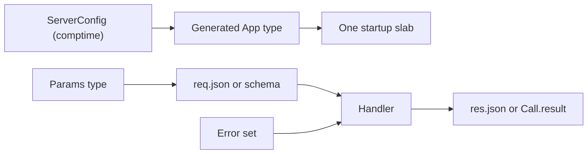

Type safety in µWebZockets means the compiler knows the shape of the application
before the listener starts. Capacities size the generated type, route callbacks
have named signatures, JSON decodes into a declared Zig type, and failures stay in
explicit error sets. There is no runtime type registry and no reflection-driven
serializer.

The mental model lives in [Type safety](/docs/concepts/type-safety). This section
covers each boundary in task order and links back to that page for the model.

## Start here

<CardGroup cols={2}>
  <Card title="Typed handlers" href="/docs/type-safety/handlers" icon="braces">
    Use the callback aliases, named functions, and explicit context pointers.
  </Card>
  <Card title="Schema validation" href="/docs/type-safety/schema-validation" icon="shield-check">
    Declare field rules at compile time and report the first rejected constraint.
  </Card>
  <Card title="Typed RPC" href="/docs/type-safety/typed-rpc" icon="network">
    Carry parameter and result types through a JSON-RPC procedure.
  </Card>
</CardGroup>

## Capacity and failure

<CardGroup cols={2}>
  <Card
    title="Compile-time capacities"
    href="/docs/type-safety/compile-time-capacities"
    icon="ruler"
  >
    Choose the capacities that size the generated application type.
  </Card>
  <Card title="Error sets and failures" href="/docs/type-safety/error-sets" icon="shield-alert">
    Read each public error set and the HTTP status or protocol code it maps to.
  </Card>
  <Card title="C ABI types" href="/docs/type-safety/c-abi-types" icon="file-code">
    Use the fixed-capacity C surface and know what it does not project.
  </Card>
  <Card title="Design rules for consumers" href="/docs/type-safety/design-rules" icon="list-checks">
    Apply the consumer rules that keep a typed boundary from drifting.
  </Card>
</CardGroup>

## The type pipeline

The left side is fixed when the program is compiled. The right side is a
per-request transformation: parse, validate, handle, serialize. A runtime JSON
shape error can still occur on the right side; the type system narrows the
values after parsing, but it cannot prove that an external client sends the
document you expect.

## What the compiler proves

| Property                                       | Proved by                                 |
| ---------------------------------------------- | ----------------------------------------- |
| Connection and buffer capacities               | `App(N)`, `ConfiguredApp`, `ServerConfig` |
| Handler accepts the registered route signature | The callback alias                        |
| JSON decodes into the declared type            | `req.json(T, allocator)`                  |
| Schema rules exist for declared fields         | `pub const validation`                    |
| Result matches the procedure contract          | `register_typed(..., Result, handler)`    |
| Failure names are known                        | Explicit error sets                       |
| C ABI struct layout is stable                  | Frozen header types and versioned enums   |

## What it does not prove

| Limit                                       | Where it is handled                  |
| ------------------------------------------- | ------------------------------------ |
| The client sends valid JSON                 | Parse error, then `400` or `-32700`  |
| A string is a meaningful email or slug      | Application semantic validation      |
| A result fits the response buffer           | Capacity check and error mapping     |
| A procedure is safe to share across workers | One service per event loop           |
| A C caller passes the right handle          | ABI contract and `uwz_error` returns |

## Next

Start with [Typed handlers](/docs/type-safety/handlers), then read
[JSON responses](/docs/http/json) and
[Schema validation](/docs/type-safety/schema-validation) before adding a
JSON-RPC service.
