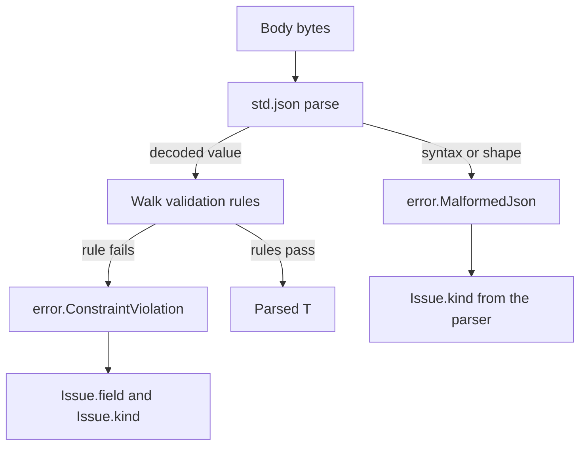

`uz.schema` turns a struct declaration into a parse-and-check step. The type
declares its rules in a `pub const validation` value, and the validator walks the
decoded value, reporting the first rejected field. No schema string, runtime
registry, or reflection metadata is involved.

## Declare rules on a type

```zig
const std = @import("std");
const uz = @import("uWebZockets");

const Role = enum {
    member,
    admin,
};

const CreateUser = struct {
    name: []const u8,
    age: u8,
    role: Role = .member,

    pub const validation = .{
        .name = uz.schema.Rule{ .min_length = 1, .max_length = 64 },
        .age = uz.schema.Rule{ .min = 18, .max = 120 },
        .role = uz.schema.Rule{ .allowed = &.{ "member", "admin" } },
    };
};
```

`validation` is an anonymous struct whose field names match data fields and whose
values are `uz.schema.Rule`. A field without a rule gets no direct constraint.
Nested structs, arrays, slices, and optionals are walked when their element type
also declares `validation`.

## Rule fields

| Field                      | Applies to                                               |
| -------------------------- | -------------------------------------------------------- |
| `min`, `max`               | Integer fields                                           |
| `min_float`, `max_float`   | Float fields; integer bounds are ignored                 |
| `min_length`, `max_length` | Strings and `[]u8` or `[]const u8` values                |
| `min_items`, `max_items`   | Arrays and non-`u8` slices                               |
| `allowed`                  | Enum tag names or whole string values; empty disables it |

`allowed` matches the whole string, not a prefix or substring. For an enum it
compares the tag name. An empty `allowed` list disables the membership check.

## Validate a body

```zig
fn create_user(req: *uz.Request, res: *uz.Response) void {
    var issue = uz.schema.Issue{};

    const parsed = uz.schema.validate_json_detailed(
        CreateUser,
        std.heap.page_allocator,
        req.text(),
        &issue,
    ) catch |err| {
        if (err == error.ConstraintViolation) {
            res.end_best_effort("422 Unprocessable Entity", @tagName(issue.kind));
            return;
        }
        if (err == error.MalformedJson) {
            res.end_best_effort("400 Bad Request", @tagName(issue.kind));
            return;
        }
        res.end_best_effort("500 Internal Server Error", "validation failed");
        return;
    };
    defer parsed.deinit();

    var buffer: [256]u8 = undefined;
    res.json_buf(.{ .name = parsed.value.name }, &buffer) catch |err| std.log.err("json response failed: {}", .{err});
}
```

A request such as `{"name":"Ada","age":17}` returns
`error.ConstraintViolation` with `issue.field == "age"` and
`issue.kind == .below_minimum`.

## Choose a validator

| Function                                                        | Returns               | Reports                          |
| --------------------------------------------------------------- | --------------------- | -------------------------------- |
| `req.validate_json(T, allocator)`                               | `!std.json.Parsed(T)` | The error name only              |
| `req.validate_json_detailed(T, allocator, &issue)`              | `!std.json.Parsed(T)` | First `Issue`                    |
| `uz.schema.validate(T, value, &issue)`                          | `!void`               | First `Issue` on a decoded value |
| `uz.schema.validate_json(T, allocator, bytes)`                  | `!std.json.Parsed(T)` | The error name only              |
| `uz.schema.validate_json_detailed(T, allocator, bytes, &issue)` | `!std.json.Parsed(T)` | First `Issue`                    |

The `req.*` variants read `req.body`. The direct variants take a byte slice, which
makes them usable in a unit test.

## Issue kinds

| Group | Kinds                                                                                                                                                                                                            |
| ----- | ---------------------------------------------------------------------------------------------------------------------------------------------------------------------------------------------------------------- |
| Parse | `malformed_json`, `syntax_error`, `unexpected_end_of_input`, `unexpected_token`, `invalid_number`, `number_overflow`, `invalid_enum_tag`, `length_mismatch`, `missing_field`, `duplicate_field`, `unknown_field` |
| Rule  | `below_minimum`, `above_maximum`, `too_short`, `too_long`, `too_few_items`, `too_many_items`, `invalid_enum_tag`                                                                                                 |
| Depth | `too_deep`                                                                                                                                                                                                       |

`invalid_enum_tag` can come from the JSON parser or from an `allowed` rule. Use
`issue.field` to tell which field failed. `issue.field` is empty when decoding
failed before the validator reached a named field.

## Validation order



Parsing comes first. A malformed document never reaches a rule. A document that
decodes but violates a rule returns `ConstraintViolation`, and the decoded value
is released before the error returns.

## Depth limit

`uz.schema.max_nested_depth` is `4`. The walker starts at depth `0` and rejects a
node at depth `4`, so it validates four levels and fails a fifth with
`too_deep`. The bound is a runtime value so a self-referential schema type cannot
recurse without end.

A flat struct with scalar fields uses one level. A struct field adds one level, a
collection element adds one level, and an optional adds one level only when the
value is present.

## Limits

| Limit                                       | Handled by                            |
| ------------------------------------------- | ------------------------------------- |
| JSON syntax and shape                       | `std.json` and the parser issue kinds |
| Declared field bounds                       | `Rule` and `IssueKind`                |
| Semantic rules such as email or slug format | Application code                      |
| Cross-field rules                           | Application code                      |
| HTTP status selection                       | The handler, not the schema           |
| Request body size                           | `ServerConfig.max_body_size`          |

The schema cannot express "field B is required when field A is true" or "this
string is a valid email". Keep those checks in a named function after validation
and return one issue type from your own code.

`uz.schema.validate` requires a struct type. A non-struct type returns
`error.SchemaMustBeStruct` before any rule runs.

## Next

- [Typed JSON](/docs/type-safety/json) covers parsing and response ownership.
- [Typed RPC](/docs/type-safety/typed-rpc) uses the same parameter types in a
  JSON-RPC service.
- [Errors and failure modes](/docs/concepts/errors) maps failures to statuses.
