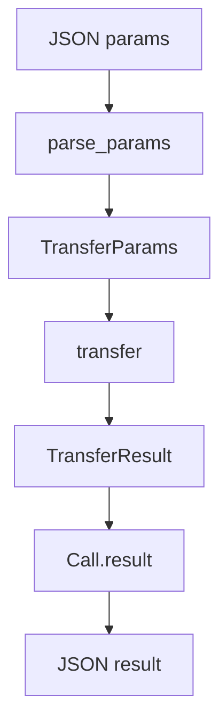

A typed RPC procedure is a normal function with a named parameter type and a
named result type. `register_typed` generates the decode and serialize steps, so
the procedure body only sees Zig values. The JSON boundary still exists, but it
is one adapter instead of hand-written parsing in every handler.

## Define the procedure

```zig
const std = @import("std");
const uz = @import("uWebZockets");

const TransferParams = struct {
    account: []const u8,
    amount: u64,
};

const TransferResult = struct {
    accepted: bool,
    balance: u64,
};

fn transfer(params: TransferParams) uz.json_rpc.HandlerError!TransferResult {
    if (params.amount == 0 or params.amount > 100) return error.InvalidParams;
    return .{ .accepted = true, .balance = 100 - params.amount };
}

var rpc = uz.json_rpc.Service{};
try rpc.register_typed("ledger.transfer", TransferParams, TransferResult, transfer);
_ = try app.rpc("/rpc", &rpc);
```

The compiler checks the function signature. A handler that returns a different
result type, or takes a different parameter type, does not compile.

## Type flow



The adapter owns the parse and the serialize step. The procedure owns the
business rule. The service owns the response buffer.

## Choose typed or raw

| Need                                  | Registration                   | Decode storage      |
| ------------------------------------- | ------------------------------ | ------------------- |
| Parameters under 4 KiB                | `register_typed`               | 4 KiB stack scratch |
| Parameters over 4 KiB                 | `register` with `parse_params` | Caller allocator    |
| Caller-owned state                    | `register_typed_context`       | 4 KiB stack scratch |
| Custom wire format or partial parsing | `register`                     | Caller allocator    |
| No runtime registry at all            | `comptime_service`             | Compile-time table  |

`register_typed` is the default. Move to `register` when the parameter type can
exceed 4 KiB or when the decoder needs a custom policy.

## Map procedure failures

| Procedure result           | JSON-RPC response                    |
| -------------------------- | ------------------------------------ |
| `TransferResult`           | `result` with the serialized value   |
| `error.InvalidParams`      | `-32602 Invalid params`              |
| `Call.fail(code, message)` | `error` with the application code    |
| `error.OutOfMemory`        | `-32603 Internal error`              |
| `error.ResultTooLarge`     | `-32603 Internal error` when it fits |
| `error.Aborted`            | No response                          |
| Another `HandlerError`     | `-32603 Internal error`              |

The application chooses the code range for `Call.fail`. Use `-32000` through
`-32099` for server-defined errors. See
[JSON-RPC errors](/docs/json-rpc/errors) for the full mapping.

## Typed context

```zig
const Ledger = struct {
    balance: u64 = 100,
};

fn debit(self: *Ledger, params: TransferParams) uz.json_rpc.HandlerError!TransferResult {
    if (params.amount > self.balance) {
        return error.InvalidParams;
    }
    self.balance -= params.amount;
    return .{ .accepted = true, .balance = self.balance };
}

var ledger = Ledger{};
try rpc.register_typed_context("ledger.debit", &ledger, TransferParams, TransferResult, debit);
```

The context is a mutable single-item pointer and must outlive the service. One
context belongs to one procedure; register the same pointer for several
procedures to share state on one event loop.

## Runtime limits

| Limit                              | Result                                     |
| ---------------------------------- | ------------------------------------------ |
| Parameter document above 4 KiB     | `error.OutOfMemory`, then `-32603`         |
| Result above the response buffer   | `error.ResultTooLarge`, then `-32603`      |
| Request body above `max_body_size` | `413 Payload Too Large` before the adapter |
| Method name invalid                | `error.InvalidMethodName` at registration  |
| Registry already sealed            | `error.RegistryLocked` at registration     |

Type safety does not prove that the client sends valid JSON. The adapter still
reports a parse failure, and the procedure still decides whether a decoded value
is semantically valid.

## Test the procedure

The type boundary makes the procedure directly testable:

```zig
test "zero transfer is invalid" {
    try std.testing.expectError(
        error.InvalidParams,
        transfer(.{ .account = "a", .amount = 0 }),
    );
}
```

The test does not need a socket, a service, or JSON. Test the adapter separately
with `service.dispatch` when the wire shape matters.

## Next

- [JSON-RPC quickstart](/docs/json-rpc/quickstart) mounts the service end to end.
- [Typed procedures](/docs/json-rpc/typed-procedures) covers the adapter and
  compile-time dispatch.
- [Schema validation](/docs/type-safety/schema-validation) adds field rules to
  the parameter type.
