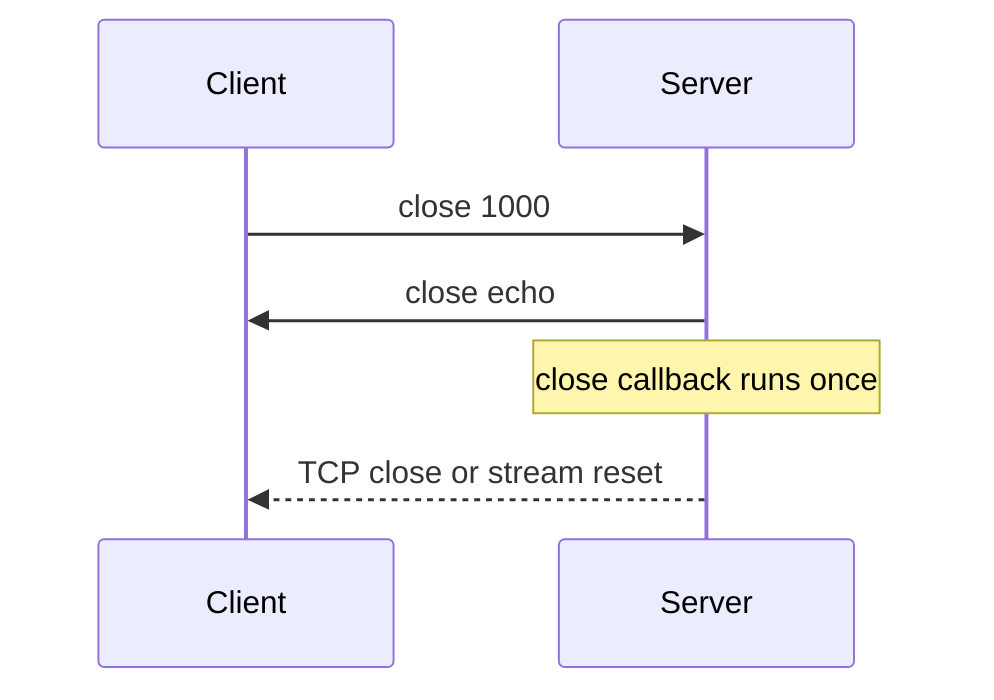

A close frame carries a two-byte status code and an optional UTF-8 reason of at
most 123 bytes. µWebZockets validates the code, sends the frame, and finishes the
closing handshake. This page lists the permitted codes and the difference between
a graceful close and `terminate`.

## Send a close

```zig
try ws.send_close(1000, "done");
```

`send_close`:

1. Returns without sending when a close frame was already sent.
2. Rejects a reason longer than 123 bytes with `error.ControlFrameTooLarge`.
3. Rejects a code outside the permitted ranges with `error.InvalidCloseCode`.
4. Rejects a non-UTF-8 reason with `error.InvalidUtf8`.
5. Sends the frame, marks the close as sent, and closes after the queue drains.

No application message may be sent after `send_close`; `send` returns
`error.ConnectionClosed`.

## Permitted codes

| Code        | Name               | Use                                               |
| ----------- | ------------------ | ------------------------------------------------- |
| `1000`      | Normal             | The purpose of the connection is complete         |
| `1001`      | Going away         | Server shutdown or the peer left                  |
| `1002`      | Protocol error     | Malformed frame or invalid state                  |
| `1003`      | Unsupported data   | A data type the endpoint cannot accept            |
| `1007`      | Invalid payload    | Text or close reason is not UTF-8                 |
| `1008`      | Policy violation   | Application policy refused the message            |
| `1009`      | Message too big    | Payload exceeded `max_message_size`               |
| `1010`      | Extension required | Client-only; a server fails the handshake instead |
| `1011`      | Internal error     | The server could not fulfill the request          |
| `1012`      | Service restart    | The server is restarting                          |
| `1013`      | Try again later    | Temporary overload                                |
| `1014`      | Bad gateway        | A downstream dependency failed                    |
| `3000-3999` | Registered         | Registered with IANA for a library or protocol    |
| `4000-4999` | Private            | Application-defined; use this range for your own  |

The parser accepts `1000` through `1003`, `1007` through `1014`, and `3000`
through `4999`. Everything else is a protocol error.

Four codes are never valid on the wire:

| Code   | Why it cannot be sent                                         |
| ------ | ------------------------------------------------------------- |
| `1004` | Reserved                                                      |
| `1005` | Means "no status code present" and must not appear in a frame |
| `1006` | Means "connection closed abnormally" and has no frame         |
| `1015` | Means "TLS handshake failed" and has no frame                 |

`1005` and `1006` describe a local observation. Do not try to send them; omit the
payload instead when you need a close frame with no code.

## Receive a close

When a peer sends a valid close frame:



1. The payload is validated. An invalid code sends `1002`; invalid UTF-8 sends
   `1007`.
2. If the server has not sent a close, it echoes the peer's payload.
3. The `close` callback runs exactly once.
4. HTTP/1.1 closes the connection after the queued frame drains. An HTTP/2
   tunnel resets its stream.

The `close` callback also runs after a parser failure and after `terminate`. It
never runs twice for one socket.

## Terminate immediately

```zig
ws.terminate();
```

`terminate` closes the transport without a close frame. It is the right choice
for a peer that is already violating the protocol, for an unrecoverable
application state, and for shutdown paths where waiting for a queued frame would
delay the process.

| Call                    | Sends a close frame | Waits for the queue | Runs `close` |
| ----------------------- | ------------------- | ------------------- | ------------ |
| `send_close`            | Yes                 | Yes                 | Yes          |
| `send(payload, .close)` | Yes                 | Yes                 | Yes          |
| `terminate`             | No                  | No                  | Yes          |
| Peer close              | Echo when needed    | Yes                 | Yes          |

Prefer `send_close` for an application-initiated end. Reserve `terminate` for
failures and forced shutdown.

## Choose an application code

Use `1000` for a completed session and `1008` for a policy refusal that the peer
can distinguish from a malformed frame. Use a code in `4000-4999` when the client
needs to branch on your reason without parsing text.

```zig
const quota_exceeded = 4001;

fn on_message(ws: *uz.WebSocket, message: []const u8, _: uz.Opcode) void {
    if (message.len > quota) {
        ws.send_close(quota_exceeded, "quota exceeded") catch ws.terminate();
        return;
    }
    handle(ws, message);
}
```

Keep the reason short and free of secrets. Browsers expose the code and reason
to page JavaScript, so treat both as public.

## Shutdown ordering

On a graceful server shutdown, stop accepting new connections first, then close
active sockets. A worker that is stopping can no longer flush, so send the close
before you request shutdown; otherwise the peer sees a dropped connection.

For the process-level sequence, see
[graceful shutdown](/docs/concepts/response-lifecycle) and the cluster model at
[shared-nothing workers](/docs/concepts/shared-nothing).

## Verify it

```console
$ npx wscat -c ws://127.0.0.1:3000/echo
Connected (press CTRL+C to quit)
> hello
< hello
> ^C
```

Closing `wscat` sends `1000` and the server logs one close. To test a server
close, call `send_close` from a timer route and confirm the client exits with
code `1000` and your reason.

## Next

- [Heartbeats and idle peers](/docs/websocket/heartbeats) for timeouts that
  terminate without a close frame.
- [WebSocket limits](/docs/websocket/limits) for the size bounds behind `1009`.
