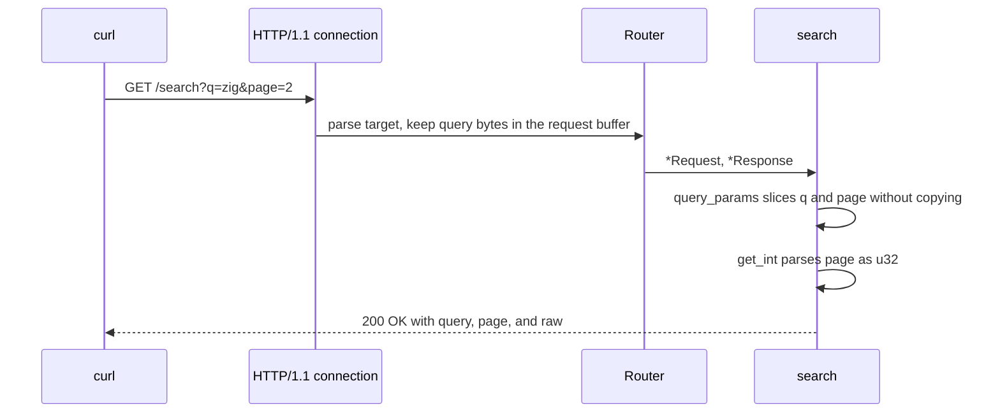

This example is a small JSON service built from `Presets.microservice`. It
registers `GET /health`, `POST /echo`, and `GET /search`, then listens on port 3000. The preset selects 256 connections, a 64 KiB request body, and smaller
WebSocket and write-queue storage than the default configuration. The program is
`examples/basic_microservice.zig` in the framework repository.

## Source [#source]

```zig src/main.zig
//! Microservice preset: small JSON payloads with a bounded connection pool.
//!
//! Build and run:
//!   zig build basic_microservice -Doptimize=ReleaseSafe
//!   curl -s http://127.0.0.1:3000/health
//!   curl -s -X POST http://127.0.0.1:3000/echo -d '{"ping":true}'
//!   curl -s 'http://127.0.0.1:3000/search?q=zig&page=2'

const std = @import("std");
const uz = @import("uWebZockets");

fn health(_: *uz.Request, res: *uz.Response) void {
    var scratch: [128]u8 = undefined;
    res.json_buf(.{ .status = "ok", .preset = "microservice" }, &scratch) catch {};
}

fn echo(req: *uz.Request, res: *uz.Response) void {
    // Request bodies borrow the connection buffer for this callback only.
    res.bytes(req.bytes()) catch {};
}

fn search(req: *uz.Request, res: *uz.Response) void {
    // Routes match on the path only; query pairs are sliced zero-copy.
    const params = req.query_params() catch {
        res.end("400 Bad Request", "invalid query") catch {};
        return;
    };
    const page = params.get_int(u32, "page") catch {
        res.end("400 Bad Request", "page must be a non-negative integer") catch {};
        return;
    };

    var scratch: [192]u8 = undefined;
    res.json_buf(.{
        .query = params.get("q") orelse "",
        .page = page orelse 1,
        .raw = params.get("page") orelse "",
    }, &scratch) catch {};
}

pub fn main(init: std.process.Init) !void {
    var server = try uz.Server.builder(init.io)
        .preset(uz.Presets.microservice)
        .with_max_clients(256)
        .build(std.heap.page_allocator);
    defer server.deinit();

    _ = try server.get("/health", health);
    _ = try server.post("/echo", echo);
    _ = try server.get("/search", search);

    try server.listen("0.0.0.0", 3000);
    try server.run();
}
```

[Full source](https://github.com/farbenbuilds/uWebZockets/blob/v2.1.6/examples/basic_microservice.zig)

`health` formats a fixed JSON object into a 128-byte stack buffer. `echo`
returns the borrowed request body as `application/octet-stream`. `search`
parses the query string without copying and formats a 192-byte JSON object.
None of the handlers allocate.

## Build wiring [#build-wiring]

Copy the program into `src/main.zig` of a project that imports the package. The
dependency fetch and the `build.zig` module are shared by every example:

```sh
zig fetch --save 'https://github.com/farbenbuilds/uWebZockets/archive/refs/tags/v2.1.6.tar.gz'
```

Follow [Run an example in your project](/examples#run-an-example-in-your-project)
for the `build.zig` block and the `run` step. The build adds the
`uWebZockets` module import and does not need a framework checkout.

The `zig build basic_microservice` line in the module header is the framework
checkout step. That command is a contributor shortcut, not the application path.

## Run [#run]

```sh
zig build run
```

The process binds `0.0.0.0:3000` and blocks in `server.run()`. The program does
not arm `catch_shutdown_signals`, so Ctrl+C ends the process without the
graceful drain path. Add `try server.catch_shutdown_signals();` before `listen`
when in-flight requests must finish cleanly.

## Verify [#verify]

```sh
curl -s http://127.0.0.1:3000/health
```

```console
{"status":"ok","preset":"microservice"}
```

```sh
curl -s -X POST http://127.0.0.1:3000/echo -d '{"ping":true}'
```

```console
{"ping":true}
```

```sh
curl -s 'http://127.0.0.1:3000/search?q=zig&page=2'
```

```console
{"query":"zig","page":2,"raw":"2"}
```

The response bodies carry no trailing newline. `echo` copies the request body
into the connection write queue and sets `Content-Type: application/octet-stream`,
even when the payload is JSON. `search` reports both the parsed `page` and the
raw `page` string.

A missing `page` defaults to `1`. A non-numeric or negative value returns
`400 Bad Request` with a plain-text body:

```sh
curl -s 'http://127.0.0.1:3000/search?q=zig&page=two'
```

```console
page must be a non-negative integer
```

`q` stays percent-encoded because `query_params` slices the raw wire bytes. Use
`percent_decode` when the value must be decoded. A query string with more than
32 pairs fails the same way and returns `invalid query`. A request body over
64 KiB is rejected by the transport with a structured `413` before `echo` runs.

## Request path [#request-path]



## Key APIs [#key-apis]

| Call                               | Effect                                                                                      |
| ---------------------------------- | ------------------------------------------------------------------------------------------- |
| `uz.Server.builder(init.io)`       | Starts a fluent configuration from the default capacities                                   |
| `.preset(uz.Presets.microservice)` | Applies 256 connections, 8 KiB messages, 16 KiB queue, 64 KiB body, and a 30 s idle timeout |
| `.with_max_clients(256)`           | Repeats the preset value; removing the call does not change capacity                        |
| `.build(std.heap.page_allocator)`  | Performs the single startup slab allocation                                                 |
| `server.get` / `server.post`       | Register exact routes before the listener locks registration                                |
| `req.query_params()`               | Returns a 32-pair view borrowed from the request target                                     |
| `params.get_int(u32, "page")`      | Parses a base-10 integer and preserves the absent-versus-invalid distinction                |
| `req.bytes()`                      | Borrows the request body for the callback                                                   |
| `res.json_buf(...)`                | Formats JSON into caller-owned scratch with no allocation                                   |
| `res.bytes(...)`                   | Writes the body with `Content-Type: application/octet-stream`                               |
| `res.end(status, body)`            | Writes a complete response without additional fields                                        |

## Capacities [#capacities]

| Capacity          |                  Value | Set by                                              | Consequence                                       |
| ----------------- | ---------------------: | --------------------------------------------------- | ------------------------------------------------- |
| Connections       |                    256 | `Presets.microservice` and `.with_max_clients(256)` | The 257th concurrent connection is refused        |
| WebSocket message |                  8 KiB | `Presets.microservice`                              | A larger message is rejected on a WebSocket route |
| Write queue       |                 16 KiB | `Presets.microservice`                              | A full queue returns `error.WouldBlock`           |
| Request body      |                 64 KiB | `Presets.microservice`                              | A larger body receives `413`                      |
| Idle timeout      |                   30 s | `Presets.microservice`                              | A drained keep-alive connection closes            |
| Request line      |                  8 KiB | Default                                             | A larger request line receives `431`              |
| Headers           |      16 KiB, 64 fields | Default                                             | A larger header block receives `431`              |
| Query pairs       |                     32 | Default                                             | A wider query view fails before the handler       |
| Router            | 256 nodes, 64 patterns | Default                                             | A larger route table fails registration           |

The preset spends its bytes on a 64 KiB request buffer and 256 connection
slots. It trims WebSocket message storage to 8 KiB and the write queue to
16 KiB because a JSON microservice does not hold long-lived chat sockets or
buffer large responses. The request buffer is reserved per connection, so the
64 KiB body region alone multiplies by 256 before the embedded HTTP/2 session,
write queues, and router storage are added.

`with_max_clients(256)` is redundant with the preset. It records the intent in
the program without changing the slab.

## Variation [#variation]

Accept a 128 KiB JSON body:

```zig
var server = try uz.Server.builder(init.io)
    .preset(uz.Presets.microservice)
    .with_max_clients(256)
    .with_max_body_size(128 * 1024)
    .build(std.heap.page_allocator);
```

Every connection reserves the larger request buffer, so the startup slab grows
by roughly 16 MiB before the HTTP/2 and queue regions. Call `slab_bytes()` on
the builder to see the exact change. Raise the limit only when the service
accepts uploads or documents that size; otherwise the extra reservation buys
nothing.

## Next [#next]

- [Custom builder](/examples/custom-builder) trades connection count for a
  50 MiB body and prints the slab before allocating it.
- [Your first HTTP server](/docs/examples/first-http-server) teaches routing,
  response errors, and the shutdown watcher step by step.
- [Capacity model](/docs/concepts/capacity-model) explains how these values
  become one startup slab.
- [ServerConfig](/reference/server-config#presets) lists every preset and
  default.
