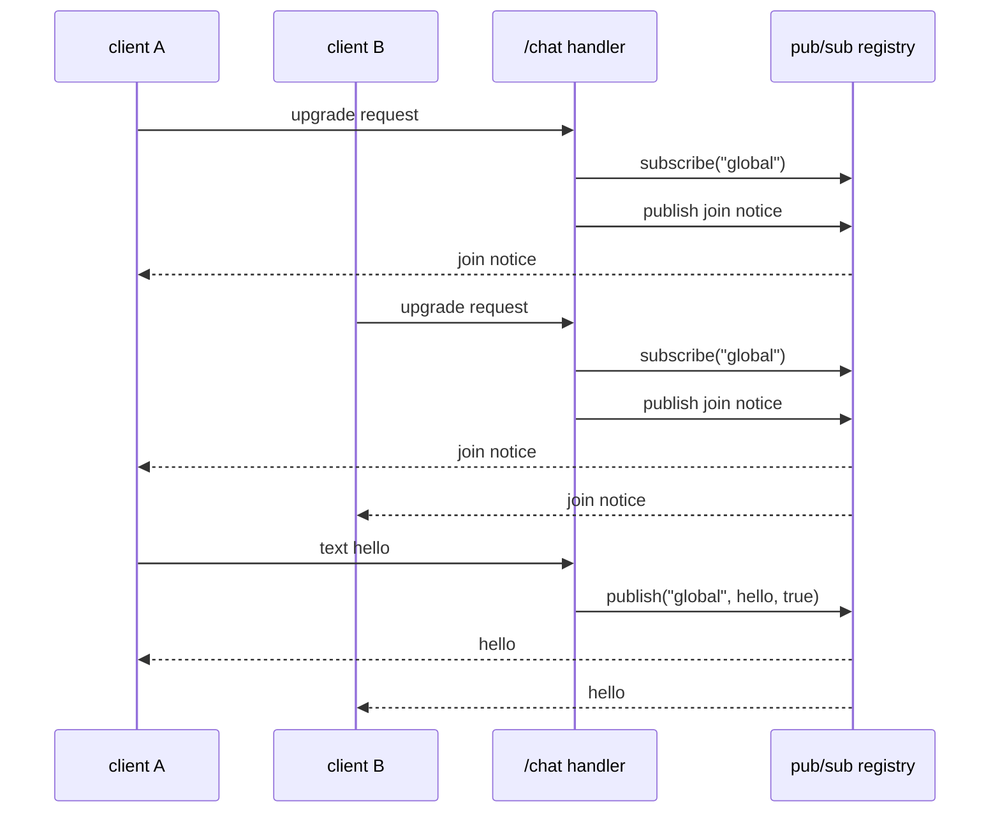

This example is a WebSocket group chat. It registers one upgrade route at
`/chat`, subscribes every peer to the `global` topic, republishes each message
to the room, and removes the subscription on close. It uses `App(128)` and the
default message path. The program is `examples/chat_server.zig` in the framework
repository.

## Source [#source]

```zig src/main.zig
const std = @import("std");
const uz = @import("uWebZockets");

fn on_ws_open(ws: *uz.WebSocket) void {
    // upon connection, join the client to the "global" room
    ws.subscribe("global") catch {
        std.debug.print("error: unable to join room.\n", .{});
        return;
    };

    // notify the whole room about the new user
    _ = ws.publish("global", "system: a new user just joined", true);
}

fn on_ws_message(ws: *uz.WebSocket, message: []const u8, opcode: uz.Opcode) void {
    // broadcast this person's message to everyone in the "global" room
    const is_text = (opcode == .text);
    _ = ws.publish("global", message, is_text);
}

fn on_ws_close(ws: *uz.WebSocket) void {
    _ = ws.unsubscribe("global");
}

pub fn main(init: std.process.Init) !void {
    var app = try uz.App(128).init(init.io);
    defer app.deinit();

    _ = try app.ws("/chat", .{
        .open = on_ws_open,
        .message = on_ws_message,
        .close = on_ws_close,
    });
    try app.listen("0.0.0.0", 3000);

    std.debug.print("group chat server is running on port 3000\n", .{});
    try app.run();
}
```

[Full source](https://github.com/farbenbuilds/uWebZockets/blob/v2.1.6/examples/chat_server.zig)

`app.ws` registers an HTTP/1.1 upgrade route on the same application value as
the HTTP router. `on_ws_open` runs after the handshake succeeds; it subscribes
the socket before publishing the join notice, so the notice reaches the new peer
as well as the existing room members.

## Build wiring [#build-wiring]

Copy the program into `src/main.zig` of a project that imports the package. The
dependency fetch and the `build.zig` module are shared by every example:

```sh
zig fetch --save 'https://github.com/farbenbuilds/uWebZockets/archive/refs/tags/v2.1.6.tar.gz'
```

Follow [Run an example in your project](/examples#run-an-example-in-your-project)
for the `build.zig` block and the `run` step. The build adds the
`uWebZockets` module import and does not need a framework checkout.

In a framework checkout only, `zig build chat_server` runs the same file. That
command is a contributor shortcut, not the application path.

## Run [#run]

```sh
zig build run
```

The process binds `0.0.0.0:3000` and blocks in `app.run()`. It prints
`group chat server is running on port 3000` before entering the loop. The
program does not arm `catch_shutdown_signals`, so Ctrl+C ends it without the
graceful drain path.

## Verify [#verify]

Connect the first client from another terminal:

```sh
npx wscat -c ws://127.0.0.1:3000/chat
```

```console
Connected (press CTRL+C to quit)
< system: a new user just joined
```

Open a second client in a third terminal. It receives the same join notice, and
the first client receives a second copy because the room now has another
subscriber:

```console
Connected (press CTRL+C to quit)
< system: a new user just joined
```

Send from the first client:

```console
> hello
< hello
```

The sender receives its own message because it is a subscriber of `global`. The
second client prints `< hello` at the same time. Text frames are republished as
text; binary frames keep the binary opcode.

Close one client. `on_ws_close` removes its subscription, and the remaining
client stays subscribed. The pub/sub engine also removes every subscription
when a socket is deinitialized, so the explicit `unsubscribe` is a fast release
of the topic slot rather than a correctness requirement.

## Request path [#request-path]



`publish` frames one message per live subscriber into that connection's write
queue. It skips a subscriber whose queue is full and returns the successful
delivery count. The source ignores the count; a production room can log it or
use it to detect a stalled peer.

## Key APIs [#key-apis]

| Call                                  | Effect                                                                                 |
| ------------------------------------- | -------------------------------------------------------------------------------------- |
| `uz.App(128).init(init.io)`           | Allocates the 128-connection slab and the embedded pub/sub registry                    |
| `app.ws("/chat", .{...})`             | Registers one HTTP/1.1 upgrade route                                                   |
| `.open = on_ws_open`                  | Runs after a successful handshake                                                      |
| `.message = on_ws_message`            | Runs for each complete text or binary message; the slice is valid only during the call |
| `.close = on_ws_close`                | Runs once when the socket closes                                                       |
| `ws.subscribe("global")`              | Adds an idempotent subscription and copies the topic name if it is new                 |
| `ws.publish(topic, message, is_text)` | Frames the message into each live subscriber's queue and returns the delivery count    |
| `ws.unsubscribe("global")`            | Removes this socket's subscription and reports whether it existed                      |
| `uz.Opcode`                           | Distinguishes `.text` from `.binary` when republishing                                 |
| `app.listen` / `app.run()`            | Binds port 3000 and drives the event loop                                              |

`subscribe` returns `error.SubscriptionCapacityReached` when the fixed
subscription table is full, and `error.TopicCapacityReached` when no topic slot
is free. The example logs the first failure and leaves the socket connected but
unsubscribed. A production server should close that peer or report the
degraded state instead of leaving a silent room member.

## Capacities [#capacities]

| Capacity              |  Value | Set by          | Consequence                                                           |
| --------------------- | -----: | --------------- | --------------------------------------------------------------------- |
| Connections           |    128 | `App(128)`      | The 129th concurrent connection is refused                            |
| WebSocket message     | 16 KiB | Default         | A larger message is rejected                                          |
| Write queue           | 64 KiB | Default         | A full queue returns `error.WouldBlock` to a direct send              |
| Idle timeout          |  120 s | Default         | A drained keep-alive connection closes                                |
| Active topics         |  1,024 | Pub/sub default | A new topic fails with `error.TopicCapacityReached`                   |
| Subscriptions         |  8,192 | Pub/sub default | A new subscription fails with `error.SubscriptionCapacityReached`     |
| Subscribers per topic | 65,535 | Pub/sub default | The next subscriber fails with `error.TopicSubscriberCapacityReached` |
| Topic name            |  127 B | Pub/sub default | A longer name fails with `error.TopicTooLong`                         |
| Request body          | 16 KiB | Default         | Unused by this WebSocket-only program                                 |

The chat server uses the default message path: `App(128)` keeps a 16 KiB message
ceiling, a 64 KiB write queue per connection, and a 120 s idle timeout. That is
enough for text chat and avoids the extra per-connection compression scratch.
The room registry is fixed capacity and per application, not per connection.
Every peer in this program shares the same `global` topic.

The `Presets.websocket_chat` builder preset is the larger option: 512
connections, 32 KiB messages, a 32 KiB queue, a 4 KiB body, a 120 s idle
timeout, and reserved compression scratch. The route still has to opt into
`.permessage_deflate` before compression is negotiated.

These bounds are per worker. Four workers can each hold 8,192 subscriptions, and
a cluster broadcast consumes one inbox slot per worker, not one per connection.

## Separate rooms [#separate-rooms]

Register one route per room and share the callbacks through a topic parameter:

```zig
fn join(ws: *uz.WebSocket, topic: []const u8) void {
    ws.subscribe(topic) catch return ws.terminate();
    _ = ws.publish(topic, "system: a peer joined", true);
}

fn on_lobby_open(ws: *uz.WebSocket) void {
    join(ws, "room:lobby");
}

fn on_lobby_message(ws: *uz.WebSocket, message: []const u8, opcode: uz.Opcode) void {
    _ = ws.publish("room:lobby", message, opcode == .text);
}
```

Repeat the pair for each room and register them as `/chat/lobby` and
`/chat/ops`. Keep the room list in code so topic names stay literals.

## Add a history buffer [#history]

Keep a fixed ring of copied messages and replay it on open. Copy into fixed
storage; retaining the callback slice would read freed memory:

```zig
const Entry = struct { len: usize = 0, bytes: [128]u8 = undefined };
var history: [50]Entry = undefined;
var history_len: usize = 0;
var history_next: usize = 0;

fn remember(message: []const u8) void {
    if (message.len > 128) return;
    const entry = &history[history_next];
    @memcpy(entry.bytes[0..message.len], message);
    entry.len = message.len;
    history_next = (history_next + 1) % history.len;
    history_len = @min(history_len + 1, history.len);
}
```

Call `remember` from `on_message` before publishing, then replay from the oldest
entry with `ws.send`. This ring is process-wide. A `Cluster` runs workers as
threads in one address space, so a module-level ring would be shared without a
lock. Keep history in the client or an external store when you cluster, or run
one process per worker.

## Variation [#variation]

Enable per-message deflate on the chat route:

```zig
_ = try app.ws("/chat", .{
    .open = on_ws_open,
    .message = on_ws_message,
    .close = on_ws_close,
    .compression = .permessage_deflate,
});
```

Compression is negotiated on HTTP/1.1 upgrades only; RFC 8441 tunnels over
HTTP/2 carry uncompressed frames. It adds paired receive and send scratch per
connection, and message processing still does not allocate. A compressed
message that expands beyond `max_message_size` is rejected rather than buffered
without a bound. Compare the startup slab before enabling it for every route.

## Next [#next]

- [Pub/sub](/docs/websocket/pub-sub) covers the registry bounds, delivery
  count, and slow-subscriber behavior.
- [Cluster pub/sub](/docs/websocket/cluster-pub-sub) broadcasts the same topic
  across shared-nothing workers.
- [WebSocket limits](/docs/websocket/limits) lists every message, subscription,
  and queue bound.
- [Heartbeats](/docs/websocket/heartbeats) covers ping and pong timeouts for
  silent peers.
- [Per-message deflate](/docs/websocket/compression) covers negotiation and
  expansion limits.
- [WebSocket quickstart](/docs/websocket/quickstart) teaches the upgrade
  lifecycle step by step.
- [RPC server](/examples/rpc-server) is the next example.
