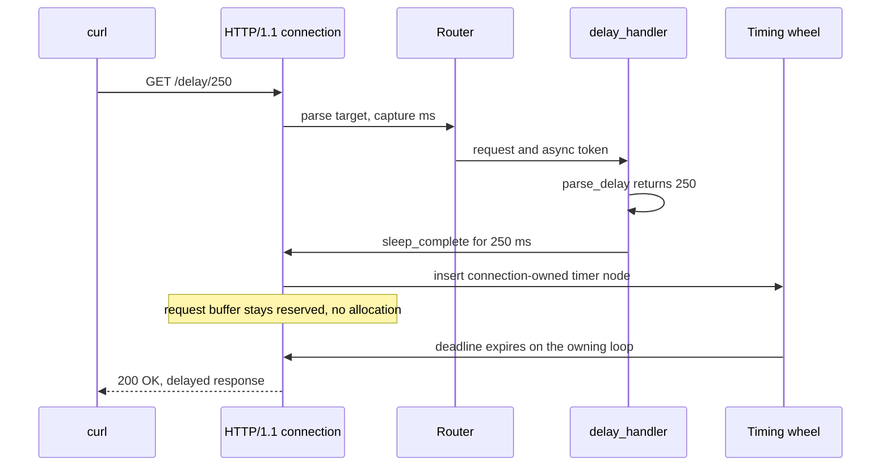

This example is the smallest deferred-response server. It allocates one
`App(128)` slab, registers `GET /delay/:ms` as an async route, parses the
capture, and parks the response on the worker's timing wheel. The delay is
capped at 60,000 ms and invalid input receives `400 Bad Request`. The program
is `examples/delay_server.zig` in the framework repository.

## Source

```zig src/main.zig
const std = @import("std");
const uz = @import("uWebZockets");

/// Largest delay the example accepts; keeps parked requests bounded.
const max_delay_ms: u64 = 60_000;

fn parse_delay(raw: []const u8) ?u64 {
    if (raw.len == 0) return null;
    const value = std.fmt.parseInt(u64, raw, 10) catch return null;
    return @min(value, max_delay_ms);
}

fn delay_handler(req: *uz.Request, token: uz.AsyncResponse) void {
    const delay = parse_delay(req.get_param("ms") orelse "");
    if (delay == null) {
        token.complete("400 Bad Request", "Invalid delay") catch |err| {
            std.log.err("delay response failed: {}", .{err});
        };
        return;
    }

    // The response fields are static, so the parked request needs no
    // allocation while it waits on the worker's timing wheel.
    token.sleep_complete(
        delay.?,
        "200 OK",
        "Content-Type: text/plain\r\n",
        "delayed response",
    ) catch |err| {
        token.complete("500 Internal Server Error", @errorName(err)) catch |complete_err| {
            std.log.err("delay response failed: {} (after {})", .{ complete_err, err });
        };
    };
}

pub fn main(init: std.process.Init) !void {
    var app = try uz.App(128).init(init.io);
    defer app.deinit();

    _ = try app.route_async(.get, "/delay/:ms", delay_handler);

    try app.listen("0.0.0.0", 3000);
    try app.run();
}
```

[Full source](https://github.com/farbenbuilds/uWebZockets/blob/v2.1.6/examples/delay_server.zig)

The handler signature is `fn (*uz.Request, uz.AsyncResponse) void`. It returns
before the response exists, and the token supplies the completion path.
`parse_delay` is a pure function: it returns `null` for an empty string, a
negative number, a non-decimal string, or a value that overflows `u64`. A
valid value above the cap is clamped by `@min` instead of rejected.

## Build wiring

Copy the program into `src/main.zig` of a project that imports the package. The
dependency fetch and the `build.zig` module are shared by every example:

```sh
zig fetch --save 'https://github.com/farbenbuilds/uWebZockets/archive/refs/tags/v2.1.6.tar.gz'
```

Follow [Run an example in your project](/examples#run-an-example-in-your-project)
for the `build.zig` block and the `run` step. The async route uses the same
`@import("uWebZockets")` module as a synchronous route.

In a framework checkout, `zig build delay_server` runs the same file. That
command is a contributor shortcut and is not the consumer path.

## Run

```sh
zig build run
```

The process listens on TCP port 3000 and blocks in `run()`. This example does
not install a signal watcher, so Ctrl+C terminates it without the graceful
drain path. A client disconnect while a response is parked cancels that token.

## Verify

```sh
time curl -s http://127.0.0.1:3000/delay/250
```

A representative local run:

```console
delayed response
real    0m0.251s
user    0m0.001s
sys     0m0.001s
```

The body arrives after roughly 250 ms. The exact `real` value includes timer
tick granularity and scheduling, so assert the body and a lower bound rather
than an exact duration. The response uses the explicit `text/plain` content
type from the source.

Reject an invalid delay:

```sh
curl -s -o /dev/null -w '%{http_code}' http://127.0.0.1:3000/delay/nope
```

```console
400
```

Without `-o /dev/null`, the body is `Invalid delay`. `parse_delay` also rejects
an empty string, a negative value, and a number that overflows `u64`. A request
for `/delay/120000` is clamped to 60,000 ms, so it waits for one minute instead
of two.

## Request path



The router keeps the response suspended until the token completes. The request
buffer is not reused while the token is pending.

## Key APIs

| Call                                                 | Effect                                                                                     |
| ---------------------------------------------------- | ------------------------------------------------------------------------------------------ |
| `uz.App(128).init(init.io)`                          | Allocates the 128-connection slab.                                                         |
| `app.route_async(.get, "/delay/:ms", delay_handler)` | Registers a callback that receives `*Request` and `AsyncResponse` instead of `*Response`.  |
| `app.listen("0.0.0.0", 3000)`                        | Binds TCP 3000, creates the per-worker timing wheel, and locks route mutation.             |
| `req.get_param("ms") orelse ""`                      | Reads the borrowed `:ms` capture. The `*Request` itself is valid only during the callback. |
| `parse_delay`                                        | Returns a capped delay or `null`; it never allocates.                                      |
| `token.complete("400 Bad Request", "Invalid delay")` | Completes immediately and exactly once. A failure is logged.                               |
| `token.sleep_complete(...)`                          | Parks the status, headers, and body in the connection-owned slot and arms the timer.       |
| `token.complete("500 Internal Server Error", ...)`   | Best-effort fallback when parking fails; a second failure is logged.                       |

`AsyncResponse` is a small copyable value: a pointer to connection- or
stream-owned state plus a generation. Copying it is safe, and the first
completion wins. A stale generation returns `error.AsyncResponseExpired`.

## Parking model

A parked response does not allocate. The token lives in a slot owned by the
connection or stream, and the timer node is embedded in the pooled connection.
`sleep_complete` stores the three borrowed slices there, so the static strings
in this example remain valid for the whole delay. The response head and body
are copied into preallocated transport storage when the deadline fires.

HTTP/1.1 has one parking slot per connection; HTTP/2 maps one slot per stream,
so only one response per HTTP/1.1 connection or per HTTP/2 stream can be
deferred at a time.

The token completes on the owning loop. `complete`, `complete_with_headers`,
`sleep`, and `sleep_complete` are event-loop confined. Passing a token to
another thread does not move the slot or make completion thread-safe: marshal
the result back to the owning loop and complete it there.

The per-worker timing wheel has four levels, from 1 ms to about 17.5 minutes,
and wakes on a bounded 5 ms tick. A 60,000 ms delay fits the third level, so
the cap stays well inside the engine. A peer disconnect increments the
generation and every outstanding copy fails closed; a pending token also keeps
the request buffer or stream from being reused.

## Capacities

| Capacity       |                     Value | Set by                | Consequence                                                      |
| -------------- | ------------------------: | --------------------- | ---------------------------------------------------------------- |
| Connections    |                       128 | `App(128)`            | The 129th concurrent connection is refused                       |
| Delay cap      |                 60,000 ms | `max_delay_ms`        | A larger valid value is clamped; an invalid value receives `400` |
| Parking slots  | 1 per HTTP/1.1 connection | Connection-owned slot | One deferred response per connection at a time                   |
| Timer tick     |                      5 ms | Per-worker timer      | A deadline fires on the next tick after it expires               |
| Write queue    |                    64 KiB | Default               | The completed body is bounded by the queue                       |
| Route patterns |                        64 | Default               | `/delay/:ms` consumes one pattern route                          |

The 128-connection capacity bounds concurrent parked responses to 128 on
HTTP/1.1, one per connection. Drop the cap or reduce the connection count when
a public endpoint must not hold connections for long waits.

## Variation

Lower the cap for a public deployment:

```zig
const max_delay_ms: u64 = 5_000;
```

`/delay/9000` then completes after five seconds instead of nine. The connection
slot is released sooner, and a client cannot hold one connection for a full
minute by asking for a long delay. Keep the cap above the longest legitimate
wait so real callers do not get a shorter response than they requested.

## Next

- [Asynchronous responses](/docs/concepts/async-responses) explains token
  generations, cancellation, and the completion errors.
- [Response lifecycle](/docs/concepts/response-lifecycle) covers synchronous
  endings, streaming, and best-effort completion.
- [Routing](/docs/http/routing) covers path captures and registration order.
- [HTTP/3 server](/examples/http3-server) is the previous example.
