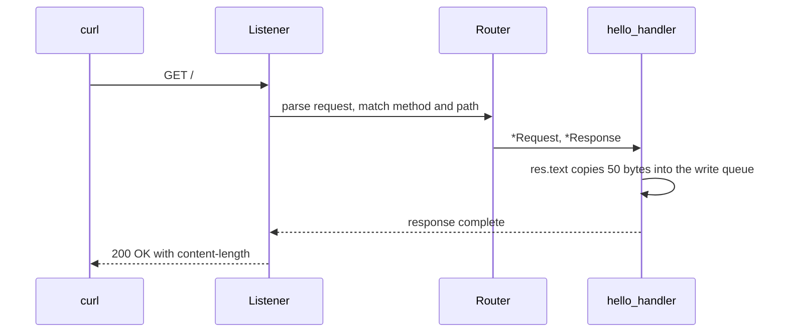

This example is the smallest complete µWebZockets server. It allocates one
`App(128)` slab, registers `GET /`, listens on port 3000, and returns one text
body. The program is `examples/hello_world.zig` in the framework repository.

## Source

```zig src/main.zig
const std = @import("std");
const uz = @import("uWebZockets");

fn hello_handler(_: *uz.Request, res: *uz.Response) void {
    res.text("Hello from µWebZockets! Zero allocation achieved.") catch |err| {
        std.debug.print("response error: {}\n", .{err});
    };
}

pub fn main(init: std.process.Init) !void {
    var app = try uz.App(128).init(init.io);
    defer app.deinit();

    _ = try app.get("/", hello_handler);

    try app.listen("0.0.0.0", 3000);
    try app.run();
}
```

[Full source](https://github.com/farbenbuilds/uWebZockets/blob/v2.1.6/examples/hello_world.zig)

## Build wiring

Add the package and import the module in your own `build.zig`:

```sh
zig fetch --save 'https://github.com/farbenbuilds/uWebZockets/archive/refs/tags/v2.1.6.tar.gz'
```

```zig build.zig
const std = @import("std");

pub fn build(b: *std.Build) void {
    const target = b.standardTargetOptions(.{});
    const optimize = b.standardOptimizeOption(.{});
    const uz = b.dependency("uWebZockets", .{
        .target = target,
        .optimize = optimize,
    });

    const exe = b.addExecutable(.{
        .name = "hello-world",
        .root_module = b.createModule(.{
            .root_source_file = b.path("src/main.zig"),
            .target = target,
            .optimize = optimize,
        }),
    });
    exe.root_module.addImport("uWebZockets", uz.module("uWebZockets"));
    b.installArtifact(exe);

    const run = b.addRunArtifact(exe);
    b.step("run", "Run the hello-world server").dependOn(&run.step);
}
```

## Run

```sh
zig build run
```

The server blocks in `app.run()` until it receives `SIGINT` or `SIGTERM`. This
example does not call `catch_shutdown_signals`, so Ctrl+C terminates the process
without the graceful drain path. Add the watcher when the server owns work that
must stop cleanly:

```zig
try app.catch_shutdown_signals();
try app.run();
```

## Verify

```sh
curl -i http://127.0.0.1:3000/
```

```console
HTTP/1.1 200 OK
content-length: 50
content-type: text/plain; charset=utf-8

Hello from µWebZockets! Zero allocation achieved.
```

The body is 50 bytes. Header order and the exact `content-length` casing are
transport details; assert the status and body in an application test.

## Request path



## Capacities

| Capacity     |             Value | Set by     | Consequence                                |
| ------------ | ----------------: | ---------- | ------------------------------------------ |
| Connections  |               128 | `App(128)` | The 129th concurrent connection is refused |
| Request line |             8 KiB | Default    | Larger request lines receive `431`         |
| Headers      | 16 KiB, 64 fields | Default    | Larger blocks receive `431`                |
| Body         |            16 KiB | Default    | Larger bodies receive `413`                |
| Write queue  |            64 KiB | Default    | A full queue returns `error.WouldBlock`    |
| Idle timeout |             120 s | Default    | A drained keep-alive connection closes     |

`App(128)` is the shortest path. Use `Server.builder(init.io)` when a value must
be selected at runtime or when you want a named
[preset](/reference/server-config#presets).

## What the example demonstrates

| Call                          | Effect                                                  |
| ----------------------------- | ------------------------------------------------------- |
| `uz.App(128).init(init.io)`   | Computes the slab layout and performs one allocation    |
| `app.get("/", hello_handler)` | Stores the route before the listener locks registration |
| `app.listen("0.0.0.0", 3000)` | Binds every local interface and starts accepting        |
| `app.run()`                   | Drives the event loop until the process stops           |
| `app.deinit()`                | Releases the slab once after the loop returns           |

The handler signature is `fn (*uz.Request, *uz.Response) void`. `res.text`
copies the body into bounded connection storage before the callback returns, so
the literal may live in static memory.

## Variations

### Bind loopback only

```zig
try app.listen("127.0.0.1", 8080);
```

Use loopback for a local service and `0.0.0.0` only when a proxy or load
balancer connects from another host.

### Raise the connection capacity

```zig
var app = try uz.App(2048).init(init.io);
```

The capacity is compile-time because it sizes the application type. The slab
grows with the connection count; call `slab_bytes()` through the builder when
you need the exact footprint before allocating.

## Next

- [Your first HTTP server](/docs/examples/first-http-server) adds route
  parameters, response errors, and the shutdown watcher.
- [HTTPS server](/examples/https-server) wraps the same route in TLS 1.3.
- [ServerConfig](/reference/server-config) lists every capacity and default.
