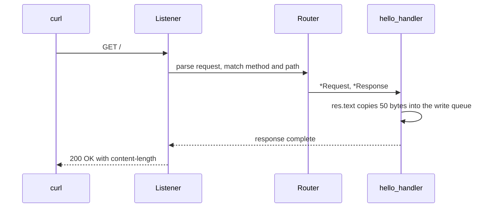

This page is both the canonical Hello world program and the first HTTP tutorial.
It starts with the smallest complete server, then adds a parameterized route, a
POST route, and the shutdown watcher. The program is `examples/hello_world.zig`
in the framework repository.

## Source

```zig src/main.zig
const std = @import("std");
const uz = @import("uWebZockets");

fn hello_handler(_: *uz.Request, res: *uz.Response) void {
    res.text("Hello from µWebZockets! Zero allocation achieved.") catch |err| {
        std.debug.print("response error: {}\n", .{err});
    };
}

pub fn main(init: std.process.Init) !void {
    var app = try uz.App(128).init(init.io);
    defer app.deinit();

    _ = try app.get("/", hello_handler);

    try app.listen("0.0.0.0", 3000);
    try app.run();
}
```

[Full source](https://github.com/farbenbuilds/uWebZockets/blob/v2.1.6/examples/hello_world.zig)

## Build wiring

Add the package and import the module in your own `build.zig`:

```sh
zig fetch --save 'https://github.com/farbenbuilds/uWebZockets/archive/refs/tags/v2.1.6.tar.gz'
```

```zig build.zig
const std = @import("std");

pub fn build(b: *std.Build) void {
    const target = b.standardTargetOptions(.{});
    const optimize = b.standardOptimizeOption(.{});
    const uz = b.dependency("uWebZockets", .{
        .target = target,
        .optimize = optimize,
    });

    const exe = b.addExecutable(.{
        .name = "hello-world",
        .root_module = b.createModule(.{
            .root_source_file = b.path("src/main.zig"),
            .target = target,
            .optimize = optimize,
        }),
    });
    exe.root_module.addImport("uWebZockets", uz.module("uWebZockets"));
    b.installArtifact(exe);

    const run = b.addRunArtifact(exe);
    b.step("run", "Run the hello-world server").dependOn(&run.step);
}
```

## Run

```sh
zig build run
```

The server blocks in `app.run()` until it receives `SIGINT` or `SIGTERM`. The
canonical program does not call `catch_shutdown_signals`; the
[Stop it cleanly](#stop-it-cleanly) section adds that watcher.

## Verify

```sh
curl -i http://127.0.0.1:3000/
```

```console
HTTP/1.1 200 OK
content-length: 50
content-type: text/plain; charset=utf-8

Hello from µWebZockets! Zero allocation achieved.
```

The body is 50 bytes. Header order and the exact `content-length` casing are
transport details; assert the status and body in an application test.

## Add a route parameter

Add one handler and register it before `listen`:

```zig
fn greet(req: *uz.Request, res: *uz.Response) void {
    const name = req.get_param("name") orelse "world";
    var buffer: [128]u8 = undefined;
    const body = std.fmt.bufPrint(&buffer, "hello {s}", .{name}) catch |err| {
        std.log.err("format failed: {}", .{err});
        res.text("hello") catch |res_err| {
            std.log.err("response failed: {}", .{res_err});
        };
        return;
    };
    res.text(body) catch |err| {
        std.log.err("response failed: {}", .{err});
    };
}

_ = try app.get("/greet/:name", greet);
```

Verify both routes:

```sh
curl -s http://127.0.0.1:3000/
curl -s http://127.0.0.1:3000/greet/Ada
```

```console
Hello from µWebZockets! Zero allocation achieved.
hello Ada
```

`/greet` does not match `/greet/:name` because the parameter requires one
nonempty segment. Register `/greet` separately if you want a route without a
capture. The `orelse "world"` fallback covers a missing capture value, not a
missing route.

## Add another method

The registration helpers follow the method name. A POST route can read the
buffered body with `req.text()`:

```zig
fn create(req: *uz.Request, res: *uz.Response) void {
    const body = req.text();
    res.text(body) catch |err| {
        std.log.err("response failed: {}", .{err});
    };
}

_ = try app.post("/items", create);
```

`req.text()` returns the buffered body. The default body capacity is 16 KiB;
raise it with `ServerConfig` or `with_max_body_size` when the application needs
larger uploads.

## Request path



## What happens at startup

| Step            | Detail                                                                                                                         |
| --------------- | ------------------------------------------------------------------------------------------------------------------------------ |
| `App(128).init` | Computes the slab layout and makes one allocation for 128 connection slots, request buffers, write queues, and router storage. |
| `app.get`       | Writes the route into fixed router storage. Registration before `listen` keeps the arrays immutable while workers run.         |
| `listen`        | Binds the socket, starts accepting, and locks route registration.                                                              |
| `run`           | Drives the event loop until shutdown completes.                                                                                |
| `deinit`        | Releases the slab exactly once. It panics if called from inside the loop.                                                      |

## Capacities

| Capacity     |             Value | Set by     | Consequence                                |
| ------------ | ----------------: | ---------- | ------------------------------------------ |
| Connections  |               128 | `App(128)` | The 129th concurrent connection is refused |
| Request line |             8 KiB | Default    | Larger request lines receive `431`         |
| Headers      | 16 KiB, 64 fields | Default    | Larger blocks receive `431`                |
| Body         |            16 KiB | Default    | Larger bodies receive `413`                |
| Write queue  |            64 KiB | Default    | A full queue returns `error.WouldBlock`    |
| Idle timeout |             120 s | Default    | A drained keep-alive connection closes     |

`App(128)` is the shortest path. Use `Server.builder(init.io)` when a value must
be selected at runtime or when you want a named
[preset](/reference/server-config#presets).

## Stop it cleanly

Add the watcher before `listen`:

```zig
try app.catch_shutdown_signals();
try app.listen("0.0.0.0", 3000);
try app.run();
```

Press Ctrl+C. The watcher requests shutdown, which stops accepting, cancels
recurring timers, closes active connections, and drains completions before
`run` returns. In-flight requests are not guaranteed to finish. The
`defer app.deinit()` then releases the slab.

## Variations

### Bind loopback only

```zig
try app.listen("127.0.0.1", 8080);
```

Use loopback for a local service and `0.0.0.0` only when a proxy or load
balancer connects from another host.

### Raise the connection capacity

```zig
var app = try uz.App(2048).init(init.io);
```

The capacity is compile-time because it sizes the application type. The slab
grows with the connection count; call `slab_bytes()` through the builder when
you need the exact footprint before allocating.

## Next

- [WebSocket quickstart](/docs/websocket/quickstart) adds a bidirectional route.
- [RPC server](/examples/rpc-server) serves typed
  procedures on the same application.
- [HTTPS server](/examples/https-server) wraps the listener in TLS
  1.3.
- [ServerConfig](/reference/server-config) lists every capacity and default.
