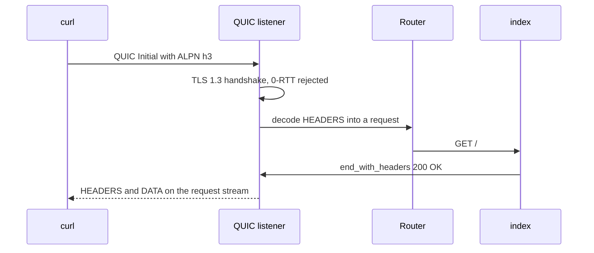

This example is the smallest complete µWebZockets HTTP/3 server. It allocates
an `App(128)` slab, registers `GET /`, binds UDP port 8443, and installs the
shutdown watcher before it enters the event loop. The program is
`examples/http3_server.zig` in the framework repository.

## Source

```zig src/main.zig
const std = @import("std");
const uz = @import("uWebZockets");

fn index(_: *uz.Request, response: *uz.Response) void {
    response.end_with_headers(
        "200 OK",
        "Content-Type: text/plain\r\n",
        "Hello from bounded HTTP/3",
    ) catch |err| std.log.err("response failed: {}", .{err});
}

pub fn main(init: std.process.Init) !void {
    var server = try uz.App(128).init_http3_ephemeral(init.io);
    defer server.deinit();

    _ = try server.get("/", index);
    try server.listen_udp("0.0.0.0", 8443);
    // SIGINT/SIGTERM must reach the normal drain path so `deinit` can assert
    // that every engine pool was returned.
    try server.catch_shutdown_signals();
    try server.run();
}
```

[Full source](https://github.com/farbenbuilds/uWebZockets/blob/v2.1.6/examples/http3_server.zig)

`init_http3_ephemeral` creates two isolated TLS 1.3 contexts. The TCP context
advertises `h2` and `http/1.1`; the QUIC context advertises only `h3` through
ALPN. This program binds only the QUIC endpoint, so every request on UDP 8443
uses HTTP/3. The TCP context exists in the `App` value but has no listener until
you add one.

## Build wiring

Copy the program into `src/main.zig` of a project that imports the package. The
dependency fetch and the `build.zig` module are shared by every example:

```sh
zig fetch --save 'https://github.com/farbenbuilds/uWebZockets/archive/refs/tags/v2.1.6.tar.gz'
```

Follow [Run an example in your project](/examples#run-an-example-in-your-project)
for the `build.zig` block and the `run` step. The program reaches the QUIC
engine through the same `@import("uWebZockets")` module.

In a framework checkout, `zig build http3_server` runs the same file. That
command is a contributor shortcut and is not the consumer path.

## Run

```sh
zig build run
```

The process binds UDP 8443 and blocks in `run()`. `catch_shutdown_signals` is
installed before the loop, so Ctrl+C enters the normal drain path. `deinit`
then verifies that every QUIC engine pool was returned.

## Verify

```sh
curl --http3-only -k https://127.0.0.1:8443/
```

```console
Hello from bounded HTTP/3
```

`--http3-only` makes curl fail when the QUIC handshake does not complete and
prevents a fallback to HTTP/2. This program has no TCP listener, so UDP 8443 is
the only reachable endpoint. `-k` accepts the self-signed certificate that
`init_http3_ephemeral` generated for `localhost`, `127.0.0.1`, and `::1`. If
the installed curl has no HTTP/3 support, the command fails before it sends a
request.

## Request path



The adapter decodes HTTP/3 pseudo-headers into the existing `*uz.Request`
shape. It writes structured QPACK response headers rather than converting
through an HTTP/1.1 text response.

## Key APIs

| Call                                        | Effect                                                                                                                           |
| ------------------------------------------- | -------------------------------------------------------------------------------------------------------------------------------- |
| `uz.App(128).init_http3_ephemeral(init.io)` | Allocates the 128-connection slab and creates both TLS contexts with in-memory self-signed certificates.                         |
| `server.get("/", index)`                    | Registers the route on the shared router before a listener locks registration.                                                   |
| `server.listen_udp("0.0.0.0", 8443)`        | Starts the QUIC transport, allocates its startup pools, and locks route mutation. The `App` value must not move after this call. |
| `server.catch_shutdown_signals()`           | Installs SIGINT and SIGTERM handlers that request the normal drain path.                                                         |
| `server.run()`                              | Drives the event loop until shutdown completes.                                                                                  |
| `response.end_with_headers(...)`            | Writes the status, the `Content-Type` header, and the body; a write failure is logged.                                           |
| `server.deinit()`                           | Releases the slab and both TLS contexts after the loop drains.                                                                   |

`end_with_headers` takes the status, a header block, and the body. `res.text`
is the shorter helper when the default `text/plain; charset=utf-8` header is
acceptable.

## Capacities

| Capacity        |                Value | Set by                                                                 | Consequence                                                          |
| --------------- | -------------------: | ---------------------------------------------------------------------- | -------------------------------------------------------------------- |
| Connections     |                  128 | `App(128)`                                                             | The 129th concurrent QUIC connection is refused                      |
| Request headers |    16 KiB, 64 fields | `max_header_size`, `max_header_count` defaults                         | A larger or wider header set is rejected                             |
| Request body    |    16 KiB per stream | `max_h3_body_size` default                                             | A larger body receives `413 Payload Too Large`                       |
| Response head   |     4 KiB, 64 fields | `max_h3_response_header_size`, `max_h3_response_header_count` defaults | A larger head fails the stream with `error.BufferOverflow`           |
| Response body   |    64 KiB per stream | `write_queue_size` default                                             | A one-shot body that exceeds it returns `error.WouldBlock`           |
| Packet payload  |          2,048 bytes | QUIC packet slot                                                       | PLPMTU is capped at 1,472 bytes                                      |
| Engine storage  | Outside the app slab | Startup pools                                                          | Sized from the connection count, header limits, and queue capacities |

The engine allocates header, body, response, and packet storage before the
event loop starts. The [HTTP/3 limits](/docs/http3/limits#memory) page gives the
formulas. At 128 connections the footprint is much smaller than the default
1,024-connection sizing, but it is still separate from the application slab.

## Boundaries

- **Clustering:** HTTP/3 and QUIC have no cluster mode. `init_http3` and
  `listen_udp` are single-application APIs, and a worker group has no UDP
  listener. See [HTTP/3 limits](/docs/http3/limits#clustering).
- **WebTransport:** the extension modules exist, but the live listener is not
  connected to them. A CONNECT request receives `501 Not Implemented`. See
  [WebTransport status](/docs/http3/webtransport).
- **Metrics:** HTTP/3 emits one `http_request` development-log record per
  completed exchange but does not advance the counter registry. See
  [HTTP/3 observability](/docs/http3/observability).
- **0-RTT:** the live listener rejects early data, so a replayable request
  never reaches a handler. See [early data](/docs/http3/early-data).
- **Congestion control:** BBRv1 with per-connection pacing. The public API does
  not expose it as a setting.

## Variation

Bind the TCP context on the same `App` value to serve HTTPS and HTTP/3 from one
route table:

```zig
_ = try server.get("/", index);
try server.listen("0.0.0.0", 3443);
try server.listen_udp("0.0.0.0", 8443);
try server.catch_shutdown_signals();
try server.run();
```

```sh
curl --http2 -k https://127.0.0.1:3443/
```

The TCP listener advertises `h2` and `http/1.1`; the UDP listener advertises
`h3`. Register every route before the first listener call because the first
bind locks route mutation.

## Next

- [Your first HTTP/3 server](/examples/first-http3-server) teaches the same
  path step by step.
- [HTTP/3 and QUIC](/docs/http3) covers QPACK, request validation, and the
  engine.
- [Delayed response](/examples/delay-server) is the next example.
- [ServerConfig](/reference/server-config) lists every H3 capacity and default.
