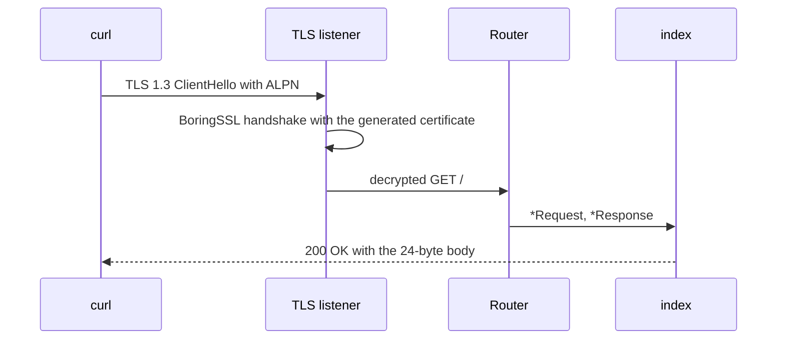

This example is the smallest complete µWebZockets HTTPS server. It allocates one
`App(128)` slab, generates a self-signed certificate in memory, registers
`GET /`, and listens on port 3443. The program is `examples/https_server.zig` in
the framework repository.

## Source [#source]

```zig src/main.zig
const std = @import("std");
const uz = @import("uWebZockets");

fn index(_: *uz.Request, response: *uz.Response) void {
    response.text("hello from ephemeral TLS") catch |err| {
        std.log.err("response failed: {}", .{err});
    };
}

pub fn main(init: std.process.Init) !void {
    var server = try uz.App(128).init_https_ephemeral(init.io);
    defer server.deinit();

    _ = try server.get("/", index);
    try server.listen("0.0.0.0", 3443);
    try server.run();
}
```

[Full source](https://github.com/farbenbuilds/uWebZockets/blob/v2.1.6/examples/https_server.zig)

## Build wiring [#build-wiring]

Add the dependency to your own project:

```sh
zig fetch --save 'https://github.com/farbenbuilds/uWebZockets/archive/refs/tags/v2.1.6.tar.gz'
```

Wire the module into your `build.zig` as shown in
[Run an example in your project](/examples#run-an-example-in-your-project), copy
the program above into `src/main.zig`, and run `zig build run`. The build adds
the `uWebZockets` module import and does not need a framework checkout.

## Run [#run]

```sh
zig build run
```

The process binds `0.0.0.0:3443` and blocks in `server.run()` until it receives
`SIGINT` or `SIGTERM`. This program does not arm `catch_shutdown_signals`, so
Ctrl+C ends the process without the graceful drain path. Add
`try server.catch_shutdown_signals();` before `listen` when the server owns work
that must stop cleanly.

In a framework checkout only, `zig build https_server -Doptimize=ReleaseSafe`
runs the same program. That is a contributor shortcut, not the application path.

## Verify [#verify]

```sh
curl -k https://127.0.0.1:3443/
```

```console
hello from ephemeral TLS
```

The body is 24 bytes. `-k` disables certificate verification because the
generated certificate is self-signed. It covers `localhost`, `127.0.0.1`, and
`::1`, uses an ECDSA P-256 key, and is valid for 90 days from startup.

The TLS context is TLS 1.3 only and advertises `h2` then `http/1.1` through ALPN.
A `curl` build with HTTP/2 support negotiates `h2`; a build without it
negotiates `http/1.1`.

## Request path [#request-path]



## Key APIs [#key-apis]

| Call                                        | Effect                                                                                 |
| ------------------------------------------- | -------------------------------------------------------------------------------------- |
| `uz.App(128).init_https_ephemeral(init.io)` | Allocates the 128-connection slab and generates the certificate before the loop starts |
| `server.get("/", index)`                    | Registers the route before the listener locks registration                             |
| `server.listen("0.0.0.0", 3443)`            | Binds every local interface and starts accepting TLS connections                       |
| `server.run()`                              | Drives the event loop until the process stops                                          |
| `response.text(...)`                        | Copies the body into the connection write queue before the handler returns             |
| `server.deinit()`                           | Releases the slab once after the loop returns                                          |

## Capacities [#capacities]

| Capacity     |             Value | Set by                                | Consequence                                |
| ------------ | ----------------: | ------------------------------------- | ------------------------------------------ |
| Connections  |               128 | `App(128)`                            | The 129th concurrent connection is refused |
| Request line |             8 KiB | Default                               | Larger request lines receive `431`         |
| Headers      | 16 KiB, 64 fields | Default                               | Larger blocks receive `431`                |
| Body         |            16 KiB | Default                               | Larger bodies receive `413`                |
| Write queue  |            64 KiB | Default                               | A full queue returns `error.WouldBlock`    |
| Idle timeout |             120 s | Default                               | A drained keep-alive connection closes     |
| TLS          |      TLS 1.3 only | `init_https_ephemeral` / `init_https` | Older protocol versions are rejected       |

The certificate is generated once, before the event loop. After that call,
handshakes, record processing, and every request path allocate nothing.

## Variation [#variation]

Use PEM files when a client must verify the certificate:

```zig
var server = try uz.App(128).init_https(
    init.io,
    "certs/fullchain.pem",
    "certs/privkey.pem",
);
defer server.deinit();
```

The certificate argument is a PEM chain with the leaf first. The key argument is
a PEM private key. BoringSSL checks that the pair matches while loading, so a
mismatch fails at startup with `error.KeyMismatch` instead of during the
first handshake. With a chain that the client trusts, drop `-k` from the verify
command.

## Next [#next]

- [Shared-nothing cluster](/examples/shared-nothing-cluster) keeps one slab and
  one event loop per worker.
- [TLS cluster](/examples/tls-cluster) gives every worker its own TLS context.
- [Your first TLS server](/examples/first-tls-server) adds mTLS and
  production credential guidance.
- [ServerConfig](/reference/server-config) lists every capacity and default.
