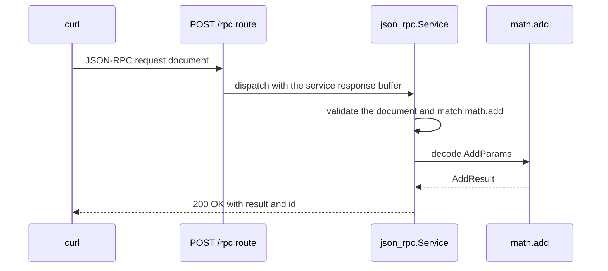

This example mounts a typed JSON-RPC 2.0 service on `POST /rpc`. It defines one
procedure, `math.add`, decodes named parameters into a Zig struct, and
serializes a typed result. It uses `App(128)` and the default `Service`
capacities. The program is `examples/rpc_server.zig` in the framework
repository.

## Source [#source]

```zig src/main.zig
const std = @import("std");
const uz = @import("uWebZockets");

const AddParams = struct {
    left: i64,
    right: i64,
};

const AddResult = struct {
    sum: i64,
};

fn add(params: AddParams) uz.json_rpc.HandlerError!AddResult {
    return .{ .sum = params.left + params.right };
}

pub fn main(init: std.process.Init) !void {
    var server = try uz.App(128).init(init.io);
    defer server.deinit();

    var rpc = uz.json_rpc.Service{};
    try rpc.register_typed("math.add", AddParams, AddResult, add);
    _ = try server.rpc("/rpc", &rpc);

    try server.listen("0.0.0.0", 3000);
    try server.run();
}
```

[Full source](https://github.com/farbenbuilds/uWebZockets/blob/v2.1.6/examples/rpc_server.zig)

`register_typed` builds the parameter decoder and result writer at compile time.
The handler receives a decoded `AddParams` value and returns an `AddResult` or
one of the `HandlerError` values. `server.rpc` mounts a POST route, copies no
procedure names at request time, and seals the registry. Register every
procedure before the mount; a later registration returns `error.RegistryLocked`.

## Build wiring [#build-wiring]

Copy the program into `src/main.zig` of a project that imports the package. The
dependency fetch and the `build.zig` module are shared by every example:

```sh
zig fetch --save 'https://github.com/farbenbuilds/uWebZockets/archive/refs/tags/v2.1.6.tar.gz'
```

Follow [Run an example in your project](/examples#run-an-example-in-your-project)
for the `build.zig` block and the `run` step. The build adds the
`uWebZockets` module import and does not need a framework checkout.

In a framework checkout only, `zig build rpc_server` runs the same file. That
command is a contributor shortcut, not the application path.

## Run [#run]

```sh
zig build run
```

The process binds `0.0.0.0:3000` and blocks in `server.run()`. The program does
not arm `catch_shutdown_signals`, so Ctrl+C ends it without the graceful drain
path. The `rpc` value lives in `main` and outlives the server loop; keep the
service at a stable address and do not copy it after mounting.

## Verify [#verify]

Send the request:

```sh
curl -s http://127.0.0.1:3000/rpc \
  -H 'Content-Type: application/json' \
  --data '{"jsonrpc":"2.0","method":"math.add","params":{"left":2,"right":3},"id":1}'
```

The request document:

```json
{
  "jsonrpc": "2.0",
  "method": "math.add",
  "params": { "left": 2, "right": 3 },
  "id": 1
}
```

The response:

```console
{"jsonrpc":"2.0","result":{"sum":5},"id":1}
```

The response is HTTP 200 with `Content-Type: application/json; charset=utf-8`.
Named parameters are decoded into `AddParams`; the result serializer writes
`AddResult` as `{"sum":5}`. A notification without an `id` returns HTTP 204
because no response body is requested.

Call a method that is not registered:

```sh
curl -s http://127.0.0.1:3000/rpc \
  -H 'Content-Type: application/json' \
  --data '{"jsonrpc":"2.0","method":"math.divide","params":{"left":2,"right":3},"id":2}'
```

```console
{"jsonrpc":"2.0","error":{"code":-32601,"message":"Method not found"},"id":2}
```

The request must carry exactly one `Content-Type: application/json` or
`application/json-rpc` header. A missing, duplicated, or different media type
receives `415 Unsupported Media Type` before the service runs.

## Request path [#request-path]



A complete JSON document is validated before a batch invokes its first
procedure. A malformed batch runs nothing. Procedure names are copied during
registration, so the source string may be temporary; the registry owns the copy
until it is sealed.

## Key APIs [#key-apis]

| Call                                                        | Effect                                                                                      |
| ----------------------------------------------------------- | ------------------------------------------------------------------------------------------- |
| `uz.App(128).init(init.io)`                                 | Allocates the 128-connection slab                                                           |
| `uz.json_rpc.Service{}`                                     | Creates a service with 64 procedures, 4 KiB of method storage, and a 16 KiB response buffer |
| `rpc.register_typed("math.add", AddParams, AddResult, add)` | Registers a typed procedure and copies the method name                                      |
| `fn add(AddParams) uz.json_rpc.HandlerError!AddResult`      | Receives a decoded value and returns a typed result                                         |
| `server.rpc("/rpc", &rpc)`                                  | Mounts a POST route, binds the service, and seals the registry                              |
| `server.listen` / `server.run()`                            | Binds port 3000 and drives the event loop                                                   |
| `server.deinit()`                                           | Releases the slab after the loop returns                                                    |

The typed adapter uses 4 KiB of fixed stack scratch for decoded parameters. For
a larger parameter type, use the lower-level `register` API with
`Call.parse_params` and an explicit allocator. See
[Your first JSON-RPC service](/docs/examples/first-json-rpc-service) for that
form.

## Capacities [#capacities]

| Capacity             |  Value | Set by              | Consequence                                                    |
| -------------------- | -----: | ------------------- | -------------------------------------------------------------- |
| Connections          |    128 | `App(128)`          | The 129th concurrent connection is refused                     |
| Request body         | 16 KiB | Default             | A larger document receives `413` before dispatch               |
| Write queue          | 64 KiB | Default             | A full queue returns `error.WouldBlock`                        |
| Idle timeout         |  120 s | Default             | A drained keep-alive connection closes                         |
| Procedures           |     64 | `Service` default   | The 65th registration returns `error.ProcedureCapacityReached` |
| Method storage       |  4 KiB | `Service` default   | The sum of copied names is bounded                             |
| Response buffer      | 16 KiB | `Service` default   | A result or batch that does not fit fails the response         |
| Typed params scratch |  4 KiB | Typed adapter       | A larger parameter document needs the lower-level API          |
| Method name          |  255 B | `max_method_length` | A longer name fails registration                               |
| Route method         | `POST` | `server.rpc`        | Other methods do not reach the service                         |

The service is a value with fixed arrays, not a registry that grows. The 64
procedures and 16 KiB response belong to the service, while the 128 connections
and 16 KiB request body belong to the application. A response that exceeds the
buffer becomes a JSON-RPC internal error when the error fits, or an HTTP 500
when even the envelope cannot be written.

One mounted service owns one response buffer and belongs to one event loop. In a
worker group, create one service per worker and mount it inside `configure`.
Sharing a service across workers would race on its response storage.

## Variation [#variation]

Raise the procedure, method-storage, and response capacities:

```zig
const Rpc = uz.json_rpc.configured_service(
    128,
    8 * 1024,
    32 * 1024,
);
var rpc = Rpc{};
try rpc.register_typed("math.add", AddParams, AddResult, add);
_ = try server.rpc("/rpc", &rpc);
```

All three arguments are compile-time and become arrays inside the service
value. The response capacity holds the complete JSON-RPC document for one HTTP
request, including the envelope and `id`, so a batch needs room for every
non-notification response. Size the buffer from the largest expected document,
not from the average result. A result larger than the buffer cannot be streamed
through JSON-RPC; use a normal HTTP stream for that workload.

## Next [#next]

- [JSON-RPC](/docs/json-rpc) covers protocol behavior, batches, and transports.
- [JSON-RPC capacities](/docs/json-rpc/capacities) lists every bound and sizing
  rule.
- [JSON-RPC errors](/docs/json-rpc/errors) covers protocol and application
  error objects.
- [Your first JSON-RPC service](/docs/examples/first-json-rpc-service) teaches
  larger parameters and custom decoding.
- [HTTP/3 server](/examples/http3-server) is the next example.
