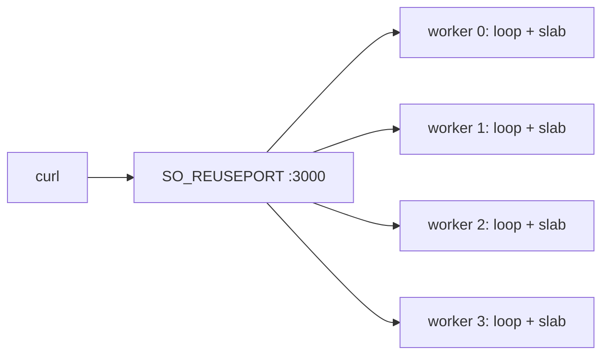

This example starts four shared-nothing workers. Each worker allocates its own
slab, runs its own event loop, and binds port 3000 through `SO_REUSEPORT` where
the platform supports it. No connection state, request buffer, or queue is
shared between workers. The program is `examples/shared_nothing_cluster.zig` in
the framework repository.

## Source [#source]

```zig src/main.zig
//! Shared-nothing worker group: one libxev loop and slab set per core.
//!
//! Build and run:
//!   zig build shared_nothing_cluster -Doptimize=ReleaseSafe
//!   curl -s http://127.0.0.1:3000/
//!
//! Each worker binds the same port through SO_REUSEPORT and is pinned to a
//! distinct physical core where the platform allows it. No connection state,
//! request buffer, or event loop is shared between workers.

const std = @import("std");
const uz = @import("uWebZockets");

const worker_count = 4;

fn hello(_: *uz.Request, res: *uz.Response) void {
    res.text("hello from a pinned shared-nothing worker") catch {};
}

pub fn main(init: std.process.Init) !void {
    var group = try uz.Server.builder(init.io)
        .with_max_clients(128)
        .with_write_queue_size(32 * 1024)
        .with_idle_timeout_ms(60_000)
        .build_cluster(std.heap.page_allocator, worker_count, .{});
    defer group.deinit();

    const Cluster = @TypeOf(group);
    try group.configure(struct {
        fn routes(worker: *Cluster.Worker, index: usize) !void {
            _ = index;
            _ = try worker.get("/", hello);
        }
    }.routes);

    try group.listen("0.0.0.0", 3000);
    try group.run();
}
```

[Full source](https://github.com/farbenbuilds/uWebZockets/blob/v2.1.6/examples/shared_nothing_cluster.zig)

The `zig build shared_nothing_cluster` line in the module header is the
framework checkout step. In your project, use `zig build run` as shown below.

## Build wiring [#build-wiring]

Add the dependency to your own project:

```sh
zig fetch --save 'https://github.com/farbenbuilds/uWebZockets/archive/refs/tags/v2.1.6.tar.gz'
```

Wire the module into your `build.zig` as shown in
[Run an example in your project](/examples#run-an-example-in-your-project), copy
the program above into `src/main.zig`, and run `zig build run`. The build adds
the `uWebZockets` module import and does not need a framework checkout.

## Run [#run]

```sh
zig build run
```

The process starts four worker threads. Each worker prints its own development
log records and owns one slab. The program does not arm `catch_shutdown_signals`,
so Ctrl+C ends the process without a graceful drain. Add
`try group.catch_shutdown_signals();` before `listen` when workers own work that
must stop cleanly.

In a framework checkout only,
`zig build shared_nothing_cluster -Doptimize=ReleaseSafe` runs the same program.
That is a contributor shortcut, not the application path.

## Verify [#verify]

```sh
curl -s http://127.0.0.1:3000/
```

```console
hello from a pinned shared-nothing worker
```

The body is 41 bytes. Repeat the request several times. On platforms with
`SO_REUSEPORT`, the kernel distributes new connections across the four listening
sockets; an individual TCP connection stays on the worker that accepted it.

## Worker layout [#worker-layout]



Pinning is best effort. Linux selects one representative CPU per physical core
and calls `sched_setaffinity`. Windows uses the process affinity mask. macOS has
no hard-affinity API, so workers run unpinned. A failed affinity call logs once
and leaves the worker unpinned instead of refusing startup.

The Windows cluster binds the shared address with `SO_REUSEADDR` because
`SO_REUSEPORT` is not available there. Kernel distribution across listeners is
unspecified on that platform.

## Key APIs [#key-apis]

| Call                                                | Effect                                                        |
| --------------------------------------------------- | ------------------------------------------------------------- |
| `uz.Server.builder(init.io)`                        | Starts a fluent configuration for one worker group            |
| `.with_max_clients(128)`                            | Sets 128 connection slots per worker                          |
| `.with_write_queue_size(32 * 1024)`                 | Sets a 32 KiB write queue per connection                      |
| `.with_idle_timeout_ms(60_000)`                     | Closes a drained keep-alive connection after 60 s             |
| `.build_cluster(page_allocator, worker_count, .{})` | Compiles four workers and allocates each slab                 |
| `group.configure(...)`                              | Registers routes once per worker before any thread starts     |
| `group.listen("0.0.0.0", 3000)`                     | Binds every worker to the same port                           |
| `group.run()`                                       | Spawns the workers, joins them, and returns the first failure |
| `group.deinit()`                                    | Releases worker storage after every loop stops                |

`build_cluster` takes the compiled worker capacity. The last argument is
`ClusterOptions`, which can select a smaller active count. Use
`build_cluster_from_environment` when `UWEBZOCKETS_WORKERS` should override the
CPU-count default.

## Capacities [#capacities]

| Capacity               |             Value | Set by                                  | Consequence                                         |
| ---------------------- | ----------------: | --------------------------------------- | --------------------------------------------------- |
| Workers                |                 4 | `build_cluster(..., worker_count, .{})` | Four slabs, four loops, four listeners              |
| Connections per worker |               128 | `.with_max_clients(128)`                | That worker refuses its 129th concurrent connection |
| Write queue            |            32 KiB | `.with_write_queue_size(32 * 1024)`     | A full queue returns `error.WouldBlock`             |
| Idle timeout           |              60 s | `.with_idle_timeout_ms(60_000)`         | A drained keep-alive connection closes              |
| Body                   |            16 KiB | Default                                 | Larger bodies receive `413`                         |
| Request line           |             8 KiB | Default                                 | Larger request lines receive `431`                  |
| Headers                | 16 KiB, 64 fields | Default                                 | Larger blocks receive `431`                         |
| WebSocket message      |            16 KiB | Default                                 | A larger message is rejected                        |
| Cluster inbox          |       64 messages | Default                                 | A full inbox returns `error.ClusterQueueFull`       |

The write queue is per connection and the connection count is per worker, so the
group holds four independent slabs. A worker count larger than the physical core
count wraps over the selected cores instead of reserving unused slabs.

## Variation [#variation]

Select the active worker count at startup instead of compiling it into the call:

```zig
var group = try uz.Server.builder(init.io)
    .with_max_clients(128)
    .with_write_queue_size(32 * 1024)
    .with_idle_timeout_ms(60_000)
    .build_cluster_from_environment(
        std.heap.page_allocator,
        8,
        init.environ_map,
        .{},
    );
```

Here 8 is the compiled capacity. Run `UWEBZOCKETS_WORKERS=6 zig build run` to
start six active workers. An explicit `ClusterOptions.worker_count` wins over
the environment, and the environment wins over the CPU count. Zero, a
non-numeric value, or a value above capacity fails before any worker slab is
allocated.

## Next [#next]

- [Hello world](/examples/hello-world) is the single-application starting point.
- [TLS cluster](/examples/tls-cluster) adds one TLS context per worker.
- [Your first cluster](/docs/examples/first-cluster) walks through the cluster
  lifecycle and failure reporting.
- [Shared-nothing workers](/docs/concepts/shared-nothing) explains the ownership
  model in detail.
