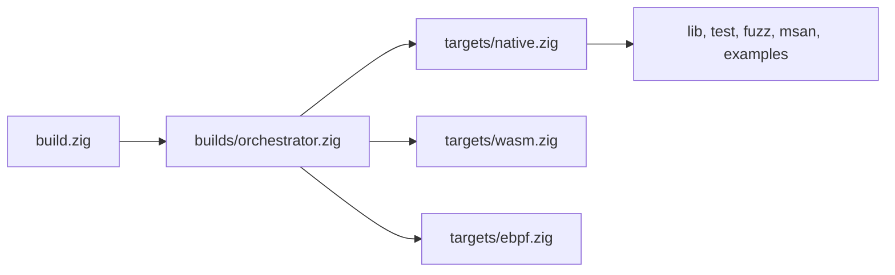

:::note[Contributing to µWebZockets]
This page describes the framework repository at
[farbenbuilds/uWebZockets](https://github.com/farbenbuilds/uWebZockets), not an
application project. Every command here runs from a framework checkout. Follow
[CONTRIBUTE.md](https://github.com/farbenbuilds/uWebZockets/blob/main/CONTRIBUTE.md)
before changing or verifying the framework. An application uses
`zig fetch --save` and its own `build.zig`; see
[Installation](/docs/getting-started/installation) and the
[C ABI consumer build](/reference/c-abi#consumer-buildzig).
:::

The root `build.zig` only injects the graph. Target, vendor, sanitizer, test,
fuzz, and example construction lives in `builds/*.zig`. Each named step below is
a contributor command; none is an application command.

## Build graph [#build-graph]



| Module                      | Owns                                                         |
| --------------------------- | ------------------------------------------------------------ |
| `builds/orchestrator.zig`   | Target selection, `clangd`, and `all-targets`                |
| `builds/targets/native.zig` | Native library, header, vendor archives, and graph wiring    |
| `builds/targets/wasm.zig`   | `wasm-freestanding`, `wasm-wasi`, and `wasm`                 |
| `builds/targets/ebpf.zig`   | `uwz_xdp.o` and `uwz_latency.o`                              |
| `builds/testing.zig`        | `test`, `test-compile`, `h1spec`, `autobahn`, and `msan`     |
| `builds/fuzzing.zig`        | `fuzz`, `oss-fuzz-objects`, `oss-fuzz-smoke`, and `oss-fuzz` |
| `builds/examples.zig`       | One run step per example                                     |
| `builds/sanitizers.zig`     | Sanitizer flags and the run environment                      |

## Build steps [#build-steps]

| Step                     | Purpose                                                                                            | Command                                 | Audience                                |
| ------------------------ | -------------------------------------------------------------------------------------------------- | --------------------------------------- | --------------------------------------- |
| Default install          | Build and install the native library, header, vendor archives, and example executables             | `zig build`                             | Contributor                             |
| `test`                   | Run the unit suite, archive check, C ABI smoke, and C++ header check                               | `zig build test --summary all`          | Contributor                             |
| `test-compile`           | Compile the tests, C smoke, and C++ header object, and run the archive check without running tests | `zig build test-compile`                | Contributor                             |
| `lib`                    | Build and install the static library, header, and five dependency archives                         | `zig build lib -Doptimize=ReleaseFast`  | Contributor; produces consumer archives |
| `clangd`                 | Write the repository-root `compile_flags.txt` from the pinned dependencies                         | `zig build clangd`                      | Contributor                             |
| `fuzz`                   | Run the deterministic parser fuzz smoke inputs; accepts `--fuzz=<count>`                           | `zig build fuzz --fuzz=100K`            | Contributor                             |
| `oss-fuzz-objects`       | Build the five libFuzzer ABI objects and verify sanitizer coverage sections                        | `zig build oss-fuzz-objects`            | Contributor                             |
| `oss-fuzz-smoke`         | Run the five deterministic protocol-boundary smoke inputs                                          | `zig build oss-fuzz-smoke`              | Contributor                             |
| `oss-fuzz`               | Build the OSS-Fuzz objects and run the smoke inputs                                                | `zig build oss-fuzz`                    | Contributor                             |
| `msan`                   | Run the instrumented C and C++ dependency-boundary smoke                                           | `zig build msan -Dmemory-sanitize=true` | Contributor                             |
| `autobahn`               | Build and run the Autobahn compliance server                                                       | `zig build autobahn`                    | Contributor                             |
| `h1spec`                 | Build and run the h1spec compliance server                                                         | `zig build h1spec`                      | Contributor                             |
| `ebpf`                   | Build the AF_XDP redirect and latency eBPF objects                                                 | `zig build ebpf`                        | Contributor                             |
| `wasm-freestanding`      | Build the V8 isolate WebAssembly target                                                            | `zig build wasm-freestanding`           | Contributor                             |
| `wasm-wasi`              | Build the WASI WebAssembly target                                                                  | `zig build wasm-wasi`                   | Contributor                             |
| `wasm`                   | Build both WebAssembly targets                                                                     | `zig build wasm`                        | Contributor                             |
| `all-targets`            | Build native install artifacts, both WebAssembly targets, and eBPF objects                         | `zig build all-targets`                 | Contributor                             |
| `hello_world`            | Run the hello-world example server                                                                 | `zig build hello_world`                 | Contributor; example shortcut           |
| `https_server`           | Run the ephemeral HTTPS example server                                                             | `zig build https_server`                | Contributor; example shortcut           |
| `chat_server`            | Run the WebSocket chat example server                                                              | `zig build chat_server`                 | Contributor; example shortcut           |
| `http3_server`           | Run the HTTP/3 example server                                                                      | `zig build http3_server`                | Contributor; example shortcut           |
| `rpc_server`             | Run the JSON-RPC example server                                                                    | `zig build rpc_server`                  | Contributor; example shortcut           |
| `basic_microservice`     | Run the microservice preset example                                                                | `zig build basic_microservice`          | Contributor; example shortcut           |
| `custom_builder`         | Run the custom builder example                                                                     | `zig build custom_builder`              | Contributor; example shortcut           |
| `shared_nothing_cluster` | Run the shared-nothing worker group example                                                        | `zig build shared_nothing_cluster`      | Contributor; example shortcut           |
| `tls_cluster`            | Run the TLS-enabled worker group example                                                           | `zig build tls_cluster`                 | Contributor; example shortcut           |
| `delay_server`           | Run the async delay timing-wheel example                                                           | `zig build delay_server`                | Contributor; example shortcut           |

The compliance steps start a server and block until the external suite or a
signal stops it. The `h1spec` step needs the pinned `vendor/h1spec` submodule.
The example steps are convenience wrappers around a framework binary; an
application runs its own `zig build run` target instead.

## Flags [#flags]

| Flag                                | Values                                                | Effect                                                                                         |
| ----------------------------------- | ----------------------------------------------------- | ---------------------------------------------------------------------------------------------- |
| `-Dtarget=<triple>`                 | Any Zig target that resolves to a supported OS        | Selects the build target; `wasm32` must use `freestanding` or `wasi`                           |
| `-Doptimize=<mode>`                 | `Debug`, `ReleaseSafe`, `ReleaseFast`, `ReleaseSmall` | Sets the optimization mode; `Debug` is the default                                             |
| `-Dsanitize=true`                   | Boolean                                               | Enables native Linux ASan, UBSan, and LSan on the C and C++ dependencies and the C ABI graph   |
| `-Dmemory-sanitize=true`            | Boolean                                               | Enables the separate x86_64 Linux MemorySanitizer dependency-boundary smoke                    |
| `-Dsanitizer-lib-dir=<path>`        | Directory                                             | Points at the LLVM sanitizer runtime; also `UWEBZOCKETS_SANITIZER_LIB_DIR`                     |
| `-Dsanitizer-libc-dir=<path>`       | Directory                                             | Points at the libc used by the sanitizer runtime; also `UWEBZOCKETS_SANITIZER_LIBC_DIR`        |
| `-Dsanitizer-dynamic-linker=<path>` | File                                                  | Sets the dynamic linker for sanitizer executables; also `UWEBZOCKETS_SANITIZER_DYNAMIC_LINKER` |

`-Dsanitize=true` and `-Dmemory-sanitize=true` are mutually exclusive, and both
require a native Linux target. ASan/UBSan supports `x86_64` and `aarch64`; MSan
supports `x86_64` only. A sanitizer build without `-Dsanitizer-lib-dir` or the
environment fallback fails at configure time. `-Dsanitizer-libc-dir` and
`-Dsanitizer-dynamic-linker` must be supplied together.

`UWEBZOCKETS_DEFAULT_TARGET` sets the default target when `-Dtarget` is absent.
The value must parse as a Zig target triple.

### Sanitizer commands [#sanitizer-commands]

```sh
zig build test -Dsanitize=true -Doptimize=ReleaseSafe --summary all
zig build test -Dsanitize=true -Doptimize=ReleaseSafe \
  -Dsanitizer-lib-dir=/path/to/compiler-rt/lib --summary all
zig build msan -Dmemory-sanitize=true -Doptimize=ReleaseSafe \
  -Dsanitizer-lib-dir=/path/to/compiler-rt/lib --summary all
```

Inside the Nix development shell, the `UWEBZOCKETS_SANITIZER_*` variables
provide the matching runtime, libc, and linker paths. Outside Nix, pass the
runtime directory explicitly. The `msan` step without
`-Dmemory-sanitize=true` fails by design.

## Cross-compilation [#cross-compilation]

```sh
zig build test-compile -Dtarget=x86_64-windows-gnu -Doptimize=ReleaseSafe
zig build lib -Dtarget=x86_64-windows-gnu -Doptimize=ReleaseFast
zig build -Dtarget=aarch64-linux-musl -Doptimize=ReleaseSafe
zig build -Dtarget=wasm32-wasi -Doptimize=ReleaseSafe
```

`-Dtarget` selects the native or cross target. When it selects `wasm32`, the
build installs the selected WebAssembly artifact directly and does not register
the native step graph, including the named `wasm-*` steps. The named `wasm`,
`wasm-freestanding`, and `wasm-wasi` steps are for a non-WASM host target.

`all-targets` includes the `ebpf` step, which fails on a non-Linux build host.
Use `zig build` or `zig build lib` on macOS and Windows instead.

## Outputs [#outputs]

| Output              | Path                                                                           |
| ------------------- | ------------------------------------------------------------------------------ |
| C ABI archive       | `zig-out/lib/libuWebZockets.a`                                                 |
| Dependency archives | `zig-out/lib/libssl.a`, `libcrypto.a`, `liblsquic.a`, `libdeflate.a`, `libz.a` |
| C header            | `zig-out/include/uWebZockets.h`                                                |
| Freestanding WASM   | `zig-out/wasm/uWebZockets-freestanding.wasm`                                   |
| WASI WASM           | `zig-out/wasm/uWebZockets-wasi.wasm`                                           |
| eBPF objects        | `zig-out/share/uwebzockets/uwz_xdp.o`, `uwz_latency.o`                         |
| OSS-Fuzz objects    | `zig-out/oss-fuzz/*.o`                                                         |
| clangd flags        | `compile_flags.txt` at the repository root                                     |

The `lib` step is the only step that installs the six link archives and the
header together. A consumer project normally receives the same artifacts through
`uz.artifact("uWebZockets")` and the five dependency artifacts instead of
building them locally; see the [C ABI reference](/reference/c-abi#linking).

## Application boundary [#application-boundary]

An application project does not run any command on this page. It adds the
package with `zig fetch --save`, imports `uWebZockets` in its own `build.zig`,
and runs `zig build` or its own `run` step. The C ABI consumer pattern is in
[C ABI](/reference/c-abi#consumer-buildzig), and the complete C program is in
[Embed from C or C++](/docs/guides/c-abi).

Use the contributor workflow for the matching task:
[Build from source](/docs/operations/build), [Tests](/docs/operations/testing),
[Sanitizers](/docs/operations/sanitizers), [Fuzzing](/docs/operations/fuzzing),
[Cross-compilation](/docs/operations/cross-compilation), and
[WASM](/docs/operations/wasm).

## Related [#related]

- [C ABI](/reference/c-abi) owns the archive list and consumer build.
- [Operations](/docs/operations) covers the contributor workflow.
- [Compatibility](/reference/compatibility) states the supported Zig and
  platform baseline.
