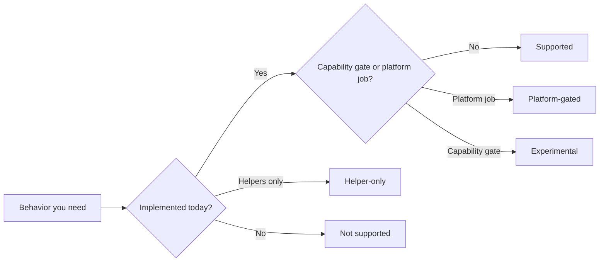

This matrix is the boundary register for µWebZockets 2.1.6. Each row names the
feature, its status, the public surface that exposes it, the page that owns the
behavior, and the evidence behind the claim. The statuses come from the project
coverage matrix and are not upgraded by this site. When a row and its owner page
disagree, report the conflict instead of choosing the friendlier answer.

## How to read a row

| Column         | Meaning                                                                                      |
| -------------- | -------------------------------------------------------------------------------------------- |
| Feature        | The behavior or protocol surface a design depends on                                         |
| Status         | One of the five statuses below, plus the qualifier carried by the coverage matrix            |
| Public surface | The type, function, build step, or header an application uses                                |
| Owner page     | The page that explains the behavior, limits, and rejection path                              |
| Evidence       | A framework source module, a framework document under `docs/`, an ADR, or a compliance suite |

Evidence paths such as `src/router/app.zig` and `docs/http.md` belong to the
[farbenbuilds/uWebZockets](https://github.com/farbenbuilds/uWebZockets)
repository, not to this site. They identify the claim, not required reading.

## Status meanings

| Status         | Meaning                                                                                    | Check before you rely on it                     |
| -------------- | ------------------------------------------------------------------------------------------ | ----------------------------------------------- |
| Supported      | Implemented and reachable through the documented public surface                            | The owner page limits still apply               |
| Helper-only    | A helper module ships, but the live server path does not use it                            | The server does not exercise it                 |
| Experimental   | A shipped surface behind a documented capability gate; its API or behavior may change      | Confirm the gate and the API stability          |
| Platform-gated | The code path builds or runs, but the support claim waits on a platform job or CI coverage | Check the platform page before claiming support |
| Not supported  | A deliberate boundary, not an undocumented omission                                        | Use the stated alternative                      |

The base word is the status. Text in parentheses is the qualifier from the
coverage matrix, for example opt-in, bounded, one per connection, or development
only. A qualifier narrows the promise and never raises it. Where the project
matrix uses a boundary label such as Optional or Community build only, this page
maps it to the closest base status and keeps the original label as the qualifier.

Experimental is part of the vocabulary but has no current row. WebTransport
helpers are Helper-only, and the Windows claim is Platform-gated.

## Application and cluster

| Feature                                               | Status    | Public surface                           | Owner page                                            | Evidence                 |
| ----------------------------------------------------- | --------- | ---------------------------------------- | ----------------------------------------------------- | ------------------------ |
| `App(N)`, `ConfiguredApp`, `ConfiguredAppWithTimeout` | Supported | `uz.App`, `uz.ConfiguredApp`             | [Application model](/docs/concepts/application-model) | `src/router/app.zig`     |
| Fluent `Server.builder`                               | Supported | `uz.Server`                              | [Server lifecycle](/docs/http/server-lifecycle)       | `src/router/builder.zig` |
| Thread-per-core cluster                               | Supported | `uz.Server.builder(...).build_cluster`   | [Cluster model](/docs/concepts/cluster-model)         | `docs/architecture.md`   |
| Cluster TLS                                           | Supported | `enable_https`, `enable_https_ephemeral` | [TLS clusters](/docs/security/tls-clusters)           | `docs/tls.md`            |

## HTTP/1.1 and helpers

| Feature                              | Status             | Public surface                                 | Owner page                                                          | Evidence                          |
| ------------------------------------ | ------------------ | ---------------------------------------------- | ------------------------------------------------------------------- | --------------------------------- |
| HTTP/1.1 parsing and routing         | Supported          | `Request`, `Response`, router                  | [HTTP](/docs/http)                                                  | `docs/http.md`, h1spec            |
| HTTP/1.1 pipelining                  | Supported          | Transparent                                    | [HTTP](/docs/http)                                                  | `docs/http.md`                    |
| Static files                         | Supported          | `App.static`, `static_files`                   | [Static files](/docs/http/static-files)                             | `src/http/static_files.zig`       |
| Streaming response                   | Supported          | `begin_stream`, `StreamProducer`               | [Streaming](/docs/http/streaming)                                   | `src/http/response.zig`           |
| Chunked response                     | Supported          | `begin_chunked`, `write_chunk`                 | [Chunked](/docs/http/chunked)                                       | `src/http/response.zig`           |
| SSE                                  | Supported          | `Response.sse`                                 | [Server-sent events](/docs/http/server-sent-events)                 | `src/http/response.zig`           |
| JSON helpers                         | Supported          | `json`, `json_buf`, `begin_json`               | [JSON](/docs/http/json)                                             | `src/http/response.zig`           |
| Schema validation                    | Supported          | `uz.schema`                                    | [Schema validation](/docs/type-safety/schema-validation)            | `src/http/schema.zig`             |
| Query and form parsing               | Supported          | `query`, `form`, `Request` helpers             | [Query and forms](/docs/http/helpers/query-and-forms)               | `src/http/query.zig`              |
| Multipart parsing                    | Supported          | `uz.multipart`                                 | [Multipart](/docs/http/helpers/multipart)                           | `src/http/multipart.zig`          |
| Cookies and signing                  | Supported          | `uz.cookie`, `Response.set_cookie`             | [Cookies](/docs/http/helpers/cookies)                               | `src/http/cookie.zig`             |
| Gzip response                        | Supported          | `Response.end_gzip`                            | [Compression](/docs/http/helpers/compression)                       | `src/http/response.zig`           |
| Compression streams and pool         | Supported          | `uz.compression_stream`, `uz.compression_pool` | [Compression](/docs/http/helpers/compression)                       | `src/http/compression_stream.zig` |
| Fetch, streams, and abort primitives | Supported          | `uz.fetch`, `uz.streams`, `uz.abort`           | [Fetch, streams, abort](/docs/http/helpers/fetch-streams-and-abort) | `src/http/fetch.zig`              |
| ETag and cache helpers               | Supported          | `uz.cache`                                     | [Caching](/docs/http/helpers/caching)                               | `src/http/cache.zig`              |
| Content negotiation                  | Supported          | `uz.negotiate`                                 | [Content negotiation](/docs/http/helpers/content-negotiation)       | `src/http/negotiate.zig`          |
| CORS                                 | Supported          | `middleware.Cors`                              | [CORS](/docs/http/cors)                                             | `src/http/middleware.zig`         |
| Security headers                     | Supported          | `middleware.SecurityHeaders`                   | [Security headers](/docs/http/security-headers)                     | `src/http/middleware.zig`         |
| Basic and Bearer auth                | Supported          | `middleware.Auth`                              | [Authentication](/docs/http/authentication)                         | `src/http/middleware.zig`         |
| Rate limiting                        | Supported          | `middleware.RateLimit`                         | [Rate limiting](/docs/http/rate-limiting)                           | `src/http/middleware.zig`         |
| OpenAPI output                       | Supported          | `App.openapi`                                  | [OpenAPI](/docs/http/openapi)                                       | `src/http/openapi.zig`            |
| RFC 10008 `QUERY`                    | Supported          | `App.query`                                    | [QUERY method](/docs/http/query-method)                             | `docs/quic.md`                    |
| `TRACE`                              | Supported (opt-in) | `App.trace`                                    | [TRACE](/docs/http/trace)                                           | `docs/roadmap.md`                 |

## WebSocket

| Feature                                      | Status                         | Public surface                             | Owner page                                         | Evidence            |
| -------------------------------------------- | ------------------------------ | ------------------------------------------ | -------------------------------------------------- | ------------------- |
| WebSocket server                             | Supported                      | `App.ws`, `WebSocket`                      | [WebSocket](/docs/websocket)                       | Autobahn            |
| RFC 7692 compression                         | Supported                      | `WsBehavior.compression`                   | [WS compression](/docs/websocket/compression)      | `docs/websocket.md` |
| WebSocket pub/sub                            | Supported                      | `subscribe`, `publish`                     | [Pub/sub](/docs/websocket/pub-sub)                 | `docs/websocket.md` |
| WebSocket stream adapters                    | Supported                      | `WebSocketStream`, `NativeWebSocketStream` | [WS streams](/docs/http/helpers/websocket-streams) | `src/ws/stream.zig` |
| Cluster pub/sub                              | Supported                      | `Cluster.publish`                          | [Cluster pub/sub](/docs/websocket/cluster-pub-sub) | ADR 0007            |
| RFC 8441 HTTP/2 tunnel                       | Supported (one per connection) | Extended CONNECT                           | [HTTP/2 tunnels](/docs/websocket/http2-tunnels)    | `docs/http2.md`     |
| WebSocket client                             | Not supported                  | None                                       | [WebSocket](/docs/websocket)                       | Roadmap             |
| WebSocket origin and subprotocol negotiation | Supported (application-owned)  | `Request` headers                          | [WS security](/docs/security/websocket-security)   | `docs/websocket.md` |

## HTTP/2

| Feature                    | Status                                            | Public surface                  | Owner page                               | Evidence              |
| -------------------------- | ------------------------------------------------- | ------------------------------- | ---------------------------------------- | --------------------- |
| HTTP/2 request routing     | Supported (bounded)                               | `init_https`, plaintext preface | [HTTP/2](/docs/http2)                    | `docs/http2.md`       |
| HTTP/2 HPACK               | Supported (bounded)                               | `uz.http2_hpack`                | [HPACK](/docs/http2/hpack)               | `src/http2/hpack.zig` |
| HTTP/2 flow control        | Supported                                         | Transparent                     | [Flow control](/docs/http2/flow-control) | `src/http2`           |
| HTTP/2 server push         | Not supported                                     | None                            | [HTTP/2](/docs/http2)                    | Roadmap               |
| h2c Upgrade                | Not supported                                     | Prior knowledge only            | [HTTP/2](/docs/http2)                    | Roadmap               |
| HTTP/2 more than 8 streams | Not supported (without connection specialization) | Compile-time                    | [HTTP/2 limits](/docs/http2/limits)      | Roadmap               |

## HTTP/3 and WebTransport

| Feature                | Status                        | Public surface                           | Owner page                                    | Evidence             |
| ---------------------- | ----------------------------- | ---------------------------------------- | --------------------------------------------- | -------------------- |
| HTTP/3 request routing | Supported                     | `init_http3`, `listen_udp`               | [HTTP/3](/docs/http3)                         | curl/ngtcp2, aioquic |
| HTTP/3 QPACK           | Supported (bounded)           | `src/quic/stream.zig`                    | [QPACK](/docs/http3/qpack)                    | `docs/quic.md`       |
| HTTP/3 0-RTT           | Not supported (live listener) | Disabled on the live listener            | [Early data](/docs/http3/early-data)          | `docs/quic.md`       |
| HTTP/3 clustering      | Not supported                 | None                                     | [HTTP/3](/docs/http3)                         | Roadmap              |
| HTTP/3 metrics parity  | Not supported                 | Development log only                     | [H3 observability](/docs/http3/observability) | Roadmap              |
| WebTransport live      | Not supported                 | Helper models only                       | [WebTransport](/docs/http3/webtransport)      | ADR 0001             |
| WebTransport helpers   | Helper-only                   | `uz.webtransport`, `uz.http3_extensions` | [WebTransport](/docs/http3/webtransport)      | Source               |

## JSON-RPC and the client

| Feature                                   | Status                             | Public surface     | Owner page                                          | Evidence           |
| ----------------------------------------- | ---------------------------------- | ------------------ | --------------------------------------------------- | ------------------ |
| Typed JSON-RPC                            | Supported                          | `register_typed`   | [Typed procedures](/docs/json-rpc/typed-procedures) | `docs/json_rpc.md` |
| HTTP/1.1 client                           | Supported (bounded)                | `uz.client`        | [Client](/docs/client)                              | `docs/client.md`   |
| Client DNS                                | Not supported (numeric hosts only) | Numeric hosts only | [Client limits](/docs/client/limits)                | `docs/client.md`   |
| Client redirects, cookies, proxy, retries | Not supported                      | None               | [Client limits](/docs/client/limits)                | `docs/client.md`   |
| Client mTLS                               | Not supported                      | None               | [TLS trust](/docs/client/tls-trust)                 | `docs/client.md`   |
| Client HTTP/2 and HTTP/3                  | Not supported                      | None               | [Client limits](/docs/client/limits)                | `docs/client.md`   |

## TLS

| Feature                | Status                          | Public surface                  | Owner page                                                        | Evidence      |
| ---------------------- | ------------------------------- | ------------------------------- | ----------------------------------------------------------------- | ------------- |
| TLS 1.3 termination    | Supported                       | `init_https`, `init_https_mtls` | [TLS](/docs/security/tls)                                         | `docs/tls.md` |
| Ephemeral certificates | Supported (development)         | `init_https_ephemeral`          | [Ephemeral certificates](/docs/security/ephemeral-certificates)   | `docs/tls.md` |
| Production PEM         | Supported                       | `init_https`                    | [Production certificates](/docs/security/production-certificates) | `docs/tls.md` |
| mTLS                   | Supported (TCP only)            | `init_https_mtls`               | [mTLS](/docs/security/mtls)                                       | `docs/tls.md` |
| TLS 1.2                | Not supported                   | None                            | [TLS](/docs/security/tls)                                         | Roadmap       |
| Hot certificate reload | Not supported (rolling restart) | Rolling restart                 | [Certificate rotation](/docs/security/certificate-rotation)       | ADR 0003      |

## Operations and platforms

| Feature                       | Status                                 | Public surface                           | Owner page                                            | Evidence             |
| ----------------------------- | -------------------------------------- | ---------------------------------------- | ----------------------------------------------------- | -------------------- |
| C ABI                         | Supported (high-level subset)          | `include/uWebZockets.h`                  | [C ABI](/reference/c-abi)                             | Header, C tests      |
| Metrics registry              | Supported (TCP only)                   | `metrics`, `/metrics`                    | [Metrics](/docs/operations/metrics)                   | `src/observability`  |
| Development log               | Supported                              | `dev_log`, `ServerConfig.enable_dev_log` | [Logging](/docs/operations/logging)                   | `src/observability`  |
| eBPF histogram                | Supported (optional)                   | `ebpf` build step, pinned map            | [eBPF](/docs/operations/ebpf)                         | `docs/operations.md` |
| kTLS                          | Helper-only                            | `uz.ktls`                                | [kTLS](/docs/operations/ktls)                         | Roadmap              |
| AF_XDP                        | Helper-only (data path unwired)        | `uz.xdp`, `uz.xdp_transport`             | [AF_XDP](/docs/operations/af-xdp)                     | Roadmap              |
| WASM edge                     | Supported (build targets, bounded API) | `wasm-freestanding`, `wasm-wasi`         | [WASM](/docs/operations/wasm)                         | `docs/operations.md` |
| Shared memory and Cap'n Proto | Supported (module)                     | `uz.shared_memory`                       | [Architecture](/docs/architecture)                    | Source               |
| Web Crypto subset             | Supported                              | `uz.crypto_subtle`                       | [Security](/docs/security)                            | Source               |
| Fuzzing                       | Supported                              | `zig build fuzz`, OSS-Fuzz               | [Fuzzing](/docs/operations/fuzzing)                   | `docs/operations.md` |
| Windows official support      | Platform-gated                         | Compile plus runtime job                 | [Windows](/docs/deployment/windows)                   | ADR 0004, roadmap    |
| BSD runtime support           | Platform-gated (community builds)      | Shared build graph                       | [BSD](/docs/deployment/bsd)                           | Roadmap              |
| Dynamic capacity growth       | Not supported (fixed slabs)            | Fixed slabs                              | [Capacity model](/docs/concepts/capacity-model)       | Roadmap              |
| Request-body streaming        | Not supported (buffered)               | Buffered bodies                          | [Request lifecycle](/docs/concepts/request-lifecycle) | Roadmap              |

## Related

- [Compatibility](/reference/compatibility) states the version, platform,
  dependency, and release policy behind these statuses.
- [Protocol matrix](/reference/protocol-matrix) compares the wire behavior of
  the supported transports.
- [Limits](/reference/limits) lists the capacities that apply after a status is
  Supported.
- [Migration](/docs/migration) maps another framework onto these boundaries.
