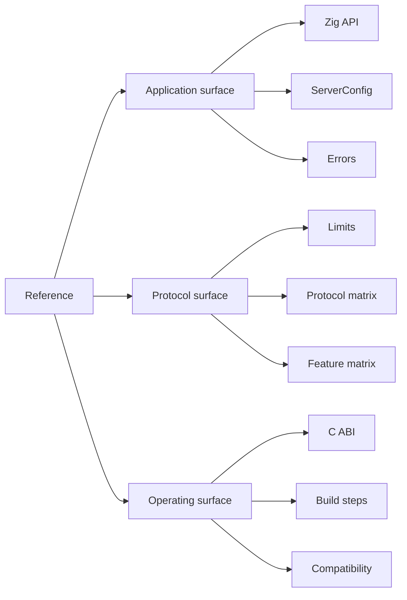

The reference is the lookup surface for exact facts. It follows µWebZockets 2.1.6
and Zig 0.16.0. Use a task page for the procedure, then return here for the
signature, default, error, or capacity.

Every table names the source that owns the fact. When a value changes in the
framework, the reference page changes in the same release; a tutorial that uses
the value links here instead of copying it.

## Start with the fact you need

| Fact                             | Page                                          | Use it for                                       |
| -------------------------------- | --------------------------------------------- | ------------------------------------------------ |
| Public Zig name or module        | [Zig API index](/reference/zig)               | Find the owning type, module, or task page       |
| Startup capacity or timeout      | [ServerConfig](/reference/server-config)      | Compare defaults, overrides, and constraints     |
| Protocol or router limit         | [Limits](/reference/limits)                   | Size a deployment and predict the rejection      |
| Zig error name                   | [Errors](/reference/errors)                   | Identify the cause, status, and fix              |
| C handle, function, or enum      | [C ABI](/reference/c-abi)                     | Embed the server from C or C++                   |
| Build step or flag               | [Build steps](/reference/build-steps)         | Compile, test, sanitize, fuzz, or cross-compile  |
| Supported or unsupported feature | [Feature matrix](/reference/feature-matrix)   | Decide whether a design is implementable         |
| Version or platform              | [Compatibility](/reference/compatibility)     | Check Zig, OS, dependency, and release policy    |
| Wire protocol behavior           | [Protocol matrix](/reference/protocol-matrix) | Compare transport, ALPN, framing, and compliance |
| Term definition                  | [Glossary](/reference/glossary)               | Resolve the vocabulary used across the site      |

## How the reference is organized

The three groups match the three things a reader checks before a change: the
application type, the wire behavior underneath it, and the build or deployment
contract around it.

## Source of truth

| Claim class               | Owning source                                                    | Reference page                              |
| ------------------------- | ---------------------------------------------------------------- | ------------------------------------------- |
| Public export             | `src/root.zig`                                                   | [Zig API index](/reference/zig)             |
| Startup field and default | `src/router/config.zig`                                          | [ServerConfig](/reference/server-config)    |
| Protocol limit            | `src/router/config.zig`, `src/http/parser.zig`, protocol modules | [Limits](/reference/limits)                 |
| Error name                | The module that returns it                                       | [Errors](/reference/errors)                 |
| C declaration             | `include/uWebZockets.h`                                          | [C ABI](/reference/c-abi)                   |
| Build step                | `builds/*.zig`                                                   | [Build steps](/reference/build-steps)       |
| Boundary or status        | `docs/roadmap.md`, ADRs, `CHANGELOG.md`                          | [Feature matrix](/reference/feature-matrix) |

The site is not the source of truth for behavior. If a reference row and the
current source disagree, report the conflict instead of choosing the friendlier
value.

## Version baseline

| Item                   | Value                                                                      |
| ---------------------- | -------------------------------------------------------------------------- |
| µWebZockets            | 2.1.6                                                                      |
| Zig                    | 0.16.0                                                                     |
| Documentation baseline | 2026-11-06                                                                 |
| Update rule            | A public behavior or limit change updates the reference in the same change |

## Related

- [Migration](/docs/migration) maps another framework onto this surface.
- [Operations](/docs/operations) covers the contributor workflow behind a release.
- [Compatibility](/reference/compatibility) states the support policy.
