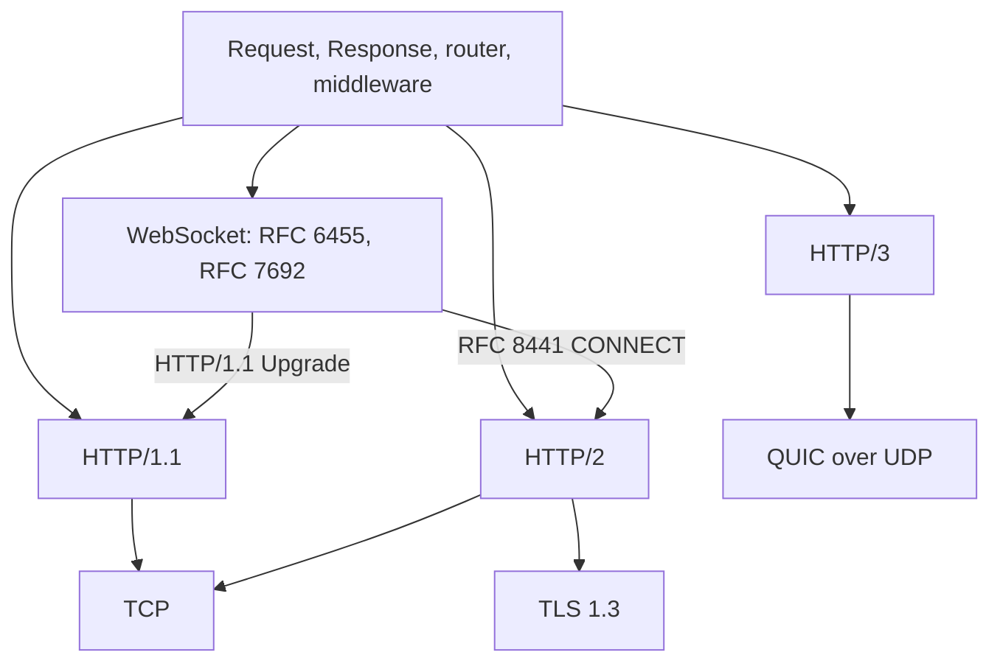

µWebZockets exposes one application boundary, built from `Request`, `Response`,
the radix router, and middleware, across every transport it serves. A handler
written once runs unchanged on HTTP/1.1, HTTP/2, and HTTP/3. WebSocket routes use
the same application and router, and JSON-RPC mounts on the same HTTP path.

## One boundary, four transports

The framing layer changes. The handler contract, route table, borrowed request
data, async token rules, and bounded output model do not.

## Negotiation and entry points

| Entry point                                 | Protocol                                           | Negotiation                                                                                      |
| ------------------------------------------- | -------------------------------------------------- | ------------------------------------------------------------------------------------------------ |
| `init` and `listen`                         | HTTP/1.1 or HTTP/2                                 | HTTP/1.1 by default; a client that opens with the HTTP/2 connection preface uses prior knowledge |
| `init_https` and `listen`                   | HTTP/2 or HTTP/1.1                                 | TLS ALPN prefers `h2` over `http/1.1`                                                            |
| `init_https_mtls` and `listen`              | HTTP/2 or HTTP/1.1                                 | Same ALPN policy with a client certificate; TCP only                                             |
| `init_http3` with `listen` and `listen_udp` | HTTP/3 over QUIC plus HTTP/1.1 and HTTP/2 over TCP | The QUIC context advertises only `h3`; the TCP context advertises `h2` then `http/1.1`           |
| `app.ws`                                    | WebSocket                                          | HTTP/1.1 `Upgrade` or RFC 8441 extended CONNECT over HTTP/2                                      |
| `app.rpc`                                   | JSON-RPC 2.0                                       | Mounted at an HTTP path; inherits the HTTP transport limits                                      |
| `uz.client`                                 | HTTP/1.1 outbound                                  | Offers `http/1.1` only; TLS 1.3 is pinned                                                        |

## Protocol comparison

| Transport | ALPN and negotiation                                                        | Framing                                                                                | Header compression                                                  | Concurrency                                                                         | Request body                                                             | Response streaming                                                               | Compliance evidence                                                                                  |
| --------- | --------------------------------------------------------------------------- | -------------------------------------------------------------------------------------- | ------------------------------------------------------------------- | ----------------------------------------------------------------------------------- | ------------------------------------------------------------------------ | -------------------------------------------------------------------------------- | ---------------------------------------------------------------------------------------------------- |
| HTTP/1.1  | Cleartext first bytes; TLS ALPN selects `http/1.1` when `h2` is not offered | Text request line and fields; `Content-Length`, chunked, or close-delimited            | None                                                                | One request at a time per connection; pipelined requests dispatch in read order     | Buffered up to `max_body_size`, 16 KiB by default                        | `begin_stream`, `begin_chunked`, and SSE; write-ring drain                       | h1spec suite plus deterministic adversarial unit cases                                               |
| HTTP/2    | ALPN prefers `h2`; cleartext prior knowledge only; no h2c Upgrade           | Binary frames; 16 KiB frame payload; HEADERS, DATA, SETTINGS, GOAWAY, RST_STREAM       | HPACK; 4 KiB dynamic table; bounded decode                          | 8 concurrent streams per connection, fixed; one RFC 8441 tunnel                     | `min(max_body_size, max_h2_body_size)`, 16 KiB by default                | Async tokens and drain-driven producers per stream; DATA frames                  | Bounded RFC 9113 session suite for frames, settings, flow control, HPACK, and stream reuse           |
| HTTP/3    | QUIC ALPN advertises only `h3`; separate `listen_udp` endpoint              | QUIC streams plus HTTP/3 frames; QPACK field sections                                  | QPACK; zero-byte decoder table; one header set outstanding          | Bounded by `max_connections` and engine streams; one engine per process; no cluster | `max_h3_body_size`, 16 KiB by default                                    | `begin_stream`; DATA frames; stream flow-control window; drain on write callback | curl/ngtcp2 and aioquic interop gate, including trailer and malformed pseudo-header cases            |
| WebSocket | HTTP/1.1 `Upgrade` or RFC 8441 extended CONNECT over HTTP/2                 | RFC 6455 frames; masking, fragmentation, and control frames; RFC 7692 on HTTP/1.1 only | None at the frame layer; per-message deflate is payload compression | One RFC 8441 tunnel per HTTP/2 connection; upgrade connections share the pool       | Not applicable after upgrade; message capacity is 16 KiB by default      | Message sends resume on drain; HTTP response streaming does not apply            | 517/517 Autobahn server cases: 514 `OK`, 3 `INFORMATIONAL`, including RFC 7692 groups 12 and 13      |
| JSON-RPC  | Mounted on any HTTP transport with `app.rpc(path, &service)`                | JSON-RPC 2.0 in the HTTP body; single calls, notifications, and batches                | Inherited from the HTTP transport                                   | One service per event loop and one response buffer; not shared across workers       | Bounded by the HTTP body limit; typed parameters use 4 KiB stack scratch | Not streamed; bounded 16 KiB service response                                    | Unit suite covers batches, notifications, decoding, and error mapping; no external conformance suite |
| TLS       | ALPN `h2` then `http/1.1` on TCP; `h3` on QUIC; TLS 1.3 only                | TLS records                                                                            | None                                                                | One TLS session per connection; cluster workers each own one `SSL_CTX`              | Not applicable                                                           | Not applicable                                                                   | TLS 1.3 handshake, ALPN, mTLS, and client trust tests                                                |
| Client    | Offers `http/1.1` only; TLS 1.3 is both the minimum and maximum             | HTTP/1.1 response parser; `Content-Length`, chunked, and close-delimited               | None                                                                | `max_inflight` compile-time slots; one request per connection                       | Caller-borrowed body, unbounded except by the transport                  | Not streamed; response body buffered up to 64 KiB by default                     | Parser suite, trust failures, loopback plaintext and TLS fetches, slot reuse                         |

## The request at the boundary

| Request part      | HTTP/1.1                          | HTTP/2                                                | HTTP/3                                             |
| ----------------- | --------------------------------- | ----------------------------------------------------- | -------------------------------------------------- |
| Method and target | Request line                      | `:method`, `:path`, and `:authority` pseudo-fields    | `:method`, `:path`, and `:authority` pseudo-fields |
| Header fields     | Text fields, 64 inline by default | HPACK-decoded fields, bounded                         | QPACK-decoded fields, bounded                      |
| Body              | Buffered up to `max_body_size`    | Buffered up to `min(max_body_size, max_h2_body_size)` | Buffered up to `max_h3_body_size`                  |
| Route captures    | Router after parsing              | Router after pseudo-header decoding                   | Router after pseudo-header decoding                |
| Response head     | Status line and text fields       | HEADERS with HPACK                                    | HEADERS with QPACK                                 |

After decoding, every transport fills the same `Request` fields and invokes the
same route. A handler that reads the method, target, headers, body, and a route
capture does not need a transport branch.

## What stays the same

| Behavior              | HTTP/1.1                              | HTTP/2                                | HTTP/3                               |
| --------------------- | ------------------------------------- | ------------------------------------- | ------------------------------------ |
| Router and middleware | Same                                  | Same                                  | Same                                 |
| Handler shape         | Same                                  | Same                                  | Same                                 |
| Async response token  | Yes                                   | Yes                                   | Yes                                  |
| Request captures      | Borrowed                              | Borrowed                              | Borrowed                             |
| Request body          | Buffered                              | Buffered                              | Buffered                             |
| Response streaming    | Chunked, SSE, or producer             | Producer and DATA frames              | Producer and DATA frames             |
| Development log       | One record per exchange plus counters | One record per exchange plus counters | One record per exchange, no counters |

WebSocket connections register with `App.ws` and use open, message, close, and
drain callbacks after the handshake. JSON-RPC mounts on an HTTP route and
inherits the transport's body, header, and response limits. Neither surface
creates a second router.

## Deliberate boundaries

| Boundary            | Exact behavior                                                                                                                      | Alternative                                               |
| ------------------- | ----------------------------------------------------------------------------------------------------------------------------------- | --------------------------------------------------------- |
| h2c Upgrade         | Not implemented. `Upgrade: h2c` is treated as HTTP/1.1; cleartext HTTP/2 uses prior knowledge only                                  | Use prior knowledge or TLS ALPN                           |
| HTTP/2 server push  | Not implemented. `SETTINGS_ENABLE_PUSH: 0`; no PUSH_PROMISE is sent                                                                 | Fetch from the client or preload                          |
| HTTP/2 stream count | Fixed at 8 concurrent streams per connection; the ninth receives `RST_STREAM REFUSED_STREAM`                                        | Open another connection or specialize the connection type |
| RFC 8441 tunnel     | One active WebSocket tunnel per HTTP/2 connection; a second receives `503 Service Unavailable` without disturbing the active tunnel | Use another connection                                    |
| HTTP/3 clustering   | No HTTP/3 cluster mode. `listen_udp` is single-application, and one process owns one QUIC engine and one UDP socket                 | Use a TCP/TLS cluster for HTTP/1.1 and HTTP/2             |
| WebTransport        | Helper-only. The live listener rejects CONNECT with `501 Not Implemented` and advertises no datagrams                               | Treat `uz.webtransport` as draft-16 helper models         |
| Client protocol     | `uz.client` is HTTP/1.1 only over TCP or TLS; no DNS, redirects, cookies, proxy, retries, mTLS, HTTP/2, or HTTP/3                   | Caller policy or another client                           |
| TLS version         | TLS 1.3 only; TLS 1.2 and older are rejected at the context                                                                         | Terminate older TLS at a proxy                            |
| HTTP/3 early data   | The live listener rejects 0-RTT; TCP uses the safe-method policy                                                                    | Complete the handshake                                    |
| HTTP/3 metrics      | The QUIC path emits request records but does not advance the counter registry                                                       | Use HTTP/1.1 or HTTP/2 for counter parity                 |

## Compliance evidence

| Gate           | Scope                                                            | Result                                                                                |
| -------------- | ---------------------------------------------------------------- | ------------------------------------------------------------------------------------- |
| Autobahn       | RFC 6455 and RFC 7692 server cases                               | 517/517 accepted: 514 `OK`, 3 `INFORMATIONAL`, including compression groups 12 and 13 |
| h1spec         | HTTP/1.1 parsing, routing, and adversarial input                 | Suite plus deterministic unit cases                                                   |
| HTTP/2 suite   | Frames, settings, flow control, HPACK, stream reuse, and tunnels | Bounded RFC 9113 behavior; no external conformance claim                              |
| HTTP/3 interop | curl/ngtcp2 and aioquic                                          | Request path, trailing fields, and malformed pseudo-header rejection                  |
| TLS and client | Handshake, ALPN, mTLS, trust rules, and loopback fetches         | TLS 1.3 and client trust suite                                                        |
| JSON-RPC       | Batches, notifications, decoding, and error mapping              | Unit suite only                                                                       |

Compliance evidence is published upstream. Do not run framework compliance
suites as part of an application build; use the published result and test your
own handlers on loopback.

## Choosing a transport

| Need                                                         | Use                                |
| ------------------------------------------------------------ | ---------------------------------- |
| Broad browser compatibility and simple request/response      | HTTP/1.1 or HTTP/2 over TLS        |
| Concurrent requests on one connection                        | HTTP/2, within the 8-stream budget |
| UDP transport and HTTP/3 request routing, without clustering | HTTP/3                             |
| Bidirectional messages                                       | WebSocket over HTTP/1.1 or HTTP/2  |
| Typed request/response service                               | JSON-RPC over any HTTP transport   |
| Outbound call from a µWebZockets application                 | `uz.client`, HTTP/1.1 only         |

## Related

- [Protocol negotiation](/docs/concepts/protocol-negotiation) explains the ALPN
  and prior-knowledge paths in task order.
- [HTTP/2 limits](/docs/http2/limits) and [HTTP/3 limits](/docs/http3/limits)
  list the per-connection storage behind the table.
- [WebSocket](/docs/websocket) covers framing, compression, pub/sub, and
  heartbeats.
- [Client](/docs/client) covers the outbound HTTP/1.1 surface.
- [Feature matrix](/reference/feature-matrix) states which protocol features are
  supported, helper-only, or absent.
