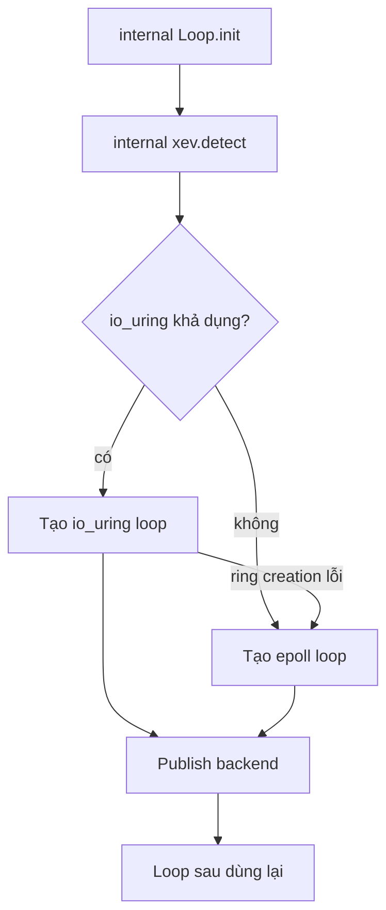

Mỗi worker chạy một libxev event loop. Backend bên dưới loop là thuộc tính của cả
process: io_uring khi có sẵn, epoll, kqueue hoặc IOCP ở nơi khác. Application
không chọn backend và public API không có getter cho nó. Trang này giải thích quy
tắc selection và hệ quả.

## Bản đồ backend

| Target       | Backend             | Selection             |
| ------------ | ------------------- | --------------------- |
| Linux        | io_uring, rồi epoll | Runtime, chỉ loop đầu |
| macOS và BSD | kqueue              | Static theo target    |
| Windows      | IOCP                | Static theo target    |

Loop được tạo với 4.096 completion entry và chạy `.until_done`, nên nó chỉ thoát
sau khi mọi I/O, timer và cancellation completion đã được xử lý. Mọi completion là
inline field của connection, server, transport hoặc engine sở hữu nó. Không
completion nào được heap-allocate và không completion nào sống lâu hơn storage mà
nó mượn.

## Selection là process-global

Linux build probe backend khi loop đầu tiên được tạo.

Backend đã chọn nằm trong một process-global value. Loop sau dùng lại selection đó
thay vì probe lại. Nếu caller cố ép backend khác sau khi selection xong, internal
loop wrapper fail với `error.BackendChanged` thay vì trộn io_uring và epoll loop
trong cùng process. Vì vậy fallback io_uring sang epoll chỉ còn khả dụng trong lúc
loop đầu tiên đang được tạo.

## Quy tắc retry io_uring

Backend io_uring đã thiết lập retry tạo loop tối đa 32 lần, mỗi lần cách 1 ms.
Retry dành cho `error.SystemResources` tạm thời mà kernel báo trong lúc uncharge
một ring đã đóng. Mọi error khác, mọi backend khác hoặc khi hết attempt bound đều
trả error gốc. Không có việc đổi backend sau khi process selection đã thiết lập.

## Blocking file work

io_uring chạy blocking file operation trong ring. epoll, kqueue và IOCP dùng một
thread pool riêng. Loop tạo pool cùng loop và teardown trước khi giải phóng loop
storage, vì worker vẫn có thể deliver completion vào loop.

Đây là lý do blocking file work được schedule khác nhau theo backend mà không đổi
application contract: completion vẫn về worker loop, nhưng blocking work chạy
ngoài loop đó.

## Windows IOCP

IOCP vốn multiplex completion qua nhiều thread và không có `SO_REUSEPORT`.
Cluster trên Windows bind địa chỉ dùng chung bằng `SO_REUSEADDR`, và phân phối của
kernel qua các listener là không xác định. Cluster Windows là fallback an toàn,
không phải đường load-balancing. Mỗi connection được accept vẫn nằm trọn trong
slab của worker đã accept nó.

Affinity trên Windows dùng `SetThreadAffinityMask`. Native Windows coverage compile
test và C ABI graph rồi chạy `zig build test` trên Windows runner; official support
theo sau một runtime job xanh cho release commit, và không có binary Windows nào
được publish.

## Application kiểm soát được gì

`ServerConfig` không có field backend. Field `transport` là chế độ request AF_XDP
được mô tả ở [kTLS và AF_XDP](/docs/architecture/ktls-and-xdp), không phải
event-loop backend. Application chọn capacity, worker count, TLS và địa chỉ
listener. Loop backend đi theo host.

Module `xev` vẫn là internal: package không export backend type, selector hay loop
handle. Muốn thêm backend introspection vào public API phải có ADR trước. Deployment
cần một backend cụ thể phải kiểm soát kernel, seccomp policy và target triple của
host, rồi tự xác minh backend qua observability của mình thay vì qua framework
getter.

## Liên quan

- [Transport](/docs/architecture/transports) map I/O chạy trên loop.
- [Event loop và completion](/docs/architecture/event-loop) theo một completion từ
  lúc đăng ký đến lúc release.
- [Cluster internals](/docs/architecture/cluster-internals) cho thấy một loop cho
  mỗi worker và lifecycle quanh nó.
