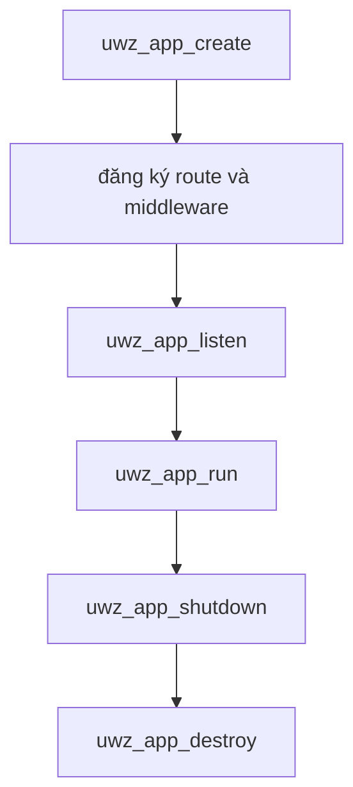

C ABI là server surface riêng với capacity cố định. Nó cung cấp một opaque
application handle, byte view dạng mượn và completion token có thể copy, đồng thời
cố ý không project compile-time configuration của Zig. Trang này giải thích kiến
trúc phía sau header. Tham chiếu từng field nằm ở
[C ABI types and enums](/docs/type-safety/c-abi-types).

## Một application opaque

| Handle               | Ý nghĩa                                        |
| -------------------- | ---------------------------------------------- |
| `uwz_app`            | Application, listener, event loop và C storage |
| `uwz_request`        | Request view trong callback                    |
| `uwz_response`       | Response writer cho request hiện tại           |
| `uwz_websocket`      | Một connection WebSocket đã upgrade            |
| `uwz_async_response` | Completion token copyable, dùng một lần        |

Coi mọi handle là opaque. Layout, size và field bên trong không thuộc ABI.
Application sở hữu router, route table cố định và native `App` phía sau handle.

## Chuỗi ownership

`uwz_app_create` yêu cầu `*out_app` là `NULL` và từ chối giá trị non-`NULL`, nên
live handle không bao giờ bị ghi đè. Các biến thể TLS và HTTP/3 giữ cùng quy tắc.
Biến thể ephemeral tạo certificate self-signed trong bộ nhớ cho development.

`uwz_app_shutdown` dừng listener, drain completion và invalidate mọi async token
đang mở. Gọi nó từ callback sẽ request shutdown mà không re-enter event loop; lần
gọi `uwz_app_run` đang active sẽ drain trước khi trả về.

`uwz_app_destroy` shutdown, release application và ghi `NULL` qua handle của
caller. Gọi nó từ callback trả `UWZ_ERROR_INVALID_STATE` và giữ handle hợp lệ, nên
caller destroy sau khi `uwz_app_run` trả về. Destroy application đang chạy cũng bị
từ chối vì lý do tương tự.

## Mapping error

`uwz_error` là kiểu trả về duy nhất cho entry point có thể fail. `UWZ_OK` bằng
zero, và mọi failure là một mã âm ổn định từ `UWZ_ERROR_INVALID_ARGUMENT` đến
`UWZ_ERROR_INTERNAL`. `uwz_error_name` trả tên có thể in cho một mã. Các giá trị âm thuộc ABI.

## Capacity cố định

| Macro                       | Giá trị | Ý nghĩa                         |
| --------------------------- | ------: | ------------------------------- |
| `UWZ_MAX_ROUTES`            |    `64` | Route path được copy            |
| `UWZ_MAX_MIDDLEWARE`        |    `32` | Middleware callback theo thứ tự |
| `UWZ_MAX_ROUTE_PARAMETERS`  |    `16` | Inline route capture            |
| `UWZ_MAX_ROUTE_PATH_LENGTH` |  `2048` | Một route path                  |

C application được tạo với 1.024 connection. Header không có entry point để đổi
capacity đó, và capacity compile-time của `ServerConfig` không có projection sang
C. Dùng Zig API khi deployment cần slab khác hoặc route table lớn hơn.

Route string được copy vào C storage cố định lúc đăng ký. Registration fail với
`UWZ_ERROR_CAPACITY` sau 64 route hoặc 32 middleware entry thay vì tăng kích thước.

## Borrowed slice

`uwz_slice` là một pointer và một length. Slice độ dài zero có thể dùng data
`NULL`. Mọi slice không rỗng truyền vào API chỉ được mượn trong call đó, trừ khi
registration function copy tường minh.

| Value             | Lifetime                                       |
| ----------------- | ---------------------------------------------- |
| `uwz_slice`       | Trong call, trừ khi registration function copy |
| Route path        | Copy lúc đăng ký                               |
| `user_data`       | Caller sở hữu; giữ sống đến khi callback drain |
| Request view      | Đến khi callback trả về                        |
| WebSocket message | Callback nhận nó                               |

Request field hoặc route parameter cần dùng sau khi callback trả về phải được copy
vào storage của caller. Quy tắc tương tự áp dụng cho WebSocket message slice.

## Async token

`uwz_async_response` gồm hai field: private state pointer và generation. Pointer
truyền vào async callback là callback-local. Callback trả `UWZ_HANDLER_PENDING`
phải copy toàn bộ struct vào storage của caller.

Bản copy còn dùng được trên owning event loop đến khi complete hoặc application
shutdown. Không được dùng nó sau `uwz_app_destroy`. Completion kiểm tra generation,
nên token cũ hoặc trùng trả `UWZ_ERROR_INVALID_STATE` thay vì complete một slot đã
được dùng lại. Completion xảy ra đúng một lần trên owning loop; công việc
cross-thread phải marshal về loop đó trước.

## C ABI không cung cấp gì

| Zig surface                                   | C ABI status   |
| --------------------------------------------- | -------------- |
| `ServerConfig` và compile-time capacity       | Không cung cấp |
| `uz.schema`, `uz.json_rpc`, `uz.client`       | Không cung cấp |
| HTTP/2, HPACK, HTTP/3 extension, WebTransport | Không cung cấp |
| mTLS                                          | Không cung cấp |
| Async HTTP route, WebSocket compression       | Có cung cấp    |

C ABI là high-level server binding, không phải bản dịch one-to-one của mọi module
Zig. C application cần một trong các surface còn thiếu phải link Zig API thay vào
đó.

## Liên quan

- [C ABI types and enums](/docs/type-safety/c-abi-types) liệt kê mọi handle, enum,
  macro và function group.
- [Ownership và lifetime](/docs/concepts/ownership-and-lifetimes) giải thích
  borrowed-view model dùng chung với Zig API.
- [Dependency policy](/docs/architecture/dependencies) nói về static archive mà C
  consumer link.
