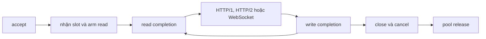

Trang này ánh xạ mỗi entry point bất đồng bộ native tới handler mà nó gọi. Các
tên dưới đây là symbol runtime internal, trừ những kiểu request, response, async,
timer và cluster public. Số dòng được cố ý bỏ qua vì chúng thay đổi; bản đồ
[callback lifecycle upstream](https://github.com/farbenbuilds/uWebZockets/blob/main/docs/callback_lifecycle.md)
theo dõi cây source hiện tại.

## Quy ước completion

Native callback của libxev trả kiểu `xev.CallbackAction` internal. Callback đăng
ký qua giao diện C hoặc được handler gọi trực tiếp giữ chữ ký riêng của chúng.

| Thuật ngữ          | Ý nghĩa                                                                    |
| ------------------ | -------------------------------------------------------------------------- |
| `.rearm`           | Giữ operation đã đăng ký cho event tiếp theo                               |
| `.disarm`          | Ngừng re-arm; handler chịu trách nhiệm cancel sau đó                       |
| `core_loop.cancel` | Cancel internal nhận biết backend, tổng hợp completion trên kqueue và IOCP |

Mọi lần cancel đều đi qua shim internal thay vì gọi backend trực tiếp.

## Bản đồ từ đăng ký đến handler

| Giai đoạn         | Entry point internal                               | Đăng ký bởi            | Được điều khiển bởi               |
| ----------------- | -------------------------------------------------- | ---------------------- | --------------------------------- |
| Accept listener   | `on_accept_complete`                               | `accept_start`         | Accept hoàn tất; trả `.rearm`     |
| Connection mới    | `on_new_connection`                                | Accept callback        | Nhận slot và arm read đầu tiên    |
| Read              | `on_read_complete`                                 | `arm_read`             | Socket đọc được                   |
| TLS handshake     | `process_tls_data`                                 | Read callback          | Byte TLS trên connection          |
| HTTP/1 dispatch   | `route_http_data`                                  | Dữ liệu đã giải mã     | Parse, middleware và handler      |
| HTTP/2 dispatch   | `route_http2_data`                                 | Dữ liệu đã giải mã     | `h2.receive` trong read callback  |
| Dữ liệu WebSocket | `WebSocket.on_data`                                | Dữ liệu đã giải mã     | Một frame hoặc message hoàn chỉnh |
| Write             | `on_write_complete`                                | `start_write`          | Socket ghi được                   |
| File body         | `pump_file_body`                                   | Write callback         | Mỗi write completion              |
| Close             | `close_connection`                                 | Handler hoặc shutdown  | Teardown idempotent               |
| Read cancel       | `on_read_cancel_complete`                          | `close_connection`     | Completion cancel                 |
| Write cancel      | `on_write_cancel_complete`                         | `close_connection`     | Completion cancel                 |
| Listener close    | `on_server_close_complete`                         | `close_server`         | Completion đóng listener          |
| Pool release      | `release_closed_connection`                        | Đường close và cancel  | Cả bốn cờ release đã sạch         |
| Timer tick        | `on_tick`                                          | Timer scheduler        | Tick 5 ms có giới hạn             |
| Idle expiry       | `on_idle_timeout`                                  | Timer wheel            | Deadline idle của connection      |
| Async HTTP/1      | `complete_async_response` và `wake_async_dispatch` | `invoke_handler`       | `AsyncResponse.complete`          |
| Async HTTP/2      | `complete_http2_async_response`                    | `arm_http2_async`      | `AsyncResponse.complete`          |
| Cluster wakeup    | `on_cluster_wakeup`                                | `arm_cluster_wakeup`   | Thông báo `xev.Async`             |
| UDP receive       | `on_read`                                          | `quic_transport.start` | Socket UDP đọc được               |
| UDP engine timer  | `on_timer`                                         | `start_timer`          | Timeout sớm nhất của lsquic       |

## Thứ tự cho một connection

1. Accept callback của listener nhận socket và trả `.rearm`.
2. `on_new_connection` nhận một pool slot, reset protocol state, gắn TLS khi được
   cấu hình và arm read đầu tiên.
3. Read callback giải mã TLS hoặc route byte plaintext. Nó trả `.rearm` trừ khi
   dispatch bị tạm dừng hoặc connection đang đóng.
4. HTTP/1 parse và dispatch đồng bộ. HTTP/2 chạy `h2.receive` trong read
   callback. Dữ liệu WebSocket đi vào frame state machine.
5. Một write completion tiến write ring có giới hạn, flush output TLS hoặc
   HTTP/2, đánh thức waiter của WebSocket drain, pump file body và bắt đầu write
   kế tiếp.
6. Một response hoàn tất để connection sẵn sàng cho request kế tiếp, trừ khi
   response yêu cầu đóng.
7. Đóng connection sẽ cancel read và write, gửi close socket và chờ close cùng
   các completion cancel.
8. `release_closed_connection` chỉ trả slot về pool sau khi release gate sạch.

## Release gate

`release_closed_connection` là đường duy nhất trở về freelist. Nó chạy khi
completion đóng socket, read cancellation, write cancellation và cờ active đều
đã sạch. Tới lúc đó slot vẫn nằm ngoài pool, nên một completion cũ không thể nhìn
thấy storage mà connection mới đã tái sử dụng.

Client áp dụng cùng quy tắc cho request slot của nó: slot chỉ trở về sau khi mọi
cancellation và việc đóng socket đã drain.

## Generation của async token

`AsyncResponse` là token copy được và được kiểm tra generation.
`complete_with_headers` kiểm tra generation, gọi completion function rồi gọi wake
function. Một token cũ sẽ trượt kiểm tra generation thay vì hoàn tất một slot đã
được tái sử dụng.

| Sự kiện      | Hành động trên slot                                   |
| ------------ | ----------------------------------------------------- |
| HTTP/1 close | Cancel async slot của HTTP/1                          |
| HTTP/2 close | Cancel mọi slot của HTTP/2 stream                     |
| HTTP/2 reset | Reset các slot của stream                             |
| Pool acquire | Cancel slot HTTP/1 trước khi request mới dùng storage |

Hoàn tất từ thread khác phải được marshal về event loop sở hữu trước. Token chỉ
dùng được trên event loop dù giá trị của nó có thể copy.

## Timer

`src/core/timer_wheel.zig` sở hữu các `TimerNode` intrusive nằm trong connection
slab. Schedule, cancel và expire không bao giờ cấp phát. Bốn level bao phủ
deadline từ mịn đến nhiều giờ, và deadline dài hơn chờ trong overflow list tới khi
nằm trong phạm vi.

`src/core/timer.zig` sở hữu một libxev timer thường trú cho mỗi worker loop. Nó
thức dậy theo tick 5 ms có giới hạn khi còn deadline, tiến wheel và cascade node.
Một tick disarm timer đã hoàn tất và arm một tick tương đối mới; nó không trả
`.rearm`. `stop` không cancel, nên shutdown chờ tối đa một tick. Deadline
keep-alive, incomplete-header và deferred response dùng chung timer này.

## Callback QUIC

Transport UDP arm một receive completion và một engine timer. Callback giao diện
lsquic được đăng ký một lần bởi engine và được gọi đồng bộ từ `process_datagram`
và `process`, không bao giờ từ một completion. Vì vậy các hook stream, header và
packet chạy trên cùng loop thread với lần đọc UDP.

Đường transmit gọi một lần send không block đồng bộ và không xếp completion nào.
Đóng socket UDP sẽ cancel receive và đóng socket; Windows đóng đồng bộ.

## Liên quan

- [Event loop và completion](/docs/architecture/event-loop) đi sâu vào loop và
  release gate.
- [Async response](/docs/concepts/async-responses) trình bày quy trình token
  public.
- [Thứ tự shutdown](/docs/architecture/shutdown) giải thích cách mọi completion
  được drain.
