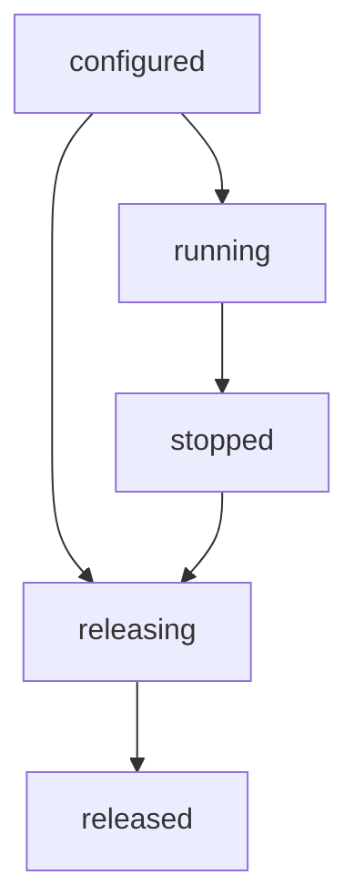

Cluster API cố ý nhỏ: `configure`, TLS setup, `listen`, `run`, `publish` và
shutdown. Bên dưới, worker group sở hữu lifecycle transition, failure capture và
release claim, trong khi mỗi worker sở hữu slab, loop và inbox riêng. Trang này
map các internal đó. Public contract vẫn nằm ở
[Cluster model](/docs/concepts/cluster-model).

## Ranh giới worker group

| Thành phần                      | Layer                                     |
| ------------------------------- | ----------------------------------------- |
| `Cluster` method                | Public API export qua `uz`                |
| Worker slab, loop, TLS context  | Theo từng worker, cluster sở hữu          |
| `src/router/worker_group.zig`   | Internal lifecycle và thread coordination |
| `ClusterState`, `WorkerFailure` | Public type export qua `uz`               |
| `begin_release`                 | Internal release claim trên worker group  |

Group mượn thread slice của cluster và không allocate. Nó không sở hữu slab,
inbox, TLS state hay loop. Zig không có private field, nên `Cluster.group` vẫn
truy cập được, nhưng truy cập trực tiếp không được hỗ trợ và có thể phá vỡ
lifecycle invariant. Hãy dùng method của cluster.

## State machine vòng đời

`ClusterState` là atomic value, vì supervisor có thể đọc nó trong lúc `run` đang
active.

| State        | Ý nghĩa                                           |
| ------------ | ------------------------------------------------- |
| `configured` | Worker đã được cấp phát; chưa thread nào chạy     |
| `running`    | Worker thread đang chạy hoặc drain                |
| `stopped`    | `run` đã trả sau khi mọi worker join              |
| `releasing`  | Một `deinit` owner đang giải phóng worker storage |
| `released`   | Worker và thread storage đã được giải phóng       |

`run` claim transition configured sang running bằng compare-and-swap, nên `run`
đồng thời thứ hai trả `error.ClusterRunning`. Configuration call fail theo state:
`ClusterRunning` trong lúc run, `ClusterStopped` sau khi run, và
`ClusterDeinitialized` sau release. Group đã drain không thể restart; hãy build
group mới.

## Cách resolve worker count

`ClusterOptions.worker_count` chọn ít active worker hơn compiled capacity. Giá trị
null giữ số lượng lúc compile. Zero hoặc lớn hơn capacity fail với
`error.InvalidWorkerCount` trước khi bất kỳ worker slab nào được cấp phát.

`build_cluster_from_environment` resolve theo thứ tự:

1. `ClusterOptions.worker_count`.
2. `UWEBZOCKETS_WORKERS`.
3. CPU count của nền tảng, giới hạn bởi compiled capacity.

Chỉ active worker mới cấp slab, inbox và thread handle. `worker_count()` trả active
count, `worker_capacity()` trả compiled ceiling, và `worker(index)` trả null ngoài
active set.

## Lỗi đầu tiên được giữ

| Field   | Ý nghĩa                       |
| ------- | ----------------------------- |
| `index` | Worker index, bắt đầu từ zero |
| `phase` | `spawn`, `run` hoặc `cleanup` |
| `err`   | Error gốc từ phase đó         |

Worker failure ghi chi tiết trước khi request shutdown, nên shutdown cascade sau
đó không thể ghi đè root cause. Failure trong event loop hoặc cleanup làm `run` trả
`error.ClusterWorkerFailed`; failure lúc spawn trả OS error gốc. Trong cả hai
trường hợp, `first_failure()` trả record và `failure_count()` báo tổng số failure
ghi từ lúc run bắt đầu. Failure lock chỉ nằm trên cold path; request path
steady-state vẫn lock-free.

## Inbox ring có giới hạn

Mỗi worker sở hữu một inbox. `uz.cluster.message_queue` là Vyukov sequence ring
internal với 64 slot, storage structure-of-arrays, và enqueue/dequeue cursor nằm
trên cache line riêng. Mọi worker có thể publish; chỉ worker sở hữu mới consume
trên loop của nó.

- Inbox đầy trả `error.ClusterQueueFull` thay vì block.
- Validation chạy một lần trước khi bất kỳ inbox nào bị sửa, nên `EmptyTopic`,
  `TopicTooLong` và `ClusterMessageTooLarge` không thể deliver một phần.
- Topic bound là 127 byte; payload bound là `max_ws_message_size` mà application
  đã cấu hình.
- Enqueue copy cả topic lẫn payload vào ring, nên sender có thể dùng lại buffer
  ngay.

`pop_scratch` là method internal, copy message cũ nhất vào scratch do queue sở
hữu. Slice trả về còn hợp lệ đến lần gọi `pop_scratch` tiếp theo, nhờ đó cluster
publish không ghi đè buffer lắp ghép WebSocket frame đang dở của connection.
`pop_copy` ghi vào buffer của caller thay vào đó.

## Publish report

`publish_report` trả `PublishReport` sau khi offer một message cho mọi active
inbox.

| Field                  | Ý nghĩa                                 |
| ---------------------- | --------------------------------------- |
| `queued`               | Inbox đã accept message                 |
| `dropped`              | Inbox đã đầy                            |
| `notify_failed`        | Message đã accept nhưng loop wakeup lỗi |
| `first_dropped_worker` | Inbox đầy đầu tiên, nếu có              |

`attempted()` trả `queued + dropped`. `all_delivered()` chỉ true khi cả `dropped`
và `notify_failed` đều bằng zero. Nó mô tả delivery ở mức queue và wakeup, không
phải application subscriber delivery: worker vẫn có thể drop message sau dispatch.
`publish` giữ dạng `!usize` và trả `report.queued`; sau `run` nó trả
`error.ClusterStopped`.

## Release claim

`deinit_checked` gọi `begin_release` internal, hàm này compare-and-swap
`configured` hoặc `stopped` sang `releasing`. Group đang running trả
`error.ClusterRunning`. Caller thứ hai thấy `releasing` hoặc `released`, chờ owner
thắng rồi trả về mà không chạm worker storage.

Release owner chờ các supervisor call đã bắt đầu trước claim hoàn tất, đưa mọi
worker loop về trạng thái drained, free thread, inbox và worker array qua allocator
ban đầu, rồi publish `released`. `deinit` giữ signature panic và đi qua cùng đường
đó.

## Liên quan

- [Cluster model](/docs/concepts/cluster-model) trình bày startup order và publish
  contract được hỗ trợ.
- [Shared-nothing workers](/docs/concepts/shared-nothing) giải thích vì sao
  không connection state nào đi qua ranh giới worker.
- [Transport](/docs/architecture/transports) map socket và completion bên trong
  mỗi worker.
