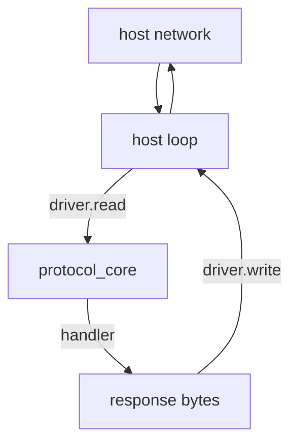

WASM build không chạy socket loop. Chúng compile một protocol core trung lập nền
tảng và export một host bridge nhỏ: linear memory, allocation có giới hạn, handle
có generation check và driver để host gọi cho read/write. Host sở hữu network và
clock.

## Edge build chứa gì

`src/edge/root.zig` re-export các module trung lập nền tảng: `abort`, `streams`,
`transport`, WebSocket backpressure, WebSocket stream, shared memory, SIMD và
JSON-RPC. Nó không gồm TCP, TLS, QUIC hay libxev loop module native. Không có
socket để tạo và không có completion để arm.

## Protocol core

`uz.transport.protocol_core(capacity)` là HTTP/1.1 parser có giới hạn, dùng chung
với native path. Nó sở hữu request buffer cố định, parser state và một
`uz.Request`. `ingest` copy byte đã mượn, dispatch mọi request hoàn chỉnh và trả
số lượng. Nó báo `InputBufferFull`, `InvalidRequest`, `HeadersTooLarge` hoặc
`BodyTooLarge`; không bao giờ allocate.

`uz.transport.driver(Adapter)` là host seam. Adapter cung cấp `read`, `write`,
`set_read_enabled` và `close`; driver chuyển tiếp. Host loop gọi `driver.read` và
`driver.write` trực tiếp, nên các build này không đăng ký libxev completion nào.

## Bề mặt export

Cả hai WASM artifact được build từ cùng root và export bridge có giới hạn.
Artifact freestanding export thêm linear memory cho V8 isolate host.

| Export           | Contract                                                                       |
| ---------------- | ------------------------------------------------------------------------------ |
| `alloc`          | Lease một block 64 KiB và trả pointer, hoặc zero                               |
| `free`           | Validate pointer và length, rồi release block đó                               |
| `shared_acquire` | Trả handle có generation check, hoặc zero                                      |
| `shared_pointer` | Trả base pointer cho handle còn sống, hoặc zero                                |
| `shared_commit`  | Ghi length đã commit trong giới hạn block và trả handle đã cập nhật, hoặc zero |
| `shared_release` | Trả `0` khi release hợp lệ, `-1` cho handle cũ hoặc không hợp lệ               |

Bridge là region cố định 64 block, mỗi block 64 KiB. `alloc` fail thay vì tăng
kích thước khi region đầy. `free` bỏ qua pointer không hợp lệ, còn
`shared_release` báo lỗi cho host. Handle mang generation, nên block đã release
không thể truy cập qua token cũ.

## Trách nhiệm của host

| Trách nhiệm          | Owner                                                |
| -------------------- | ---------------------------------------------------- |
| Socket và TLS        | Host; edge build không có network stack              |
| Thời điểm read/write | Host loop                                            |
| Memory lifetime      | Host giữ exported memory ổn định khi view còn sống   |
| Release handle       | Host release đúng một lần sau khi view không còn cần |
| Timer                | Host                                                 |
| Request parsing      | `protocol_core`                                      |
| Response byte        | Application handler qua driver                       |

Host phải giữ mỗi handle trong lúc view shared memory còn sống và release đúng một
lần. Release trùng hoặc quá cũ sẽ fail thay vì free block mà một allocation sau có
thể sở hữu.

## Build target

| Target                | Output                          | Ghi chú                           |
| --------------------- | ------------------------------- | --------------------------------- |
| `wasm32-freestanding` | `uWebZockets-freestanding.wasm` | Export memory cho V8 isolate host |
| `wasm32-wasi`         | `uWebZockets-wasi.wasm`         | Compile single-threaded           |

Cả hai target tắt executable entry point và export bridge. Target freestanding
thêm atomics và bulk-memory feature; target WASI dùng feature set WASI mặc định.

## Giới hạn

- Edge path xử lý byte request HTTP/1.1. HTTP/2 và HTTP/3 framing nằm trên native
  transport.
- Request lớn hơn capacity của `protocol_core` fail với `InputBufferFull`; chọn
  capacity theo request line và header bạn chấp nhận.
- Payload shared memory bị giới hạn bởi block size và envelope word bound truyền
  vào `read_capnp_message`.
- Bridge validate handle và envelope length. Nó không xác thực peer và không
  validate ngữ nghĩa payload của application.

## Liên quan

- [Transport](/docs/architecture/transports) map native path mà build này bỏ qua.
- [Dependency policy](/docs/architecture/dependencies) giải thích WASM build lấy
  các package pin như thế nào.
- [Shared-nothing workers](/docs/concepts/shared-nothing) đối chiếu worker
  model native với host-driven loop.
