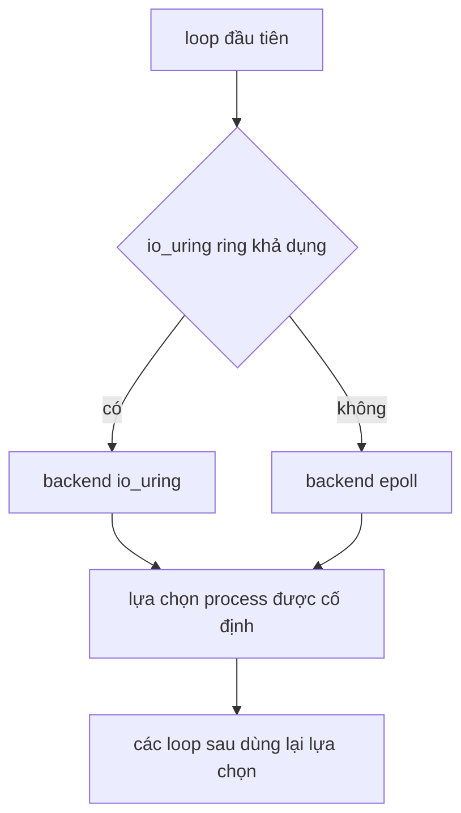

Một libxev loop điều khiển một worker. Nó sở hữu mọi completion mà worker gửi,
chọn một backend cho toàn process và chỉ trả connection slot về pool sau khi mọi
completion của slot đó đã drain. Trang này giải thích các quy tắc đó cùng cơ chế
retry và fallback phía sau.

## Một loop mỗi worker

`src/core/loop.zig` là wrapper internal quanh một libxev loop. Nó cấp phát 4096
completion entry và chạy loop ở chế độ `.until_done`, nên `run` chỉ trả về khi
mọi completion đang hoạt động đã được xử lý, cancel hoặc disarm.

| Thuộc tính         | Giá trị                                                   |
| ------------------ | --------------------------------------------------------- |
| Completion entry   | 4096                                                      |
| Chế độ chạy        | `.until_done`                                             |
| Nơi đọc backend    | Chỉ loop wrapper                                          |
| Blocking file work | Offload sang thread pool riêng trên epoll, kqueue và IOCP |
| Vòng đời loop      | Một loop mỗi worker, tạo trước khi listener accept        |

Loop tạo thread pool quanh event loop và tear down trước khi giải phóng storage
của loop, vì một worker thread có thể vẫn giao completion. Trên io_uring, file
operation nằm trong ring và không cần thread pool.

## Chọn backend dính theo process

Trên Linux, loop đầu tiên probe io_uring và hạ xuống epoll khi kernel hoặc
security policy của container từ chối ring. Fallback này giữ server dùng được
trong Docker Desktop và OrbStack mà không cần thêm quyền. Target khác giữ API
single-backend tĩnh của libxev.

Chọn động là phạm vi toàn process. Loop đầu tiên chọn backend đúng một lần và
các loop sau dùng lại lựa chọn đó. Một lần đổi backend sẽ thất bại với
`error.BackendChanged` internal thay vì trộn loop epoll và io_uring, nên fallback
từ io_uring sang epoll chỉ có trên loop đầu tiên.

Một loop io_uring đã thiết lập sẽ retry tạo loop tối đa 32 lần, cách nhau 1 ms,
trong lúc kernel uncharge một ring đã đóng và báo `error.SystemResources`. Mọi
error khác, backend khác hoặc số lần thử đã hết sẽ trả nguyên error ban đầu thay
vì đổi backend.

Package không export kiểu backend, selector hay loop handle. `xev` là internal,
và `ServerConfig.transport` chọn chính sách transport như kernel bypass, không
phải backend của libxev. Thêm introspection backend vào public API cần một quyết
định kiến trúc trước.

## Completion thuộc sở hữu inline

Mọi completion là thành viên inline của connection, server, transport hoặc engine
sở hữu nó. Không completion nào nằm trên heap và không completion nào sống lâu
hơn storage mà nó mượn. Native callback trả `xev.CallbackAction`:

| Hành động | Tác dụng                                             |
| --------- | ---------------------------------------------------- |
| `.rearm`  | Giữ operation đã đăng ký cho event tiếp theo         |
| `.disarm` | Ngừng re-arm; handler chịu trách nhiệm cancel sau đó |

Việc cancel đi qua shim `core_loop.cancel` internal. Shim tổng hợp completion
trên kqueue và IOCP thay vì gọi backend trực tiếp, nhờ đó cancel đúng trên mọi
backend.

## Release gate

Một pool slot đã đóng chỉ trở về freelist qua đường `release_closed_connection`
internal. Đường này chờ bốn điều kiện:

1. Completion đóng socket đã chạy.
2. Mọi read cancellation đã hoàn tất.
3. Mọi write cancellation đã hoàn tất.
4. Connection không còn được đánh dấu active.

Chỉ khi đó slot mới trở về pool. Gate này ngăn một completion cũ nhìn thấy
connection đã được tái sử dụng. Client cũng áp dụng quy tắc này cho các request
slot của nó.

## Nhịp timer

`src/core/timer_wheel.zig` là deadline engine của mỗi worker. Nó dùng bốn level
với node intrusive nằm trong connection của pool, nên schedule, cancel và expire
một deadline không cấp phát.

| Level | Slot | Độ phân giải | Phạm vi  |
| ----- | ---: | ------------ | -------- |
| 0     |  256 | 1 ms         | 256 ms   |
| 1     |   64 | 256 ms       | 16.4 s   |
| 2     |   64 | 16.4 s       | 17.5 min |
| 3     |   64 | 17.5 min     | 18.64 h  |

`src/core/timer.zig` điều khiển wheel bằng một libxev timer thường trú. Timer
thức dậy theo nhịp 5 ms có giới hạn khi còn deadline. Mỗi tick disarm timer đã
hoàn tất và arm một tick tương đối mới với cùng completion inline; nó không trả
`.rearm`, vì reset hoặc tái dùng một timer completion đã hết hạn sẽ đua với
callback đang xếp hàng trên IOCP. Shutdown dừng scheduler mà không cancel: tick
cuối thấy cờ stop rồi disarm.

Deadline keep-alive, incomplete-header và deferred response dùng chung timer này.
Không có pool sweep định kỳ và không có file-body timer; mỗi write completion là
nhịp cho một file đang stream.

## Liên quan

- [Worker shared-nothing](/docs/architecture/shared-nothing) giải thích vì sao
  mỗi worker sở hữu một loop.
- [Callback lifecycle](/docs/architecture/callback-lifecycle) liệt kê handler
  đăng ký với các completion này.
- [Thứ tự shutdown](/docs/architecture/shutdown) cho thấy loop drain trước khi
  storage được giải phóng.
