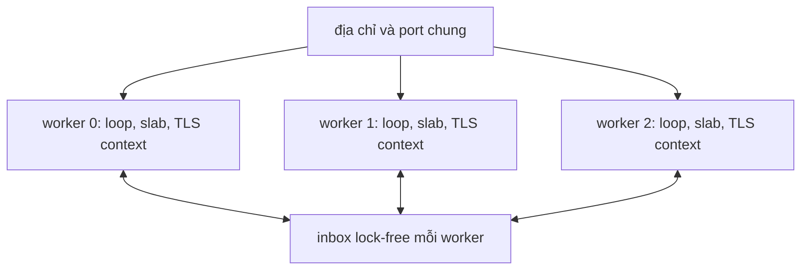

Cluster là tập các worker không chia sẻ gì ngoài port lắng nghe. Mỗi worker sở
hữu một event loop, một slab và TLS context riêng, nên một connection không bao
giờ bị hai thread cùng chạm tới. Trang này giải thích cách tách đó, inbox vượt
ranh giới và khác biệt giữa capacity compile với số worker đang hoạt động.

## Mỗi worker sở hữu gì

| Tài nguyên   | Quyền sở hữu                                                       |
| ------------ | ------------------------------------------------------------------ |
| Event loop   | Một libxev loop trên một OS thread, pin khi platform cho phép      |
| Startup slab | Pool, request buffer, message region, write queue, bảng protocol   |
| TLS context  | Một `SSL_CTX` BoringSSL mỗi worker, tạo trước khi listen           |
| Listener     | Cùng địa chỉ và port với mọi worker khác                           |
| Inbox        | Một ring lock-free có giới hạn cho message do worker khác publish  |
| Timer wheel  | Một deadline engine mỗi worker cho keep-alive và response trì hoãn |

Không tài nguyên nào được reference count hay chia sẻ. Connection được accept rơi
trọn vào slab của worker accept nó và chỉ event loop của worker đó chạm tới.

Mỗi worker sở hữu loop, slab và TLS context của chính nó. Kernel phân phối
connection được accept cho các listener, và mỗi worker chỉ drain inbox của chính
nó. Một publish đưa message tới mọi inbox; nó không bao giờ ghi vào storage của
connection.

## Một port, không chia sẻ connection

Mọi worker bind cùng địa chỉ và port. Trên Linux và các platform có
`SO_REUSEPORT`, kernel cân bằng tải connection đến giữa các listener. Vì worker
accept sở hữu connection suốt vòng đời của nó, trạng thái read, write, parse và
timer không bao giờ vượt ranh giới thread. Đó là lý do hot path I/O ở trạng thái
ổn định không có mutex hay spinlock.

Windows không có `SO_REUSEPORT`. Ở cluster mode, mọi worker bind địa chỉ chung
bằng `SO_REUSEADDR`. Connection được accept vẫn rơi trọn vào slab của worker
accept nó, nên routing vẫn an toàn, nhưng việc kernel phân phối giữa các listener
không được bảo đảm. Cluster trên Windows là đường dự phòng, không phải đường cân
bằng tải.

## Affinity là best effort

Pin theo physical core. Trên Linux, runtime đọc tập CPU được phép và bỏ qua các
SMT sibling, rồi pin worker `i` bằng `sched_setaffinity`. Windows dùng
`SetThreadAffinityMask`. Platform khác báo `error.UnsupportedPlatform` và tiếp
tục không pin; macOS không có API hard-affinity.

Cpuset bị hạn chế hoặc syscall bị lỗi sẽ log một lần và để worker không pin thay
vì từ chối khởi động. Worker vượt quá số physical core sẽ quay vòng lựa chọn, nên
affinity không trở thành lỗi startup trên máy oversubscribe.

## Inbox là đường duy nhất giữa các worker

Publish giữa worker dùng một ring Vyukov sequence có giới hạn cho mỗi inbox
(`src/router/cluster.zig`). Mọi worker thread đều có thể publish; chỉ worker sở
hữu mới consume trên event loop của nó. Vị trí enqueue và dequeue nằm trên cache
line riêng để tránh false sharing, và ring không cấp phát.

Inbox đầy không block và không mở rộng. Queue helper internal báo
`error.ClusterQueueFull`, và `Cluster.publish_report` cho biết số message được
accept và bị drop thay vì gộp một inbox đầy vào một con số tổng. Publisher
validate message trước khi bất kỳ inbox nào bị sửa, nên topic sai hoặc payload
quá lớn không thể giao một phần.

Owning loop copy từng message qua scratch thuộc queue. Vì vậy publish không thể
ghi đè buffer lắp ghép WebSocket đang phân mảnh của một connection, kể cả khi hai
bên chạy trên worker khác nhau.

## Capacity không phải số worker đang hoạt động

`App.cluster(N)` và `Server.builder(...).build_cluster(allocator, N, options)`
compile capacity `N` worker. Runtime có thể dùng ít hơn. `ClusterOptions` là
public và `ClusterOptions.worker_count` chọn số worker hoạt động tường minh;
`build_cluster_from_environment` ưu tiên option đó, rồi tới
`UWEBZOCKETS_WORKERS`, rồi tới số CPU của platform.

Chỉ worker đang hoạt động mới cấp phát slab, inbox và thread handle, nên capacity
compile lớn không giữ chỗ cho worker không bao giờ khởi động. `worker_count()`
báo số đã cấp phát, `worker_capacity()` báo capacity compile, `state()` báo
lifecycle của cluster, và `worker(i)` trả null khi nhóm có ít worker hoạt động
hơn.

## Vì sao không có connection state chia sẻ

Chia sẻ một connection sẽ cần lock cho mọi thao tác read, write, completion và
timeout, đồng thời đặt hai event loop lên cùng một buffer. Mô hình tránh điều đó
bằng cách cho mỗi connection đúng một chủ sở hữu:

| Connection state | Chủ sở hữu                                               |
| ---------------- | -------------------------------------------------------- |
| Slot             | Pool và slab của worker accept                           |
| Completion       | Thành viên inline của connection, không phải object heap |
| Async token      | Chỉ event loop sở hữu                                    |
| Deadline         | Timing wheel của worker sở hữu                           |
| TLS session      | `SSL_CTX` của worker accept                              |

Cái giá là bộ nhớ tăng theo số worker hoạt động chứ không chỉ theo số connection:
mỗi worker mang một slab, một inbox và, khi có TLS, một context. Lợi ích là hot
path không cần phối hợp giữa các thread.

## Liên quan

- [Mô hình cluster](/docs/concepts/cluster-model) bao quát lifecycle, báo cáo
  failure và publish semantics.
- [Slab và memory model](/docs/architecture/memory-model) định cỡ slab và inbox
  của mỗi worker.
- [Callback lifecycle](/docs/architecture/callback-lifecycle) ánh xạ các loop
  callback giữ state trong một worker.
