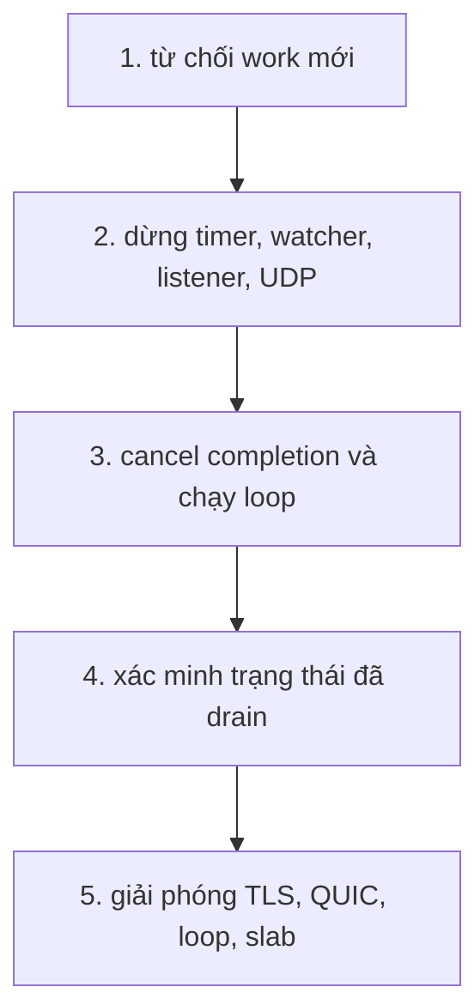

Shutdown đảo ngược ownership graph theo một thứ tự cố định. Nó từ chối work mới,
dừng các nguồn lặp lại, đóng listener, cancel completion, xác minh không còn gì
mượn slab, và chỉ sau đó mới giải phóng storage. Trang này theo dõi thứ tự đó và
các entry point kích hoạt nó.

## Năm bước

| Bước | Hành động                                                                            |
| ---- | ------------------------------------------------------------------------------------ |
| 1    | Từ chối work mới và đánh dấu application không còn khả dụng                          |
| 2    | Dừng timing wheel và signal watcher, đóng listener, shutdown UDP/QUIC                |
| 3    | Cancel mọi completion của connection và chạy loop tới khi mọi completion được disarm |
| 4    | Xác minh drain: pool rỗng, listener close hoàn tất, QUIC transport đã drain          |
| 5    | Giải phóng TLS, QUIC, loop và slab qua allocator ban đầu                             |

`begin_shutdown` (internal) thực hiện hai bước đầu. Nó đặt cờ shutdown, dừng
scheduler mà không cancel timer, dừng signal watcher, đóng từng listener và
shutdown QUIC transport. Sau đó nó bắt đầu bước 3 bằng cách gọi
`close_connection` cho mọi pool slot đang active. `drive_shutdown` (internal)
chạy loop tới khi các cancellation đó hoàn tất rồi xác minh kết quả.

## Entry point

| Lần gọi                    | Thread                      | Hợp đồng                                                                      |
| -------------------------- | --------------------------- | ----------------------------------------------------------------------------- |
| `request_shutdown()`       | Thread bất kỳ hoặc callback | Ghi cờ stop, đánh thức owning loop, trả về ngay                               |
| `shutdown()`               | Loop thread                 | Từ callback thì bắt đầu shutdown rồi trả về; ngoài run thì chạy loop và drain |
| `run()`                    | Owning thread               | Block tới khi shutdown drain; gọi lại trả `error.ApplicationAlreadyRunning`   |
| `deinit()`                 | Owner                       | Idempotent; panic nếu gọi từ trong event loop                                 |
| `catch_shutdown_signals()` | Trước `run`                 | Cài watcher SIGINT và SIGTERM toàn process                                    |

Sau khi shutdown bắt đầu hoặc `deinit` chạy, `run` và các lần gọi listen trả
`error.ApplicationUnavailable`. `shutdown` trả
`error.ApplicationDeinitialized` sau khi release, và `error.ShutdownIncomplete`
khi còn thứ chưa drain.

## Drain xác minh điều gì

`verify_shutdown` (internal) từ chối một lần drain chưa hoàn tất khi một trong các điều sau
vẫn đúng:

- Pool còn slot active.
- Timer scheduler vẫn active.
- Timer wheel watcher chưa drain.
- Signal watcher chưa drain.
- Một listener chưa báo close hoàn tất.
- QUIC transport chưa drain.

`run` thực hiện cùng phép xác minh khi shutdown được yêu cầu trong lúc loop chạy.
`deinit` gọi `shutdown` và panic nếu shutdown thất bại, vì trả về sẽ để kernel
completion trỏ vào storage mà caller sắp giải phóng.

## Signal watcher

Gọi `try app.catch_shutdown_signals()` trước `try app.run()`. Trên POSIX, watcher
cài handler SIGINT và SIGTERM ghi một byte vào self-pipe không block. Một libxev
file poll trên đầu đọc đánh thức loop, drain pipe và gộp bao nhiêu signal đang chờ
thành một shutdown request trên loop thread.

Windows cài console control handler đặt một process flag và đánh thức một libxev
async. Loop thread sau đó gọi cùng callback đó.

Watcher có phạm vi toàn process: lần gọi thứ hai trả
`error.SignalWatcherAlreadyInstalled`, và lần gọi sau khi shutdown bắt đầu trả
`error.ApplicationUnavailable`. `begin_shutdown` (internal) dừng watcher qua đúng arm mà
handler dùng thay vì cancel một completion. `deinit` khôi phục disposition signal
trước đó và đóng pipe chỉ sau khi loop đã drain.

## Deinitialization

`deinit` khẳng định trạng thái đã drain thay vì đoán. Nó giải phóng theo thứ tự:

1. Timer scheduler và file watcher.
2. Signal watcher.
3. Storage của listener.
4. QUIC transport và TLS context của nó.
5. TLS context của application.
6. WebSocket compression state và HTTP gzip pool.
7. Static-file handler và cluster wakeup.
8. Event loop và thread pool của nó.
9. Connection pool, compression storage cấp phát lazy, kernel-bypass transport
   state và startup slab.

Mỗi object được giải phóng đúng một lần qua chủ sở hữu của nó. Một lần gọi từ
trong event loop sẽ panic với `cannot deinitialize an application from its event
loop`, vì loop vẫn sở hữu completion trỏ vào application.

## Shutdown cluster

`Cluster.request_shutdown()` yêu cầu mọi worker dừng qua async wakeup riêng của
từng worker. `catch_shutdown_signals()` cài một watcher toàn process trên worker
đầu tiên, nên một SIGINT hoặc SIGTERM duy nhất drain cả nhóm.

Một worker failure ghi lại index, phase và error gốc trước khi yêu cầu shutdown.
`run` trả `error.ClusterWorkerFailed`, `first_failure()` giữ chi tiết sau khi
join, và `failure_count()` báo kích thước cascade. `begin_release` (internal) nhận đường
giải phóng đúng một lần, nên một `deinit` đồng thời không thể double-free storage
của worker.

`deinit` panic nếu `run` vẫn active. Supervisor không chấp nhận panic gọi
`deinit_checked` và xử lý `error.ClusterRunning` thay thế.

## Liên quan

- [Event loop và completion](/docs/architecture/event-loop) giải thích release
  gate phía sau drain.
- [Callback lifecycle](/docs/architecture/callback-lifecycle) liệt kê các
  completion mà shutdown cancel.
- [Vòng đời server](/docs/http/server-lifecycle) cho thấy cùng các lần gọi từ góc
  nhìn của application.
