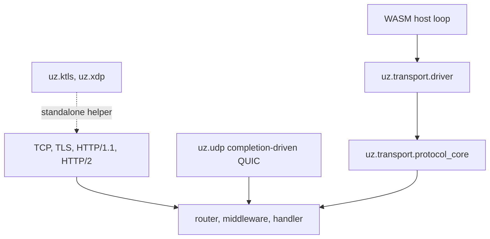

µWebZockets tách protocol state khỏi cơ chế di chuyển byte. Native server, QUIC
listener và các WASM edge build dùng chung một protocol core, trong khi mỗi
transport sở hữu socket, completion và buffer riêng. Trang này map các thành phần
đó và nói rõ phần nào sở hữu phần nào.

## Stack transport

Application layer không rẽ nhánh theo transport. Framing layer thay đổi, còn mỗi
transport tự báo limit và error của nó.

## Các nhóm transport

| Nhóm       | Entry surface                                | Data path hiện tại |
| ---------- | -------------------------------------------- | ------------------ |
| TCP và TLS | `init`, `init_https`, `init_https_ephemeral` | Có, native loop    |
| HTTP/1.1   | Cùng TCP listener                            | Có, native loop    |
| HTTP/2     | Prior knowledge hoặc ALPN trên TCP listener  | Có, native loop    |
| HTTP/3     | `init_http3`, `listen_udp`                   | Có, QUIC listener  |
| Client     | `uz.client`                                  | Chỉ outbound       |
| WASM edge  | `uz.transport`                               | Host điều khiển    |
| kTLS       | `uz.ktls`                                    | Standalone helper  |
| AF_XDP     | `uz.xdp`, `uz.xdp_transport`                 | Standalone helper  |

Chi tiết HTTP nằm ở [protocol negotiation](/docs/concepts/protocol-negotiation),
còn policy QUIC ở [QUIC transport](/docs/http3/quic-transport). Trang này nói về
ranh giới ownership bên dưới hai lớp đó.

## Protocol core chỉ xử lý protocol

`uz.transport` là lớp tách compile-time, không phải socket library.

| Đơn vị                                 | Sở hữu                                                 | Không sở hữu                 |
| -------------------------------------- | ------------------------------------------------------ | ---------------------------- |
| `uz.transport.protocol_core(capacity)` | Request buffer có giới hạn, parser state, một request  | Socket, loop, timer, TLS     |
| `uz.transport.driver(Adapter)`         | Chuyển tiếp `read`, `write`, `set_read_enabled`, close | Scheduling, buffering, retry |

`protocol_core` copy byte đã mượn vào storage cố định, parse các request hoàn
chỉnh, gọi handler một lần cho mỗi request và trả số request đã dispatch. Lỗi của
nó là `InputBufferFull`, `InvalidRequest`, `HeadersTooLarge` và `BodyTooLarge`.
Capacity phải chứa request line tối đa cộng bốn byte, nếu không type sẽ từ chối
compile.

`driver` là adapter seam cho WASM host. Adapter cung cấp bốn function và driver
chỉ chuyển tiếp. Nó không thêm policy riêng. Trang
[Edge và WASM](/docs/architecture/edge-and-wasm) nói về phía host.

## QUIC điều khiển bằng completion

`uz.udp.quic_transport(Engine)` là QUIC transport, không phải HTTP parser. Nó sở
hữu một UDP socket đã bind, một receive completion đang chờ, một socket-close
completion và QUIC deadline timer. `init` bind socket và tạo engine, `start` arm
receive và timer, `shutdown` cancel chúng, còn `is_drained` là điều kiện để
release.

Engine sở hữu QUIC connection, stream, header set và packet pool. Adapter HTTP/3
phía trên decode pseudo-header vào `uz.Request` và ghi QPACK response field.
HTTP/3 dùng TLS context riêng với TCP, nên TCP listener có thể advertise `h2` và
`http/1.1` trong khi QUIC listener chỉ advertise `h3`.

## Datagram plumbing

`uz.datagram` và `uz.datagram_ring` là plumbing có giới hạn cho datagram kiểu
WebTransport. Chúng không phải WebTransport server đang chạy.

| Đơn vị                          | Giới hạn                                                |
| ------------------------------- | ------------------------------------------------------- |
| `uz.datagram.Router`            | 16 session path, đăng ký lúc startup, quét tuyến tính   |
| `uz.datagram_ring.DatagramRing` | Capacity cố định lúc init, SoA storage do caller sở hữu |
| `uz.webtransport`               | Model draft-16, setting, capsule và varint              |

Router dùng session `:path` làm khóa và từ chối path không bắt đầu bằng `/`.
Handler nhận session id và payload chỉ mượn trong call. Ring copy từng payload
vào stride cố định, nên view trả về chỉ còn hợp lệ đến khi slot bị dùng lại hoặc
ring bị clear.

Live listener trả `501 Not Implemented` cho `CONNECT` thường và không advertise
datagram. Đọc [WebTransport status](/docs/http3/webtransport) trước khi thiết kế
integration dựa trên các helper này.

## Cầu shared memory

`uz.shared_memory` là cầu fixed-block cho host do bạn kiểm soát. Một `Handle`
đóng gói block index, generation chống dùng lại và leased length vào một giá trị
64-bit. `region(block_size, block_count)` kiểm tra cả hai bound lúc compile time.

| Thao tác              | Bảo đảm                                                 |
| --------------------- | ------------------------------------------------------- |
| `acquire`             | Từ chối length bằng zero hoặc quá lớn, hoặc region đầy  |
| `bytes`, `capacity`   | Validate generation trước khi trả view                  |
| `commit`              | Ghi committed length trong giới hạn block               |
| `release`             | Zero block và tăng generation                           |
| `handle_from_pointer` | Chỉ lấy lại handle cho block đã lease và đúng alignment |

`release` trả `InvalidHandle` cho handle cũ hoặc bị release hai lần, nên một view
không thể free hai lần qua cùng token. Generation wraparound là trạng thái cuối:
block bị retire thay vì dùng lại.

Helper Cap'n Proto ghi envelope single-segment: tiền tố tám byte với segment count
bằng zero và word count, theo sau là các word đã encode. `read_capnp_message` kiểm
tra tiền tố, word bound và độ dài chính xác của message. Cả handle lẫn envelope
đều không xác thực peer. Chỉ dùng module này qua trust boundary do bạn sở hữu, giữ
mỗi handle sống trong suốt thời gian view tồn tại và release đúng một lần.

## Liên quan

- [Cluster internals](/docs/architecture/cluster-internals) trình bày worker group
  nằm trên các transport này.
- [Edge và WASM](/docs/architecture/edge-and-wasm) nói về data path do host điều
  khiển.
- [kTLS và AF_XDP](/docs/architecture/ktls-and-xdp) nêu rõ standalone helper làm
  gì và không nối vào server phần nào.
