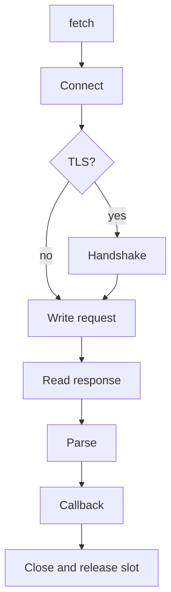

µWebZockets ship một HTTP/1.1 client có giới hạn trên cùng libxev event loop với
server. Nó thực hiện một request cho mỗi connection, buffer response trong storage
allocate lúc startup và đóng connection sau exchange. Plaintext request path không
allocate; TLS fetch allocate BoringSSL session và memory BIO một lần cho mỗi
connection.

Client được thiết kế nhỏ có chủ đích. Nó không resolve DNS, follow redirect, lưu
cookie, dùng proxy, retry, pool connection hay nói HTTP/2, HTTP/3 hoặc WebSocket.

## Bắt đầu

<CardGroup cols={2}>
  <Card title="Client quickstart" href="/docs/client/quickstart" icon="play">
    Fetch một URL từ chương trình Zig và đọc status, header, body.
  </Card>
  <Card title="fetch_blocking" href="/docs/client/fetch-blocking" icon="square">
    Chạy một request tới khi xong với response storage do caller sở hữu.
  </Card>
  <Card title="Callback client" href="/docs/client/callback-client" icon="layers">
    Giữ nhiều request in-flight và điều khiển loop bằng `run`.
  </Card>
  <Card title="TLS trust" href="/docs/client/tls-trust" icon="shield-check">
    Verify server bằng CA bundle tường minh, SNI và chỉ TLS 1.3.
  </Card>
</CardGroup>

## Tham chiếu

<CardGroup cols={2}>
  <Card title="Timeouts và errors" href="/docs/client/timeouts-and-errors" icon="clock">
    Đọc connect và read deadline, failure kind và setup error.
  </Card>
  <Card title="Client limits" href="/docs/client/limits" icon="ruler">
    Đọc mọi buffer, in-flight slot và response bound.
  </Card>
</CardGroup>

## Vòng đời request



`fetch` chỉ chuẩn bị công việc. Không có gì chạy cho tới khi `run` điều khiển
event loop, hoặc `fetch_blocking` chạy temporary client của nó.

## Fetch tối thiểu

```zig
const std = @import("std");
const uz = @import("uWebZockets");

pub fn main(init: std.process.Init) !void {
    var storage: uz.client.FetchStorage = .{};

    const outcome = try uz.client.fetch_blocking(init.io, .{
        .method = .get,
        .host = "127.0.0.1",
        .path = "/status",
    }, .{
        .port = 8080,
        .connect_timeout_ms = 2_000,
        .read_timeout_ms = 5_000,
    }, &storage);

    switch (outcome) {
        .response => |response| std.log.info("status {d}, {d} bytes", .{
            response.status,
            response.body.len,
        }),
        .failure => |failure| std.log.err("fetch failed ({s}): {s}", .{
            @tagName(failure.kind),
            failure.message,
        }),
    }
}
```

View response trả về mượn `storage`; nó còn hiệu lực chừng nào `storage` còn sống.

## Field của request

| Field     | Kiểu             | Default  | Rule                                |
| --------- | ---------------- | -------- | ----------------------------------- |
| `method`  | `Method`         | `.get`   | Chọn HTTP method token              |
| `host`    | `[]const u8`     | bắt buộc | Numeric IPv4 hoặc IPv6 literal      |
| `path`    | `[]const u8`     | `/`      | Origin-form target, gồm query       |
| `headers` | `[]const Header` | `&.{}`   | Mượn; reserved name bị từ chối      |
| `body`    | `[]const u8`     | `""`     | Mượn; `Content-Length` được sinh ra |

`FetchOptions` thêm `port`, `tls` tùy chọn, `connect_timeout_ms`,
`read_timeout_ms` và `response_body_capacity`. Builder gửi `Host` và
`Connection: close` trên mọi request.

## Framing request và response

Request builder luôn gửi `Host`, thêm `Content-Length` khi có body và gửi
`Connection: close`. Header do caller đặt tên `Host`, `Content-Length`,
`Transfer-Encoding` hoặc `Expect` bị từ chối với `error.ReservedHeader` thay vì
tạo field trùng. `host` là numeric address; IPv6 literal viết không bracket và
builder thêm bracket vào header.

Response parser chấp nhận các framing rule sau:

| Dạng response                | Hành vi                                    |
| ---------------------------- | ------------------------------------------ |
| `Content-Length`             | Body length lấy từ field                   |
| `chunked` có trailer         | Chunk decode tại chỗ; trailer tối đa 8 KiB |
| Close-delimited              | Body kết thúc khi peer đóng                |
| `HEAD`, `204`, `205`, `304`  | Body rỗng bất kể framing field             |
| Tối đa tám `100 Continue`    | Bỏ qua như interim response                |
| 1xx khác                     | `.protocol` failure                        |
| Framing field xung đột       | `.protocol` failure                        |
| Transfer coding không hỗ trợ | `.protocol` failure                        |

Parser không follow redirect, không lưu cookie và không dùng lại connection.
Response vi phạm các rule này trở thành `.protocol` failure, không phải partial
body.

## Boundary

| Feature                   | Trạng thái                                    |
| ------------------------- | --------------------------------------------- |
| HTTP/1.1 request          | Được hỗ trợ                                   |
| TLS 1.3                   | Được hỗ trợ với trust policy tường minh       |
| Plaintext HTTP            | Được hỗ trợ                                   |
| DNS resolution            | Không được hỗ trợ; dùng numeric address       |
| Redirect                  | Không theo                                    |
| Cookie                    | Không lưu                                     |
| Proxy                     | Không được hỗ trợ                             |
| Automatic retry           | Không thực hiện                               |
| Connection pooling        | Không được hỗ trợ; một request mỗi connection |
| HTTP/2 hoặc HTTP/3 client | Không cung cấp                                |
| WebSocket client          | Không cung cấp                                |
| mTLS                      | Không được hỗ trợ                             |

:::warning[Tự resolve name bên ngoài client]
`Request.host` phải là numeric IPv4 hoặc IPv6 literal. Đặt DNS name trong
`TlsOptions.server_name` cho SNI và certificate verification, nhưng kết nối tới
address bạn tự resolve.
:::

## Tiếp theo

Đọc [Client quickstart](/docs/client/quickstart) để chạy fetch đầu tiên, sau đó
[TLS trust](/docs/client/tls-trust) trước khi dùng client ngoài localhost.
