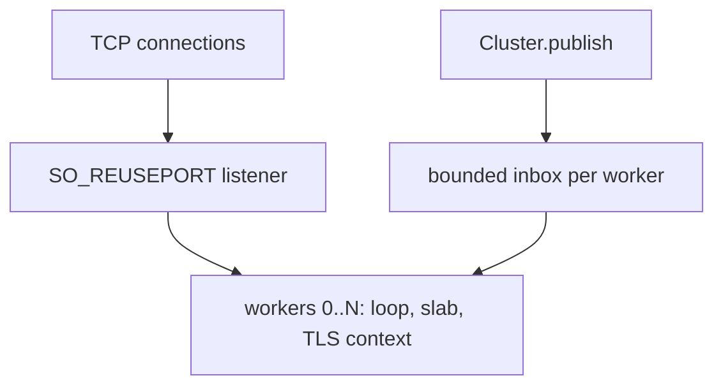
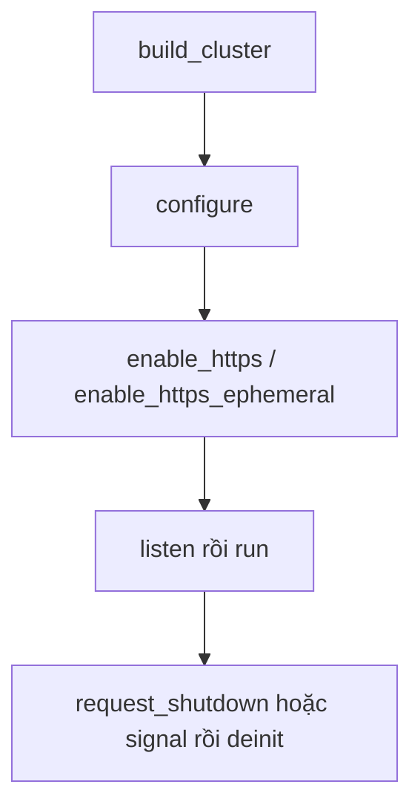

Cluster µWebZockets là nhóm ứng dụng hoàn chỉnh theo mô hình thread-per-core. Mỗi
worker đang hoạt động sở hữu một event loop, một startup slab, một inbox có giới
hạn, và một TLS context khi TLS được bật. Không connection, request buffer, queue,
completion hay mutable TLS state nào đi qua ranh giới worker.

## Capacity khác số worker đang hoạt động

`build_cluster(allocator, worker_count, options)` xem đối số `worker_count` là
compiled capacity. Runtime có thể dùng ít worker hơn:

- `ClusterOptions.worker_count` chọn active count nhỏ hơn.
- `build_cluster_from_environment` ưu tiên option đó, rồi biến môi trường
  `UWEBZOCKETS_WORKERS`, rồi CPU count của nền tảng.
- Giá trị 0 hoặc lớn hơn compiled capacity sẽ báo lỗi với
  `error.InvalidWorkerCount` trước khi cấp slab cho bất kỳ worker nào.

Chỉ active worker mới cấp slab, inbox và thread handle, cộng TLS context khi TLS
được bật. Compiled capacity lớn vì vậy không giữ memory cho worker không dùng.
`worker_count()` báo active count và `worker_capacity()` báo compiled ceiling.

## Topology



Mỗi worker trong nhóm `W` là một event loop riêng với slab và TLS context riêng.
Kernel phân phối connection được accept qua các listener, và mỗi connection được
accept nằm trọn trong slab của worker đã accept nó. Publish chéo worker ghi vào
inbox có giới hạn của worker đích, và chỉ worker sở hữu mới drain inbox đó. Trên
Windows, group bind bằng `SO_REUSEADDR`; phân phối của kernel là không xác định
và cluster Windows là fallback an toàn, không phải đường load-balancing.

## Vòng đời

```zig
const std = @import("std");
const uz = @import("uWebZockets");

fn hello(_: *uz.Request, res: *uz.Response) void {
    res.text("hello from a worker") catch {};
}

pub fn main(init: std.process.Init) !void {
    var group = try uz.Server.builder(init.io)
        .with_max_clients(256)
        .build_cluster(std.heap.page_allocator, 4, .{});
    defer group.deinit();

    const Group = @TypeOf(group);
    try group.configure(struct {
        fn routes(worker: *Group.Worker, index: usize) !void {
            _ = index;
            _ = try worker.get("/", hello);
        }
    }.routes);

    try group.listen("0.0.0.0", 3000);
    group.run() catch |err| {
        if (group.first_failure()) |failure| {
            std.log.err("worker {d} ({s}): {s}", .{
                failure.index,
                @tagName(failure.phase),
                @errorName(failure.err),
            });
        }
        return err;
    };
}
```

Chương trình lược bỏ signal watcher; `Cluster.catch_shutdown_signals()` cài cùng
đường shutdown một watcher cho mọi worker. Thứ tự được hỗ trợ là `build_cluster`,
`configure`, TLS setup tùy chọn, `listen`, `run`, shutdown, rồi `deinit`. Route
được đăng ký cho từng worker qua `configure` trước khi `listen` khóa chúng.

| State        | Ý nghĩa                                                    |
| ------------ | ---------------------------------------------------------- |
| `configured` | Worker tồn tại nhưng chưa thread nào chạy                  |
| `running`    | Worker thread đang chạy hoặc drain                         |
| `stopped`    | `run` đã trả sau khi mọi worker join                       |
| `releasing`  | `deinit` đã nhận release và đang giải phóng worker storage |
| `released`   | Mọi worker và thread handle đã được giải phóng             |

Lifecycle-sensitive call báo lỗi theo tên thay vì chạm storage đã drain.
Configuration call khi `run` đang active trả `error.ClusterRunning`; gọi sau khi
`run` trả về trả `error.ClusterStopped`; gọi sau release trả
`error.ClusterDeinitialized`. `deinit_checked()` báo `error.ClusterRunning` khi
group active, và release đồng thời chờ releaser thắng publish `released`.

## Lỗi đầu tiên được giữ

`run()` trả `error.ClusterWorkerFailed` khi một worker lỗi. Root cause vẫn có qua
`first_failure()`, một `WorkerFailure` với `index`, `phase` và `err`. Phase là
`spawn`, `run` hoặc `cleanup`. Lỗi đầu tiên được giữ, nên shutdown cascade sau đó
không thay thế nó. `failure_count()` báo tổng số failure ghi từ lần `run` gần
nhất.

## Publish là delivery có giới hạn

`Cluster.publish(topic, message, is_text)` broadcast qua ring có giới hạn của
từng worker và trả `PublishError!usize` với số worker đã accept. Mỗi inbox giữ 64
message. Group đã dừng không có consumer, nên publish sau `run` trả
`error.ClusterStopped` thay vì queue vào loop đã chết.

`publish_report` trả `PublishReport` với `queued`, `dropped`, `notify_failed` và
`first_dropped_worker`. Validation chạy trước khi bất kỳ inbox nào bị sửa, nên
`EmptyTopic`, `TopicTooLong` và `ClusterMessageTooLarge` không thể deliver một
phần. `all_delivered()` nghĩa là mọi active worker accept message và mọi loop
wakeup được post; nó không có nghĩa application subscriber đã consume message.

Dùng `request_shutdown()` để drain mọi worker. Sau `deinit` nó là no-op có tài
liệu vì worker slice đã mất; dùng `state()` và `deinit_checked()` khi supervisor
cần câu trả lời có kiểu.

## Thứ tự TLS

Gọi một trong hai đúng một lần sau `configure` và trước `listen`:



Mỗi worker tạo và sở hữu một BoringSSL `SSL_CTX` trước khi listener tồn tại, và
mỗi connection tạo `SSL` riêng từ context của worker đó. Credential file được đọc
một lần mỗi worker, nên rotation cần rolling restart. Gọi enable lần hai trả
`error.TlsAlreadyEnabled`; enable sau `listen` trả `error.AlreadyListening`.

`enable_https` không cấu hình client certificate; dùng `init_https_mtls`
single-application khi cần mutual TLS. HTTP/3 và QUIC clustering không được hỗ
trợ: `init_http3` và `listen_udp` vẫn là API single-application, và cluster
listener chỉ TCP/TLS.
[Roadmap upstream](https://github.com/farbenbuilds/uWebZockets/blob/main/docs/roadmap.md)
ghi lại boundary này.

## Tiếp theo

- [Shared-nothing workers](/docs/concepts/shared-nothing) giải thích quy tắc
  ownership phía sau topology.
- [Cluster đầu tiên](/examples/first-cluster) chạy worker group.
- [Mô hình bảo mật](/docs/concepts/security-model) bao gồm boundary TLS và
  authentication quanh cluster.
