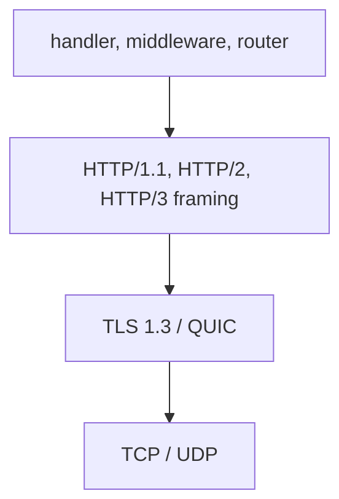

µWebZockets chọn giao thức wire từ cách connection đến, không từ cấu hình theo
route. Sau khi thương lượng, HTTP/1.1, HTTP/2 và HTTP/3 cùng đi vào router,
middleware và `uz.Handler`. Chỉ transport, giới hạn và cách báo lỗi khác nhau.

## Một boundary cho handler

| Transport     | Entry point                                              | Cách chọn giao thức                                          |
| ------------- | -------------------------------------------------------- | ------------------------------------------------------------ |
| TCP plaintext | `init`                                                   | HTTP/1.1, hoặc HTTP/2 khi client mở đầu bằng prior knowledge |
| TLS trên TCP  | `init_https`, `init_https_ephemeral`, `init_https_mtls`  | ALPN chọn `h2` trước `http/1.1`                              |
| QUIC          | `init_http3`, `init_http3_ephemeral`                     | Context QUIC chỉ quảng bá `h3`                               |
| Cluster TLS   | `Cluster.enable_https`, `Cluster.enable_https_ephemeral` | Cùng chính sách ALPN, chỉ TCP và TLS                         |

Ứng dụng HTTP/3 dùng cả hai listener: `listen` cho TCP/TLS và `listen_udp` cho
QUIC. Context TCP vẫn quảng bá `h2` và `http/1.1`, nên một ứng dụng có thể phục
vụ cả ba giao thức trên các port bạn bind.

## Các lớp transport



Application layer giống nhau trên mọi đường. Framing layer đổi giữa HTTP/1.1,
HTTP/2 và HTTP/3; TLS 1.3 mang TCP và QUIC, còn operating system mang TCP hoặc
UDP. Handler không cần rẽ nhánh theo transport trừ khi chủ động đọc metadata
trong `Request`.

## HTTP/2 plaintext dùng prior knowledge

Listener plaintext nhận HTTP/1.1 và HTTP/2 trên cùng socket. Trước khi parse
HTTP/1.1, transport kiểm tra client có mở đầu bằng HTTP/2 connection preface
không. Client gửi preface được đưa vào HTTP/2 session nhúng.

Không có trao đổi `Upgrade: h2c`. Server không bao giờ trả
`101 Switching Protocols` vì cơ chế h2c Upgrade không được triển khai. RFC 9113
đã bỏ cơ chế này; prior knowledge là đường cleartext chuẩn, còn TLS ALPN là đường
mã hóa chuẩn.

:::warning[Không hỗ trợ]
Client HTTP/2 không thể bắt đầu bằng một request HTTP/1.1 có `Upgrade`. Cấu hình
client dùng prior knowledge trên connection cleartext, hoặc dùng TLS với ALPN.
:::

## TLS dùng ALPN [#tls-uses-alpn]

TLS termination dùng BoringSSL và chỉ TLS 1.3. Các phiên bản cũ bị từ chối tại
context. Context quảng bá `h2` trước rồi `http/1.1`, nên client gửi cả hai sẽ
nhận HTTP/2. Context chọn bằng `select_http_protocol`; connection đã thiết lập
đọc giá trị đã chọn bằng `negotiated_protocol`.

Early data theo cùng chính sách cho TLS single-application và cluster. Dispatcher
chỉ nhận safe method cho đến khi handshake được xác nhận: `GET`, `HEAD`,
`OPTIONS` và `TRACE`. `QUERY` vẫn replay-unsafe, và non-safe method đến trong
early data nhận `425 Too Early`. Chế độ client certificate `.optional` và
`.required` tắt TLS 1.3 early data vì client certificate được kiểm tra ở flight
thứ hai.

## HTTP/3 dùng context riêng

`init_http3` nạp cùng certificate và key vào hai context. Context TCP quảng bá
`h2` và `http/1.1`; context QUIC chỉ quảng bá `h3`. Adapter HTTP/3 decode
pseudo-header trực tiếp vào `uz.Request` và ghi QPACK response header mà không
chuyển qua text HTTP/1.1.

```zig
const std = @import("std");
const uz = @import("uWebZockets");

fn hello(_: *uz.Request, res: *uz.Response) void {
    res.text("hello over HTTP/3") catch {};
}

pub fn main(init: std.process.Init) !void {
    var server = try uz.App(128).init_http3(
        init.io,
        "certs/fullchain.pem",
        "certs/privkey.pem",
    );
    defer server.deinit();

    _ = try server.get("/", hello);
    try server.listen("0.0.0.0", 3443);
    try server.listen_udp("0.0.0.0", 8443);
    try server.run();
}
```

`init_http3_ephemeral` tạo certificate development trong memory. Giá trị `App`
phải giữ địa chỉ ổn định sau `listen_udp`.

## Giới hạn giao thức cố định

HTTP/2 dùng một session nhúng cho mỗi TCP connection và cố định mỗi connection ở
tám stream đồng thời. Giới hạn header block, request body và response header cho
từng stream đến từ `ServerConfig`:

- `max_h2_header_block_size`
- `max_h2_body_size`
- `max_h2_response_header_size`
- `max_h2_response_header_count`

Một tunnel WebSocket RFC 8441 được phép cho mỗi HTTP/2 connection. Tunnel thứ hai
nhận `503 Service Unavailable` mà không ảnh hưởng tunnel đang hoạt động. Tăng số
stream cần chuyên biệt hóa connection type và được theo dõi trong
[roadmap upstream](https://github.com/farbenbuilds/uWebZockets/blob/main/docs/roadmap.md).

HTTP/3 decode request header trong `max_header_size` và `max_header_count`, và
giới hạn request body bằng `max_h3_body_size`. Response metadata dùng
`max_h3_response_header_size` và `max_h3_response_header_count`. Connection,
active stream và packet buffer được cấp bởi application capacity và QUIC engine,
không bởi các field header và body.

:::warning[Không hỗ trợ]
HTTP/2 server push không được triển khai. HTTP/3 extended CONNECT, WebTransport,
push và application datagram chỉ ở mức helper; QUIC listener live từ chối
`CONNECT` với `501 Not Implemented`. HTTP/3 clustering không được hỗ trợ.
[Roadmap upstream](https://github.com/farbenbuilds/uWebZockets/blob/main/docs/roadmap.md)
ghi lại từng boundary.
:::

## Kiểm tra phiên bản đã thương lượng

Với server ở trên đang chạy, một `curl` có hỗ trợ HTTP/3 sẽ in phiên bản đã dùng:

```sh
curl -sk --http2 https://127.0.0.1:3443/ -o /dev/null -w '%{http_version}\n'
curl -sk --http3-only https://127.0.0.1:8443/ -o /dev/null -w '%{http_version}\n'
```

Lệnh đầu tiên in `2` khi ALPN chọn HTTP/2. Lệnh thứ hai in `3` khi QUIC listener
truy cập được và client hỗ trợ HTTP/3. Ví dụ trên không có listener plaintext;
thêm một listener bằng `init` và `listen` trên port khác trước khi dùng
`--http2-prior-knowledge`.

## Tiếp theo

- [Type safety](/docs/concepts/type-safety) giải thích cách capacity, JSON và
  callback được kiểm tra trước khi server chạy.
- [Mô hình cluster](/docs/concepts/cluster-model) bao gồm worker group TCP/TLS.
- [HTTP/3 server đầu tiên](/examples/first-http3-server) đi từng bước
  qua đường QUIC.
