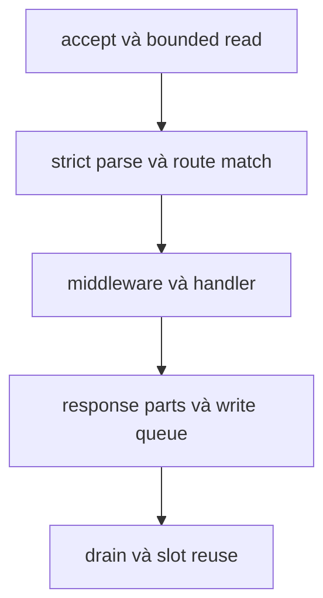

Mọi request đi qua cùng một đường có giới hạn. Transport khác nhau, nhưng parse,
định tuyến, middleware và gọi handler vẫn nằm trên một application surface.
Trang này theo dõi đường đó và chỉ ra nơi một request có thể gặp lỗi.

Sơ đồ nhóm chín bước bên dưới thành năm checkpoint. Danh sách đánh số giữ chi
tiết: accept, read, parse, route, middleware, handler, response parts, drain và
reuse.

## Từ accept đến handler

1. **Accept.** Listener nhận socket và gọi accept callback của application. Với
   HTTP/1.1 và HTTP/2, application lấy một connection slot từ startup slab. Khi
   pool cạn, nó đóng socket mới ngay thay vì tăng bộ nhớ.
2. **Đọc có giới hạn.** Transport đọc vào request buffer cố định của connection.
   TLS giải mã trong cùng ranh giới ownership; socket plaintext được kiểm tra
   HTTP/2 prior-knowledge preface trước khi parse HTTP/1.1.
3. **Parse nghiêm ngặt.** Parser chứng minh request head và body đã đủ. Nó từ
   chối framing xung đột và cú pháp sai bằng `400 Bad Request`. Input quá lớn bị
   từ chối trước handler: `413 Payload Too Large` cho body và
   `431 Request Header Fields Too Large` cho request line hoặc header.
4. **Match route.** Router resolve request đầu tiên trong buffer và ghi lại node
   hoặc pattern khớp. Route capture mượn request buffer của connection.
5. **Middleware.** Các callback middleware theo thứ tự chạy trước handler được
   chọn. Route được resolve trước để middleware có thể dừng dispatch cho một
   route khớp, và middleware cũng chạy khi không route nào khớp, trước `404`.
6. **Handler.** Router gọi handler sync, context, async hoặc async-context đã
   lưu cho method và route đó.
7. **Response part.** Response writer thêm status line, header và body thành các
   part có giới hạn vào write queue của connection. Body lớn không bị nối thành
   một buffer.
8. **Drain.** Event loop ghi byte trong queue khi socket writable. Chunked
   response, producer stream và file body hoàn tất qua completion path riêng.
9. **Reuse hoặc close.** Response hoàn chỉnh giữ connection cho request tiếp
   theo trừ khi response yêu cầu close. Connection đóng chỉ trả slot về pool sau
   khi close, read, write và cancellation completion đều đã drain.

## HTTP/1.1, HTTP/2 và HTTP/3

| Giai đoạn        | HTTP/1.1                               | HTTP/2                                          | HTTP/3                       |
| ---------------- | -------------------------------------- | ----------------------------------------------- | ---------------------------- |
| Đơn vị           | Connection                             | Stream trong một connection                     | QUIC stream                  |
| Request storage  | Request buffer theo connection         | Một session theo connection với tám stream slot | Pool của QUIC engine         |
| Concurrency      | Một request dispatch tại một thời điểm | Tối đa tám stream đồng thời                     | Giới hạn bởi QUIC engine     |
| Response framing | Text head và body part                 | Frame HPACK                                     | Field QPACK                  |
| Early data       | TLS 0-RTT: chỉ method an toàn          | TLS 0-RTT: chỉ method an toàn                   | Listener từ chối 0-RTT       |
| Reuse gate       | Connection slot sau mọi completion     | Stream slot cùng async token                    | Stream close và pool release |

HTTP/1.1 giữ byte pipelined sau khi response hoàn tất và dispatch từng request
hoàn chỉnh theo thứ tự. HTTP/2 giữ read armed trong khi một stream chờ async
token, và mỗi stream sở hữu response state riêng. HTTP/3 decode pseudo-header
trực tiếp vào cùng shape `Request` và ghi structured response header mà không
chuyển qua text HTTP/1.1.

## Nơi request dừng lại

Request có thể rời đường đi này trước handler:

- Connection pool đầy thì đóng socket vừa accept. Không có queue chờ slot.
- Request sai cú pháp nhận `400 Bad Request`.
- Body quá lớn nhận `413 Payload Too Large` kèm JSON document có cấu trúc ghi rõ
  giới hạn và giá trị.
- Header hoặc request line quá lớn nhận `431 Request Header Fields Too Large`
  với document tương đương.
- Middleware có thể hoàn tất response và dừng dispatch trước handler.

Handler trả về mà không bắt đầu response sẽ nhận `500 Internal Server Error`.
Trang vòng đời response giải thích quy tắc completion này.

## Tiếp theo

- [Vòng đời response](/docs/concepts/response-lifecycle)
- [Giới hạn HTTP](/docs/http/limits)
- [Mô hình định tuyến](/docs/concepts/routing-model)
