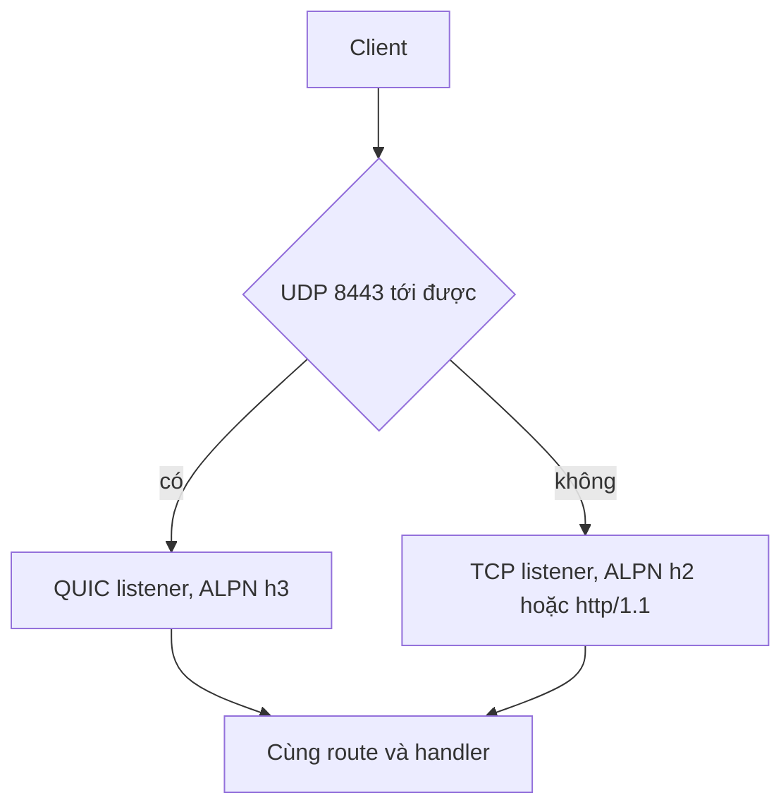

HTTP/3 là listener thứ hai trên cùng một application, không phải một deployment
model thứ hai. `init_http3` tạo một TCP context quảng bá `h2` và `http/1.1`, cùng
một QUIC context chỉ quảng bá `h3`; `listen_udp` bind endpoint UDP. Handler không
đổi, nên công việc vận hành nằm ở firewall, load balancer và certificate rotation.

## Điều gì thay đổi với QUIC

| Thuộc tính         | TCP listener                        | QUIC listener                      |
| ------------------ | ----------------------------------- | ---------------------------------- |
| Transport          | TCP                                 | UDP                                |
| ALPN               | `h2`, rồi `http/1.1`                | Chỉ `h3`                           |
| Early data         | Chỉ safe method, còn lại `425`      | Bị từ chối                         |
| Clustering         | `build_cluster` với per-worker loop | Không hỗ trợ                       |
| Metrics registry   | Tăng request counter                | Ghi log record, không tăng counter |
| Client certificate | Chỉ qua `init_https_mtls`           | Không request                      |

Khoảng trống metrics quan trọng với dashboard: một đường HTTP/3-only có thể phục
vụ traffic trong khi `uwz_http_requests` đứng yên. Hãy alert riêng cho QUIC
listener.

## Bind cả hai listener

```zig
const std = @import("std");
const uz = @import("uWebZockets");

fn index(_: *uz.Request, res: *uz.Response) void {
    res.text("hello over HTTP/3") catch {};
}

pub fn main(init: std.process.Init) !void {
    var server = try uz.App(128).init_http3(
        init.io,
        "certs/fullchain.pem",
        "certs/privkey.pem",
    );
    defer server.deinit();

    _ = try server.get("/", index);
    try server.catch_shutdown_signals();
    try server.listen("0.0.0.0", 3443);
    try server.listen_udp("0.0.0.0", 8443);
    try server.run();
}
```

`App` phải ở địa chỉ ổn định sau `listen_udp`; QUIC transport borrow value đó. Một
process sở hữu một QUIC endpoint, nên không thêm `listen_udp` vào worker group.

## Firewall và port binding

```sh
sudo ufw allow 8443/udp
sudo ufw allow 3443/tcp
ss -lunp | grep 8443
ss -ltnp | grep 3443
```

Mở UDP ở mọi hop, gồm cloud security group và firewall trên node. UDP bị chặn sẽ
fail ở QUIC handshake đầu tiên, trong khi TCP vẫn chạy, nên triệu chứng trông như
HTTP/3 client hỏng chứ không như firewall. Xác nhận socket đã bind trước khi debug
client.

## Certificate context

`init_http3` đọc cùng PEM chain và key vào cả hai context. Certificate là chain với
leaf đứng đầu, và key không khớp sẽ fail lúc startup thay vì ở handshake đầu tiên.

| Sự kiện                             | Hệ quả                                               |
| ----------------------------------- | ---------------------------------------------------- |
| Chỉ TLS 1.3 trên cả hai context     | Client TLS 1.2 fail handshake                        |
| QUIC chỉ quảng bá `h3`              | Không có downgrade chéo protocol trên UDP listener   |
| Client certificate chỉ dành cho TCP | mTLS không bảo vệ traffic QUIC                       |
| File chỉ đọc một lần lúc startup    | Rotation là rolling restart, không phải ghi lại file |

Không có hot reload, nên certificate rotate cần process mới. Giữ process cũ drain
trong khi process mới phục vụ, đúng như với TCP TLS.

## Không có clustering

`init_http3` và `listen_udp` là single-application API. Clustered worker group là
TCP/TLS listener, và QUIC clustering chưa được implement. Scale HTTP/3 bằng các
replica độc lập sau một load balancer hỗ trợ UDP, không bằng cách thêm worker dùng
chung một QUIC endpoint.



Các replica không chia sẻ QUIC state, nên client reconnect sang replica khác sẽ mở
connection mới. Điều này bình thường với topology này và không cần session
affinity, nhưng resumption là theo từng process.

## Early data bị tắt

QUIC listener hiện tại từ chối 0-RTT, nên datagram bị replay không tới được
handler. Các policy helper tồn tại cho backend tương lai, nhưng đường đang chạy
không nhận early data. TCP giữ policy safe-method: `GET`, `HEAD`, `OPTIONS` và
`TRACE` có thể đến trước khi handshake xác nhận, các method khác nhận
`425 Too Early`.

## Yêu cầu cho load balancer

| Yêu cầu                        | Lý do                                                  |
| ------------------------------ | ------------------------------------------------------ |
| Forward UDP                    | Load balancer chỉ TCP làm QUIC listener không tới được |
| Stickiness theo connection     | Datagram của một QUIC connection phải ở một replica    |
| Health check ngoài QUIC        | Probe TCP listener; UDP check không nói được HTTP      |
| Không terminate TLS cho QUIC   | Terminate QUIC ở balancer sẽ để lại backend TCP        |
| Idle timeout lớn hơn QUIC idle | Timer NAT hoặc LB ngắn làm rớt connection sống lâu     |

Address migration phá stickiness theo connection, nên deployment dựa vào hash
5-tuple nên tắt migration hoặc chấp nhận reconnect fail sau khi mạng đổi.

## Kiểm tra

```sh
curl --version | grep -i HTTP3
curl --http3-only -k https://127.0.0.1:8443/
curl --http2 -k https://127.0.0.1:3443/
```

```console
hello over HTTP/3
hello over HTTP/3
```

`--http3-only` fail khi QUIC handshake fail; `--http3` âm thầm fallback về HTTP/2 và
có thể pass trên sai protocol. Dùng `-v` khi cần xem version đã thương lượng.

## Fallback về TCP

Giữ TCP listener kể cả khi UDP chạy được ở mọi nơi. Client không có QUIC, và client
sau mạng chặn UDP, sẽ dùng HTTP/2 hoặc HTTP/1.1 với cùng handler. Framework không
phát `Alt-Svc`, nên việc khám phá thuộc về client hoặc edge; đừng quảng bá `h3`
trong DNS nếu không giữ được UDP mở.

## Các lỗi thường gặp

| Triệu chứng                          | Nguyên nhân                                | Cách sửa                                               |
| ------------------------------------ | ------------------------------------------ | ------------------------------------------------------ |
| QUIC handshake timeout               | UDP bị chặn ở firewall hoặc security group | Mở port UDP từ đầu đến cuối                            |
| TCP chạy, QUIC không bao giờ chạy    | Có load balancer chỉ TCP ở phía trước      | Thêm forward UDP hoặc bỏ qua balancer                  |
| `425 Too Early` trên QUIC            | Kỳ vọng early data hoạt động               | Thiết kế từ chối; retry sau handshake                  |
| Client reconnect sang replica khác   | Không có stickiness hoặc NAT rebind        | Bật affinity theo connection, hoặc chấp nhận reconnect |
| Metrics không thấy traffic HTTP/3    | Đường QUIC không tăng registry             | Alert trên log record hoặc probe riêng                 |
| Certificate chỉ bị từ chối trên QUIC | Client không hỗ trợ TLS 1.3 hoặc `h3`      | Dùng TCP listener cho client đó                        |
