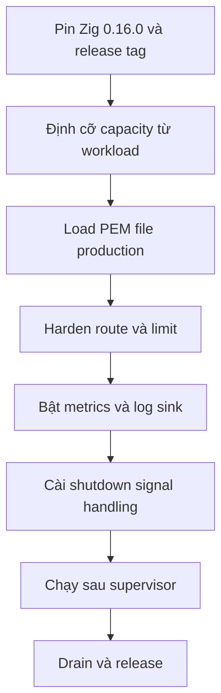

Phần này biến contract của framework thành runbook production. Nội dung gồm
những quyết định bạn sở hữu lúc launch: credential, capacity, hardening request
path, observability và vòng đời process quanh supervisor.

µWebZockets cho bạn một server, không phải một platform. Certificate, secret
storage, load balancing và operating system vẫn thuộc về bạn. Hãy đọc phần này
như danh sách quyết định phải chốt trước khi client thật đầu tiên kết nối.

## Đường Deployment

Mỗi bước đều kiểm chứng được trước khi bước sau có ý nghĩa. Lỗi capacity hiện ra
thành lỗi cấp phát lúc startup, lỗi credential thành `listen` thất bại, và thiếu
shutdown handler thành drain bị cắt ngang.

## Sẵn sàng ship

| Gate          | Mức tối thiểu                                                   | Evidence                                       | Trang                                                   |
| ------------- | --------------------------------------------------------------- | ---------------------------------------------- | ------------------------------------------------------- |
| Credential    | PEM chain và key production, hoặc ngoại lệ ephemeral có ghi lại | `init_https` trả về không có lỗi load          | [TLS deployment](/docs/deployment/tls)                  |
| Capacity      | `slab_bytes()` vừa ngân sách host cho mọi active worker         | Footprint mỗi worker và số worker được in ra   | [Capacity planning](/docs/deployment/capacity-planning) |
| Hardening     | Auth, rate limit, CORS, header và limit đã được quyết định      | Middleware registration và limit đã cấu hình   | [Hardening](/docs/deployment/hardening)                 |
| Observability | Metrics endpoint hoặc snapshot, cùng một log destination        | Một scrape hoặc dòng `log_metrics` sau traffic | [Observability](/docs/deployment/observability)         |
| Shutdown      | SIGTERM drain và process thoát sạch                             | Load test gửi SIGTERM khi đang có traffic      | [Production checklist](/docs/deployment/checklist)      |
| Platform      | Tập target được hỗ trợ khớp với kế hoạch triển khai             | Compile và runtime evidence của release        | [Production checklist](/docs/deployment/checklist)      |

## Bản đồ trang

<CardGroup cols={2}>
  <Card title="Production checklist" href="/docs/deployment/checklist" icon="clipboard-check">
    Chạy một danh sách có thứ tự với evidence và rollback cho từng gate launch.
  </Card>
  <Card title="TLS deployment" href="/docs/deployment/tls" icon="lock">
    Load PEM file production, chọn mTLS và rotate credential mà không cần hot reload.
  </Card>
  <Card title="Capacity planning" href="/docs/deployment/capacity-planning" icon="ruler">
    Biến preset thành bộ nhớ mỗi worker, rồi kiểm tra slab trước khi cấp phát.
  </Card>
  <Card title="Hardening" href="/docs/deployment/hardening" icon="shield">
    Chốt authentication, rate limit, header, timeout và chính sách TRACE.
  </Card>
  <Card title="Observability" href="/docs/deployment/observability" icon="activity">
    Thu metrics có giới hạn, định tuyến development log và đọc khoảng trống HTTP/3.
  </Card>
</CardGroup>

## Cũng trong phần này

| Trang                                                   | Nội dung                                             |
| ------------------------------------------------------- | ---------------------------------------------------- |
| [Shutdown and draining](/docs/deployment/shutdown)      | Thứ tự drain, signal và release cluster              |
| [Docker](/docs/deployment/docker)                       | Image multi-stage, non-root, filesystem read-only    |
| [Kubernetes](/docs/deployment/kubernetes)               | Probe, grace period và capacity request              |
| [systemd](/docs/deployment/systemd)                     | Unit file, hardening directive và log                |
| [Reverse proxy](/docs/deployment/reverse-proxy)         | Client address, upgrade, buffering và timeout        |
| [HTTP/3 deployment](/docs/deployment/http3)             | Bind UDP, certificate context và không có clustering |
| [Zero-downtime rollout](/docs/deployment/zero-downtime) | Rolling restart và resumption theo từng worker       |
| [Windows](/docs/deployment/windows)                     | Gate hỗ trợ, build path và IOCP transport            |
| [BSD targets](/docs/deployment/bsd)                     | Trạng thái build-only và validate cục bộ             |

## Ranh giới

Đây là quyết định của framework, không phải cấu hình còn thiếu. Hãy lên kế hoạch
quanh chúng thay vì chờ một switch.

| Ranh giới                      | Hành vi                                                                                           | Cần làm                                                        |
| ------------------------------ | ------------------------------------------------------------------------------------------------- | -------------------------------------------------------------- |
| Không hot reload certificate   | PEM file chỉ được đọc một lần khi mỗi worker tạo context                                          | Roll process mới rồi drain process cũ                          |
| Không có HTTP/3 cluster        | `init_http3` và `listen_udp` vẫn là API single-application                                        | Chạy QUIC như một application riêng                            |
| Windows support đang bị gate   | Compile gate cùng native runtime job; official support chỉ có sau một lần chạy xanh cho release   | Coi Windows là gated cho tới khi evidence của release xác nhận |
| Không tăng capacity động       | Mọi pool cố định lúc startup và exhaustion trả về rejection có cấu trúc                           | Định cỡ trước launch và theo dõi rejection                     |
| Không ship deployment asset    | Không có image, Helm chart hay systemd unit được publish                                          | Tự build từ Zig 0.16.0                                         |
| BSD target không có runtime CI | FreeBSD, NetBSD, OpenBSD và DragonFlyBSD dùng chung build graph, không có hosted runtime coverage | Tự validate trên host của bạn trước khi cam kết support        |

Không có Windows binary được publish. Release là source tag, nên deployment
Windows build từ source và tự sở hữu runtime evidence của mình.

## Liên quan

- [Server lifecycle](/docs/http/server-lifecycle) cho thứ tự `listen`, `run` và
  `shutdown`.
- [Graceful shutdown](/docs/operations/graceful-shutdown) cho signal path và
  hành vi drain.
- [Platform support](/docs/operations/platforms) cho ma trận target và các claim
  đang bị gate.
- [Threat model](/docs/security/threat-model) cho những asset mà phần này bảo vệ.
