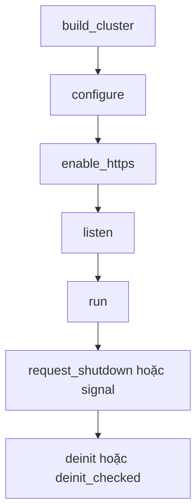

Một listener production của µWebZockets terminate TLS 1.3 bằng BoringSSL.
Framework cố định protocol policy và đọc credential do deployment cung cấp.
Trang này nói về credential path, quyết định mTLS, quy tắc early data và quy
trình restart thay certificate.

Về bản thân protocol surface, đọc [TLS 1.3 và ALPN](/docs/security/tls). Trang
này chỉ bàn phần deployment quanh nó.

## Load credential production

```zig
var server = try uz.App(128).init_https(
    init.io,
    "certs/fullchain.pem",
    "certs/privkey.pem",
);
defer server.deinit();
```

Cả hai path là Zig slice NUL-terminated (`[:0]const u8`). File certificate là PEM
chain với leaf certificate đứng đầu. File key là PEM private key. BoringSSL kiểm
tra cặp này ngay khi load, nên mismatch fail lúc startup với
`error.PrivateKeyLoadFailed` thay vì fail ở handshake đầu tiên.

| Path                             | Nguồn credential                    | Dùng cho                          |
| -------------------------------- | ----------------------------------- | --------------------------------- |
| `init_https`                     | PEM chain và key                    | Production và hệ thống dùng chung |
| `init_http3`                     | PEM file vào cả TCP và QUIC context | QUIC production                   |
| `init_https_ephemeral`           | Generate trong memory               | Development và test cục bộ        |
| `init_https_mtls`                | PEM server cùng client CA bundle    | Identity bằng client certificate  |
| `Cluster.enable_https`           | PEM file load một lần mỗi worker    | TLS cluster production            |
| `Cluster.enable_https_ephemeral` | Generate một lần mỗi worker         | Cluster development               |

Credential ephemeral không export được và không phù hợp để pinning. Chỉ dùng
chúng ở nơi client có thể bỏ qua verification.

## Quyết định mutual TLS

mTLS thuộc về TLS layer khi identity của caller phải được chứng minh trước khi
bất kỳ route nào chạy. Nó chỉ hỗ trợ TCP: context HTTP/3 không yêu cầu client
certificate, và `Cluster.enable_https` không cấu hình client certificate.

| Mode                      | Yêu cầu certificate | Verify                 | Client anonymous | Early data        |
| ------------------------- | ------------------- | ---------------------- | ---------------- | ----------------- |
| `tls.ClientAuth.none`     | Không               | Không                  | Được phép        | 0-RTT safe method |
| `tls.ClientAuth.optional` | Có                  | Khi client gửi         | Được phép        | Tắt               |
| `tls.ClientAuth.required` | Có                  | Có; thiếu cert là fail | Bị từ chối       | Tắt               |

`.optional` và `.required` cần `ca_path` khác rỗng. Certificate đã verify chứng
minh client sở hữu key; nó không cấp role. Authorization vẫn thuộc về handler.
Đọc [Mutual TLS](/docs/security/mtls) cho format bundle và ranh giới revocation.

## ALPN và tách protocol

| Transport | Context               | Protocol quảng bá    |
| --------- | --------------------- | -------------------- |
| TCP       | Một context cho HTTPS | `h2`, rồi `http/1.1` |
| QUIC      | Một context riêng     | Chỉ `h3`             |

TLS 1.3 là version duy nhất được chấp nhận; không có switch hạ cấp. Client chỉ
đưa ra `http/1.1` vẫn kết nối được, vì TCP context quảng bá cả hai protocol.
Client chỉ đưa ra `h2` trên QUIC listener sẽ fail, vì QUIC context chỉ quảng bá
`h3`.

## Early data

TCP context bật 0-RTT trừ khi client certificate được cấu hình. Trước khi
handshake xác nhận, dispatcher chỉ nhận `GET`, `HEAD`, `OPTIONS` và `TRACE`. Mọi
method khác nhận `425 Too Early`.

Early data có thể bị replay bởi network attacker. Hãy coi handler `GET` trên
public listener là read-only, hoặc chuyển công việc thay đổi state sang method
không thể tới bằng early data. `QUERY` vẫn không an toàn với replay. QUIC context
giữ early data tắt.

## Thứ tự cluster



Gọi đúng một hàm enable một lần sau `configure` và trước `listen`. `listen` khóa
route và bắt đầu accept, nên enable sau đó trả `error.AlreadyListening`, và
enable lần hai trả `error.TlsAlreadyEnabled`.

Mỗi active worker tạo và sở hữu một `SSL_CTX` trước khi listener tồn tại, rồi tạo
một `SSL` cho mỗi connection được accept. File credential được đọc một lần mỗi
worker, và không có TLS state nào chia sẻ giữa các loop. Request path không thêm
lock và không cấp phát.

Ticket key theo từng worker cũng giới hạn session resumption. Một reconnect rơi
vào worker khác không resume được session trước. Phép đo 1.9.0 reuse 100/120
handshake với một worker và 23/120 với bốn worker, đúng hành vi ticket theo
worker. Hãy tính đến một full handshake khi load balancer phân bổ lại connection.

## Rotate credential

Không có hot reload. Thay file trên đĩa không ảnh hưởng process đang chạy, và
signal không reload chúng. Rotate bằng rolling restart:

1. Cài chain và key mới tại path đã cấu hình, giữ file cũ.
2. Start process mới với cùng route và capacity.
3. Verify handshake và protocol đàm phán trước khi gửi traffic người dùng.
4. Chuyển traffic bằng load balancer hoặc service discovery.
5. Gửi `SIGTERM` tới process cũ và chờ nó drain rồi thoát.
6. Xóa file cũ sau khi supervisor báo exit sạch.

[Certificate rotation](/docs/security/certificate-rotation) mô tả đầy đủ trình tự
và trường hợp cluster.

## Error

| Error                         | Nguyên nhân                                             |
| ----------------------------- | ------------------------------------------------------- |
| `CertificateLoadFailed`       | Không đọc hoặc parse được PEM chain                     |
| `PrivateKeyLoadFailed`        | Không đọc, parse hoặc khớp được PEM key với certificate |
| `KeyMismatch`                 | Check phòng vệ ở context; key đã fail từ lúc load       |
| `InvalidClientAuthConfig`     | Mode khác `.none` nhưng `ca_path` rỗng                  |
| `TrustStoreLoadFailed`        | Không đọc hoặc parse được client CA bundle              |
| `ProtocolConfigurationFailed` | Không áp được TLS 1.3 bound                             |
| `TlsContextCreationFailed`    | BoringSSL không allocate được context                   |
| `AlreadyListening`            | `enable_https` được gọi sau khi `listen` bắt đầu        |
| `TlsAlreadyEnabled`           | `enable_https` được gọi nhiều hơn một lần               |
| `ClusterRunning`              | Một configuration call được gọi khi `run` đang active   |
| `ApplicationUnavailable`      | Một worker đang shutdown hoặc đã deinitialize           |

Enable thất bại chỉ release những context mà call đó tạo và có thể thử lại sau
khi sửa nguyên nhân. Nó không bao giờ ghi đè context đã được cài bởi một call
thành công trước đó.

## Liên quan

- [TLS 1.3 và ALPN](/docs/security/tls) cho protocol policy.
- [Mutual TLS](/docs/security/mtls) cho client-certificate mode.
- [Certificate rotation](/docs/security/certificate-rotation) cho rolling
  restart.
- [Capacity planning](/docs/deployment/capacity-planning) cho bộ nhớ mỗi worker
  mà TLS context thêm vào ngoài slab.
