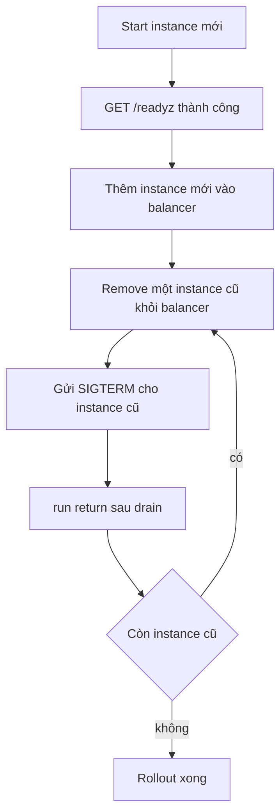

Zero downtime ở đây nghĩa là không request nào fail vì process bị thay. Framework
cung cấp drain sạch; nó không cung cấp hot reload, socket handoff hay listener
takeover có phối hợp. Vì vậy rollout là quy trình của load balancer với application
hợp tác, không phải một feature bật lên là xong.

## Framework cho bạn gì

| Cơ chế                           | Có sẵn | Ranh giới                                                         |
| -------------------------------- | ------ | ----------------------------------------------------------------- |
| Drain do signal                  | Có     | SIGINT và SIGTERM; bound bởi `idle_timeout_ms`                    |
| Shutdown tường minh từ handler   | Có     | `run` đang active drain trước khi return                          |
| `SO_REUSEPORT` trong một process | Có     | Worker trong một group chia sẻ port; kernel cân bằng accept       |
| Cross-process socket handoff     | Không  | `listen_all` là in-process all-or-nothing; handoff là carried     |
| Hot certificate reload           | Không  | Per-worker context đọc PEM một lần lúc startup                    |
| TLS resumption chéo worker       | Không  | Ticket key theo worker, nên reconnect có thể cần handshake đầy đủ |

Cluster yêu cầu `SO_REUSEPORT` cho worker của nó, nhưng đó không phải cross-process
handoff: process thay thế tự mở listener riêng, và không có gì bảo process cũ ngừng
accept. Rollout an toàn vẫn remove instance khỏi load balancer trước khi stop.

## Thứ tự rollout



1. Build artifact bất biến và tag theo digest, không theo tag di động.
2. Start instance mới bên cạnh các instance cũ. Nó bind port và slab riêng.
3. Poll `/readyz` tới khi có trả lời. Readiness phải có nghĩa là listener đã bind.
4. Thêm instance vào load balancer và chờ health check đầu tiên.
5. Remove một instance cũ khỏi balancer. Với TCP proxy, chờ connection draining
   hoặc keep-alive timeout của nó.
6. Gửi SIGTERM. App ngừng accept, cancel completion và chờ pool rỗng.
7. Chờ process thoát trong grace period, rồi lặp lại.

Start instance mới trước khi remove instance cũ giữ capacity ổn định. Rollout kiểu
stop trước rồi start sau sẽ có khoảng trống dù từng bước đều sạch.

## Certificate rotation

Certificate rotation dùng cùng quy trình với artifact khác:

| Bước | Hành động                                                       |
| ---- | --------------------------------------------------------------- |
| 1    | Đặt chain và key mới ở nơi process mới đọc                      |
| 2    | Start process mới; nó đọc file một lần lúc startup              |
| 3    | Thêm vào balancer và xác nhận chain đang phục vụ bằng `openssl` |
| 4    | Remove và drain process cũ                                      |
| 5    | Giữ certificate cũ còn hiệu lực tới khi process cũ cuối thoát   |

Không có file watch và không có reload call. Ghi lại file PEM dưới một process đang
chạy không thay đổi gì, vì mỗi worker đã load context lúc startup. Cluster load một
context cho mỗi worker từ cùng bộ file, nên mọi worker chỉ thấy credential mới sau
khi restart.

## Resumption theo worker

TLS ticket key là theo từng worker, nên client reconnect sau restart có thể rơi vào
worker không resume được session. Đo đạc 1.9.0 ghi nhận đây là hành vi dự kiến và
chấp nhận cho workload HTTP mục tiêu; group bốn worker resume được ít reconnect hơn
hẳn một worker.

Tác động vận hành là một đợt full handshake sau restart, không phải failure. Hãy
dành CPU cho đợt đó, và đừng xây rollout plan dựa trên giả định session resumption
sống qua việc thay process.

## Rollout không làm được gì

| Giả định                                 | Thực tế                                                         |
| ---------------------------------------- | --------------------------------------------------------------- |
| Gửi SIGHUP để reload configuration       | Không có SIGHUP handler; default action terminate process       |
| Thay binary tại chỗ                      | Process đang chạy giữ image đã map                              |
| Thừa hưởng listener từ process cũ        | Không có descriptor handoff; `listen_all` chỉ in-process        |
| Giữ WebSocket session qua restart        | Socket đang drain bị đóng; client phải reconnect và resubscribe |
| Migrate QUIC connection sang process mới | HTTP/3 là single-application và theo process                    |

Client WebSocket cần chiến lược reconnect có backoff và cách lập lại subscription,
vì server không chuyển socket đang sống sang process mới. Điều tương tự áp dụng cho
SSE stream sống lâu.

## Rollback

Giữ image digest cũ, cặp certificate cũ và capacity configuration cũ cho tới khi
rollout sống qua một chu kỳ traffic đầy đủ. Rollback là cùng quy trình theo chiều
ngược:

1. Start instance của digest cũ.
2. Chờ readiness, rồi thêm vào balancer.
3. Remove các instance mới, gửi SIGTERM và chờ drain.
4. Xác nhận version cũ phục vụ đúng route và protocol.

Framework không có cơ chế schema hay data migration, nên thay đổi làm đổi dữ liệu đã
lưu nằm ngoài quy trình này. Quyết định compatibility window trước rollout, không
phải trong lúc rollback.

## Kiểm tra

```sh
fail=0
for i in $(seq 1 300); do
  curl -fsS -o /dev/null https://app.example.com/healthz || fail=$((fail + 1))
  sleep 0.2
done
echo "failures: $fail"
```

Chạy vòng lặp đó ở một terminal trong khi rollout chạy ở terminal khác. Kỳ vọng
`failures: 0`; con số khác chỉ ra lỗ hổng ở balancer drain, readiness gate hoặc
grace period, không phải lỗi drain của framework.

## Các lỗi thường gặp

| Triệu chứng                       | Nguyên nhân                                | Cách sửa                                                  |
| --------------------------------- | ------------------------------------------ | --------------------------------------------------------- |
| 502 ngắn ở mỗi lần thay instance  | SIGTERM gửi trước khi balancer remove pod  | Remove khỏi balancer trước, rồi mới signal                |
| Connection reset trong lúc drain  | Grace period ngắn hơn `idle_timeout_ms`    | Tăng grace period hoặc hạ idle timeout                    |
| Instance mới nhận traffic quá sớm | Readiness pass trước khi listener bind     | Cho `/readyz` kiểm tra listener, không chỉ process        |
| Process cũ không bao giờ thoát    | Handler block loop                         | Return khỏi handler; không block việc shutdown            |
| CPU handshake tăng sau rollout    | Ticket key theo worker buộc full handshake | Dự kiến trước; size CPU và connection limit cho đợt burst |
| WebSocket client không hồi phục   | Client thiếu reconnect và resubscribe      | Thêm backoff và replay subscription ở client              |
| Rollback phục vụ hành vi lẫn lộn  | Hai version dùng chung balancer quá lâu    | Drain hẳn version này trước khi version kia tiếp quản     |
