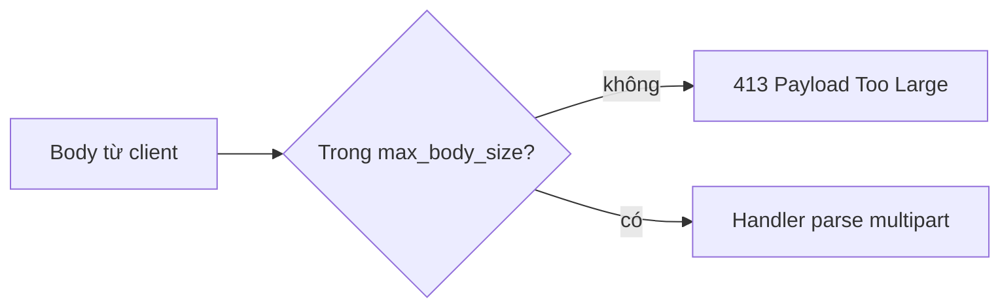

Một upload là request body server buffer hoàn toàn trước khi handler chạy;
`max_body_size` quyết định nó có đến được không.

## Bài toán

Một form gửi một file và vài text field. Bạn cần file có bound, field được
validate, và rejection rõ ràng khi request quá lớn.

## Giả định

- Upload vừa một body limit cố định chọn lúc startup.
- Handler chạy sau khi body hoàn tất, nên nó xem được mọi part.
- Server, không phải handler, trả lời body vượt limit.

## Request body model



µWebZockets không có incremental upload streaming. Handler không thể bắt đầu xử lý
byte khi client còn đang gửi, và không API nào lộ partial body.

## Build route upload

```zig src/main.zig
const std = @import("std");
const uz = @import("uWebZockets");

const max_upload: usize = 8 * 1024 * 1024;

fn safe_filename(name: []const u8) bool {
    if (name.len == 0 or name.len > 255) return false;
    if (std.mem.indexOfAny(u8, name, "/\\") != null) return false;
    return std.mem.endsWith(u8, name, ".png") or std.mem.endsWith(u8, name, ".jpg");
}

fn upload(req: *uz.Request, res: *uz.Response) void {
    var parser = req.multipart() catch |err| {
        res.end("400 Bad Request", @errorName(err)) catch {};
        return;
    };

    var files: usize = 0;
    while (true) {
        const maybe_part = parser.next_part() catch |err| {
            res.end("400 Bad Request", @errorName(err)) catch {};
            return;
        };
        const part = maybe_part orelse break;
        const filename = part.filename orelse continue;
        if (!safe_filename(filename)) {
            res.end("415 Unsupported Media Type", "") catch {};
            return;
        }
        files += 1;
    }

    var buffer: [48]u8 = undefined;
    const body = std.fmt.bufPrint(&buffer, "files={d} bytes={d}", .{
        files,
        req.bytes().len,
    }) catch return;
    res.text(body) catch {};
}

pub fn main(init: std.process.Init) !void {
    const builder = uz.Server.builder(init.io).with_max_body_size(max_upload);
    var server = try builder.build(std.heap.page_allocator);
    defer server.deinit();

    _ = try server.post("/upload", upload);
    try server.catch_shutdown_signals();
    try server.listen("127.0.0.1", 3000);
    try server.run();
}
```

`with_max_body_size` nhận giá trị biết lúc compile vì nó quyết định kích thước
application type được sinh. Limit lớn hơn làm slab của mỗi connection lớn hơn.

## Validate trước khi dùng

| Check                   | Từ chối bằng                        | Vì sao                                |
| ----------------------- | ----------------------------------- | ------------------------------------- |
| Media type là multipart | `400`, `error.NotMultipartFormData` | `req.multipart()` cần boundary        |
| Part có name hợp lệ     | `400`, `error.MissingPartName`      | Part không có `name` không phải field |
| Filename không có path  | `415`                               | Path không được chạm storage          |

`Part.filename` do attacker kiểm soát. Coi nó là label, không bao giờ là path.

## Giả định capacity

| Tài nguyên   | Mặc định       | Hành vi khi vượt                            |
| ------------ | -------------- | ------------------------------------------- |
| Request body | 16 KiB         | `413` trước handler; HTTP/2 đóng connection |
| Boundary     | tối đa 70 byte | `error.InvalidMultipartBoundary`            |

Body limit mặc định làm hầu hết upload thật fail. Đặt `with_max_body_size` bằng body
lớn nhất bạn nhận, rồi giữ cap riêng cho mỗi file. Xem
[HTTP limits](/docs/http/limits) và [backpressure](/docs/concepts/backpressure).

## Hành vi khi lỗi

| Điều kiện                 | Kết quả                                        |
| ------------------------- | ---------------------------------------------- |
| Body vượt `max_body_size` | `413` với `payload_too_large` và `limit_bytes` |
| Boundary thiếu hoặc sai   | `400` từ handler của bạn                       |

## Kiểm chứng

```sh
curl -i -X POST http://127.0.0.1:3000/upload \
  -F 'title=guide' -F 'avatar=@./avatar.png'

head -c 9000000 /dev/zero > big.bin
curl -s -o rejection.json -w '%{http_code}\n' \
  -F 'file=@big.bin' http://127.0.0.1:3000/upload
jq -e '.error.code == "payload_too_large"' rejection.json
```

Call đầu trả số byte; call thứ hai trả `413` và handler không chạy.

## Biến thể: chỉ một file

Đếm số file part và từ chối file thứ hai.

```zig
var seen = false;
while (true) {
    const maybe_part = parser.next_part() catch break;
    const part = maybe_part orelse break;
    if (part.filename == null) continue;
    if (seen) {
        res.end("400 Bad Request", "one file only") catch {};
        return;
    }
    seen = true;
}
res.end("201 Created", "") catch {};
```

## Biến thể: nhiều field

Copy từng text value vào storage có bound khi gặp.

```zig
const Form = struct { title: [128]u8 = undefined, title_len: usize = 0 };

fn read_field(form: *Form, part: uz.multipart.Part) bool {
    const name = part.name orelse return false;
    if (!std.mem.eql(u8, name, "title")) return true;
    if (part.data.len > form.title.len) return false;
    @memcpy(form.title[0..part.data.len], part.data);
    form.title_len = part.data.len;
    return true;
}
```

Value lớn hơn cột lưu trữ phải fail trước khi copy, không được cắt âm thầm.

## Tiếp theo

- [Multipart parsing](/docs/http/helpers/multipart) liệt kê part header và error.
- [HTTP limits](/docs/http/limits) trình bày mọi body và header bound.
