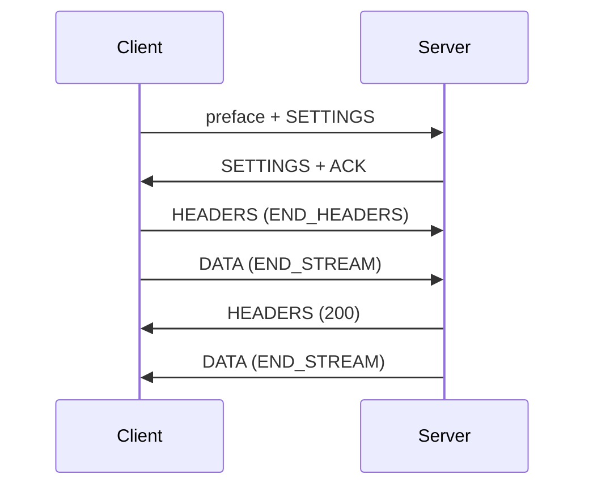

HTTP/2 connection ghép nhiều request thành stream. Mỗi stream mang một request và
một response, còn connection sở hữu state chung: preface, SETTINGS, HPACK table và
flow-control window. Trang này theo một exchange và nêu validation từ chối request
sai.

## Một request, từ đầu đến cuối



Session dispatch request khi end-stream marker đến: `END_STREAM` trên header block
đầu hoặc DATA frame cuối. Handler luôn thấy body đầy đủ trong giới hạn, và client
không bao giờ kết thúc request sẽ giữ stream slot cho đến khi connection đóng.

## Preface

Byte đầu tiên trên cleartext connection được so với:

```text
PRI * HTTP/2.0\r\n\r\nSM\r\n\r\n
```

Sai khớp thì fallback sang HTTP/1.1 parsing. Sau khi preface được nhận, frame đầu
tiên phải là SETTINGS không có ACK; bất kỳ frame khác gửi GOAWAY `PROTOCOL_ERROR`.

## Frame header

Mọi frame bắt đầu bằng chín byte:

| Offset | Size | Field                                |
| ------ | ---- | ------------------------------------ |
| 0      | 3    | Payload length, 24-bit big-endian    |
| 3      | 1    | Frame type                           |
| 4      | 1    | Flags                                |
| 5      | 4    | Stream identifier, high bit reserved |

Payload trên 16 KiB là connection error và gửi GOAWAY `FRAME_SIZE_ERROR`, bất kể
peer đã quảng bá gì.

## Frame type

| Type            | Xử lý                                              |
| --------------- | -------------------------------------------------- |
| `SETTINGS`      | Validate, acknowledge và áp dụng                   |
| `PING`          | Echo với ACK flag và cùng payload                  |
| `GOAWAY`        | Dừng stream local mới và để stream active hoàn tất |
| `RST_STREAM`    | Giải phóng stream slot và báo close callback       |
| `HEADERS`       | Bắt đầu request hoặc trailer section               |
| `CONTINUATION`  | Nối vào header block đang mở                       |
| `DATA`          | Nối vào request body và trả flow-control credit    |
| `WINDOW_UPDATE` | Tăng connection hoặc stream send credit            |
| `PRIORITY`      | Parse và bỏ qua; session không reprioritize        |
| Type lạ         | Bỏ qua, đúng theo RFC 9113                         |

Padding bị loại trước khi payload tới parser. Frame bị cấm trên stream zero, như
DATA, là connection error.

## Header block

Header block là một HEADERS frame theo sau bởi zero hoặc nhiều CONTINUATION frame.
Không frame nào khác được xen vào. Session thực thi:

- Block liên tục.
- `END_HEADERS` đóng block.
- Size cộng dồn vừa `max_h2_header_block_size`.
- Field decode vừa `max_header_count` và `max_header_size`.
- Trailer section không có pseudo-field, không có `content-length`, và kết thúc
  stream.

Block vượt size cấu hình gửi GOAWAY `COMPRESSION_ERROR`. HPACK syntax error cũng
vậy. Request có pseudo-field sai, trùng, sai thứ tự hoặc đi với connection-specific
header chỉ reset stream đó với `PROTOCOL_ERROR`.

## Vòng đời stream

| State                | Peer được gửi    | Local được gửi   |
| -------------------- | ---------------- | ---------------- |
| `idle`               | chỉ HEADERS      | không            |
| `open`               | mọi stream frame | mọi stream frame |
| `half_closed_remote` | không            | mọi stream frame |
| `half_closed_local`  | mọi stream frame | không            |
| `closed`             | không            | không            |

Client stream identifier là số lẻ và tăng dần. HEADERS cho identifier thấp hơn
chưa từng mở là connection error; HEADERS cho stream đã mở và đóng vẫn xử lý ở
cấp stream để frame đến muộn không mở lại được.

## Stream capacity

Connection sở hữu tám stream slot. Mỗi slot giữ request header byte, request body
byte, response body byte và async token state. Khi cả tám active, HEADERS mới được
ghi nhận và trả `RST_STREAM REFUSED_STREAM`; connection vẫn mở và stream khác vẫn
chạy.

Hàng đợi không phải concurrency limiter cho application. Nó giới hạn memory, nên
client mở nhiều stream phải chờ slot hoặc reconnect.

## Hành vi reset

Reset giải phóng slot, chạy stream close callback một lần và làm fail response
đang xử lý của stream đó. Response helper trả `error.ConnectionClosed` hoặc
`error.StreamClosed`. Nó không bao giờ ghi vào storage của stream khác.

Async token thuộc một stream. Complete nó sau reset là failure no-op; token không
làm sống lại stream. Xem
[asynchronous responses](/docs/concepts/async-responses).

## Tiếp theo

- [Flow control](/docs/http2/flow-control) cho hành vi data window.
- [HTTP/2 limits](/docs/http2/limits) cho mọi bound trong một bảng.
