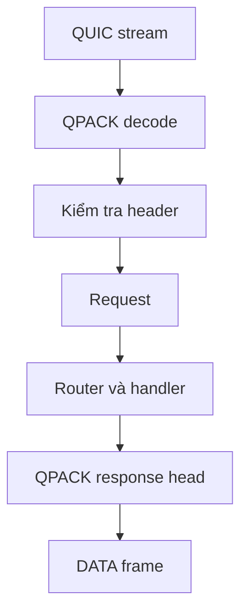

HTTP/3 adapter decode pseudo-header trực tiếp vào cùng `Request` shape mà HTTP/1.1
và HTTP/2 dùng. Nó không dựng request text HTTP/1.1 rồi parse lại. Trang này theo
một request từ QUIC stream tới handler và quay lại.



Luồng đi một chiều: decode, validate, dispatch, encode. Validation failure dừng ở
stream, trước khi `Request` tồn tại.

## Decode và validate

| Field         | Nguồn            | Validation                                  |
| ------------- | ---------------- | ------------------------------------------- |
| `method`      | `:method`        | HTTP token không rỗng                       |
| `target`      | `:path`          | Origin-form path hoặc `*` cho OPTIONS       |
| `authority`   | `:authority`     | Không user information, host và port hợp lệ |
| `scheme`      | `:scheme`        | `https` cho live listener                   |
| Regular field | QPACK field list | Name lowercase, không control byte          |

Request chỉ tới handler khi field list hợp lệ. Adapter từ chối:

- Pseudo-field sau regular field.
- Pseudo-field trùng.
- Pseudo-field lạ.
- Field name viết hoa.
- `connection`, `keep-alive`, `proxy-connection`, `transfer-encoding` và `upgrade`.
- `content-length` thứ hai, hoặc body length không khớp nó.

Validation failure đóng stream bằng `H3_MESSAGE_ERROR`. Stream khác trên connection
vẫn chạy.

Nếu field list có `:authority` mà không có `host`, adapter thêm field `host` để
handler thấy cùng header trên mọi transport.

## Xử lý body

Request body được buffer vào body region của stream. Không có API request-body
streaming; handler luôn thấy body hoàn chỉnh trong giới hạn.

| Điều kiện                              | Kết quả                 |
| -------------------------------------- | ----------------------- |
| Body bằng hoặc dưới `max_h3_body_size` | Giao qua `req.bytes()`  |
| Body trên `max_h3_body_size`           | `413 Payload Too Large` |
| `content-length` không khớp            | `400 Bad Request`       |
| Body lớn hơn `content-length`          | `400 Bad Request`       |

Request body bị giới hạn bởi capacity, không bởi flow control. Receive credit được
trả khi dữ liệu được consume, nên client có thể tiếp tục gửi; body limit mới là thứ
bảo vệ memory.

## Dispatch

Adapter parse method, áp body suppression cho `HEAD` và dispatch qua cùng router và
middleware chain như transport khác. `CONNECT` request nhận `501 Not Implemented`
trước routing, trừ extended CONNECT mà helper WebTransport mô hình nhưng live
listener không bật.

`QUERY` là method hạng nhất. Adapter yêu cầu `Content-Type` hợp lệ; handler sở hữu
media-type policy. Xem
[QUERY qua HTTP/3](/docs/http3/query-method).

## Dựng response

Response helper validate status và header block trước khi ghi:

| Quy tắc                                    | Error                  |
| ------------------------------------------ | ---------------------- |
| Status ba chữ số, 100 đến 599              | `error.InvalidStatus`  |
| Header line có dấu hai chấm                | `error.InvalidHeaders` |
| Không connection-specific header hoặc `te` | `error.InvalidHeaders` |
| Field count trong cap                      | `error.BufferOverflow` |
| Header byte trong cap                      | `error.BufferOverflow` |

Field name được lowercase vào response header storage. Adapter ghi structured QPACK
header set với `:status` đầu tiên, rồi mỗi field một name và value.

## Ghi body

Có hai path:

| Path           | Hành vi                                                          |
| -------------- | ---------------------------------------------------------------- |
| `end` one-shot | Copy body vào stream response buffer; `WouldBlock` khi không vừa |
| `begin_stream` | Dùng `write_chunk` đến khi buffer đầy, rồi chờ write callback    |

Stream response buffer là `write_queue_size` byte. Body one-shot lớn hơn mức đó trả
`WouldBlock` thay vì truncate; dùng streaming cho body lớn.

Response `HEAD` bỏ body nhưng giữ header. Body trên response bị suppress trả
`error.BodyNotAllowed`.

## Write và tiến độ từng phần

QUIC stream write tiến theo số byte transport nhận. Write không tiến được trả
`WouldBlock` và stream được re-arm với `wantwrite`. Body offset được giữ, nên
callback sau tiếp tục từ chỗ callback trước dừng.

Đây là cùng contract backpressure với transport khác, chỉ khác một điểm: không có
TCP write ring hấp thụ burst. Body one-shot lớn phải vừa per-stream buffer hoặc
fail.

## Kiểm tra path

```sh
curl --http3-only -k -v https://127.0.0.1:8443/items?id=7
```

Kiểm tra response header và body, rồi gửi request có pseudo-field trùng từ client
tùy chỉnh và xác nhận `H3_MESSAGE_ERROR` trên stream đó trong khi request sibling
vẫn thành công.

## Tiếp theo

- [QPACK](/docs/http3/qpack) cho header compression phía trên path này.
- [HTTP/3 limits](/docs/http3/limits) cho capacity chính xác.
