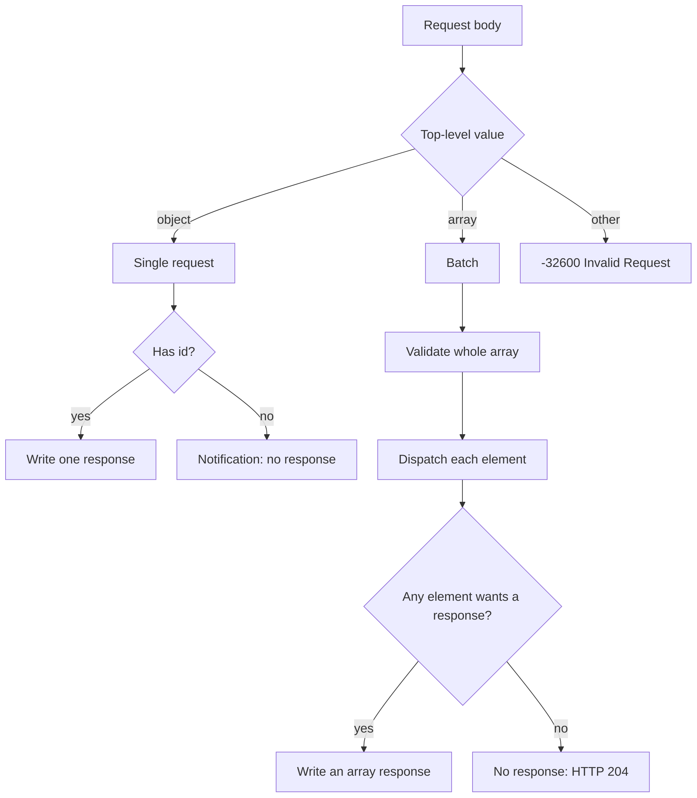
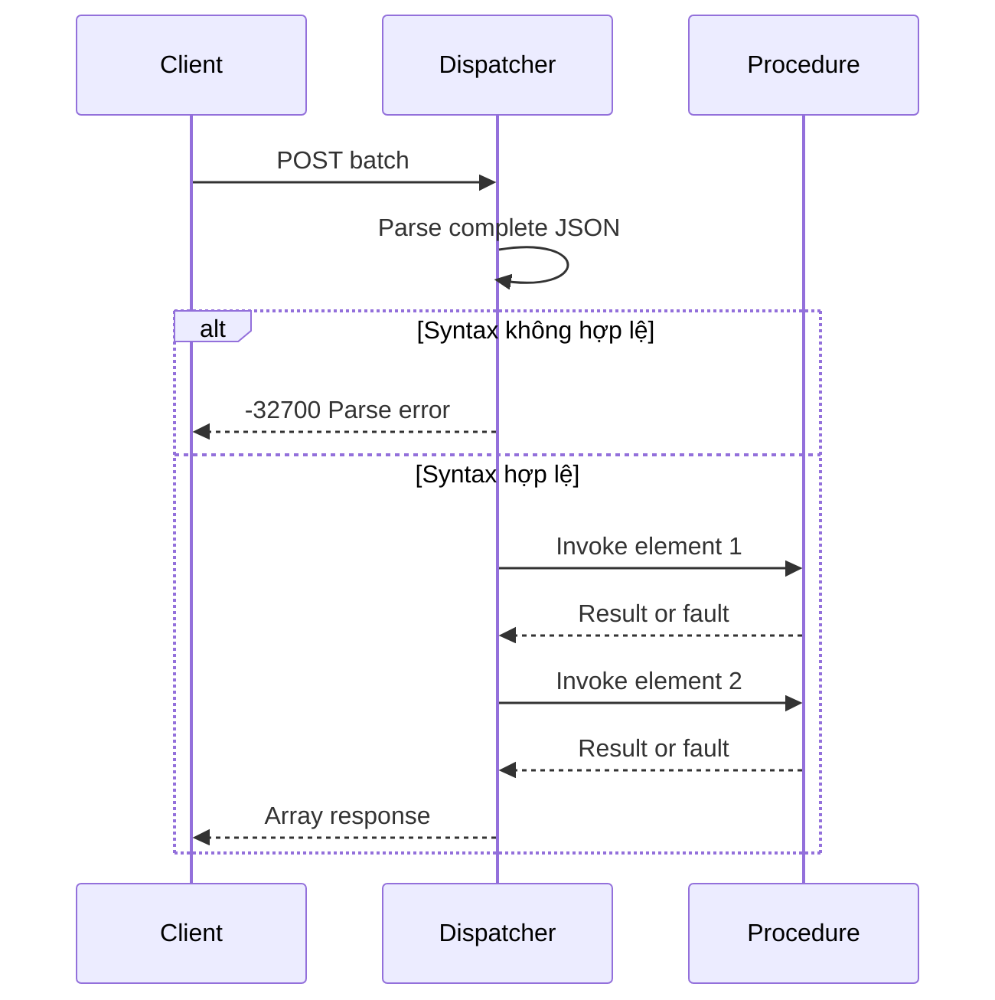

JSON-RPC 2.0 nhận một object hoặc một array object trong một HTTP body. Khác biệt
giữa call và notification là sự có mặt của `id`, không phải endpoint riêng.
Dispatcher phân loại document trước khi gọi procedure, nên batch sai định dạng
không thể chạy một prefix hợp lệ.

## Phân loại document



Top-level type quyết định response container. Một request trả một object. Một batch
trả array, kể cả khi chỉ một phần tử cần response. Array rỗng là invalid request
và trả một error object, không phải array rỗng.

## Dạng request

| Request body                                | Response body                    | HTTP status |
| ------------------------------------------- | -------------------------------- | ----------- |
| Một object có `id`                          | Một result hoặc error object     | `200`       |
| Một object không có `id`                    | Rỗng                             | `204`       |
| Array có ít nhất một request                | Array của result và error object | `200`       |
| Array chỉ có notification                   | Rỗng                             | `204`       |
| Array rỗng                                  | Một `-32600` error object        | `200`       |
| JSON sai định dạng                          | Một `-32700` error object        | `200`       |
| Top-level string, number, boolean hoặc null | Một `-32600` error object        | `200`       |

Notification bị bỏ khỏi response array. Các response còn lại giữ thứ tự input, nên
client có thể correlate `id` mà không cần index riêng.

## Pre-validation trước side effect

Batch được validate qua hai pass. Pass đầu parse toàn bộ JSON syntax và kiểm tra
document kết thúc sau array. Chỉ sau đó dispatcher scan lại array và gọi procedure.



Syntax error ở phần tử cuối ngăn phần tử đầu chạy. Semantic error ở một phần tử,
như unknown method hoặc invalid parameter, không dừng các phần tử khác.

## Phần tử không hợp lệ

Array element không phải object tạo một `-32600` error object với id `null`. Các
phần tử hợp lệ vẫn chạy:

```json
[
  { "jsonrpc": "2.0", "result": 5, "id": 1 },
  { "jsonrpc": "2.0", "error": { "code": -32600, "message": "Invalid Request" }, "id": null },
  { "jsonrpc": "2.0", "result": 8, "id": 3 }
]
```

Error object nằm ở vị trí của phần tử không hợp lệ. Nó không bị append vào cuối.
Khối này được format cho dễ đọc; dispatcher gửi JSON compact trên wire.

## Notification

Notification là request hợp lệ không có `id`. Nó chạy procedure và bỏ response:

```json
{ "jsonrpc": "2.0", "method": "metrics.increment", "params": { "name": "requests" } }
```

| Kết quả notification       | Response                        |
| -------------------------- | ------------------------------- |
| Procedure trả result       | Không                           |
| Procedure trả fault        | Không                           |
| Không tìm thấy method      | Không                           |
| Request shape không hợp lệ | Một error object với `id: null` |
| Batch chỉ có notification  | HTTP 204, không body            |

Hai dòng cuối là có chủ đích. Notification chỉ là notification khi nó là request
hợp lệ. Object không có `method` không thể được coi là notification, nên
dispatcher báo protocol error.

## Method name và sealing

Method name được copy vào service trong lúc đăng ký. Bản copy nghĩa là caller có
thể free hoặc tái sử dụng source slice sau khi `register` trả về.

| Rule                          | Kết quả                    |
| ----------------------------- | -------------------------- |
| Tên rỗng                      | `error.InvalidMethodName`  |
| Dài hơn 255 byte              | `error.InvalidMethodName`  |
| UTF-8 không hợp lệ            | `error.InvalidMethodName`  |
| Bắt đầu bằng `rpc.`           | `error.InvalidMethodName`  |
| Tên trùng                     | `error.DuplicateProcedure` |
| Đăng ký sau `seal` hoặc mount | `error.RegistryLocked`     |

`app.rpc` seal registry lúc mount. Batch không thể thêm procedure và procedure
không thể bị thay thế khi server đang chạy.

## Kiểm tra batch

```sh
curl -sS http://127.0.0.1:3000/rpc \
  -H 'Content-Type: application/json' \
  --data '[
    {"jsonrpc":"2.0","method":"math.add","params":{"left":2,"right":3},"id":1},
    {"jsonrpc":"2.0","method":"math.add","params":{"left":4,"right":5}},
    {"jsonrpc":"2.0","method":"math.add","params":{"left":6,"right":7},"id":3}
  ]'
```

```json
[
  { "jsonrpc": "2.0", "result": { "sum": 5 }, "id": 1 },
  { "jsonrpc": "2.0", "result": { "sum": 11 }, "id": 3 }
]
```

Notification đã chạy nhưng không tạo phần tử. Thay object ở giữa bằng `1` và
response chứa `-32600` error tại vị trí đó.

## Tiếp theo

- [JSON-RPC errors](/docs/json-rpc/errors) liệt kê mọi code và HTTP mapping.
- [JSON-RPC capacities](/docs/json-rpc/capacities) giải thích điều xảy ra khi batch
  response vượt buffer.
- [Testing một JSON-RPC service](/docs/json-rpc/testing) trình bày batch fixture và
  assertion.
