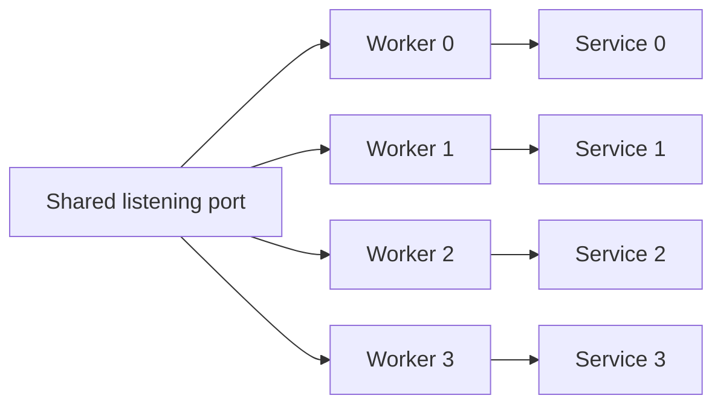

Cluster chạy một event loop cho mỗi worker, và mỗi worker có slab, connection và
route table riêng. JSON-RPC service sở hữu response buffer mutable, nên nó theo
cùng rule: một service cho mỗi worker, mount trên loop của worker đó. Chia sẻ một
service giữa các worker sẽ race trên response byte.

## Sơ đồ



Kernel phân phối connection được accept. Connection ở lại worker đã accept nó.
Mỗi worker dispatch JSON-RPC call trên loop của mình và ghi vào response buffer
riêng.

## Mount một service cho mỗi worker

`configure` chạy trước khi thread worker nào start và không capture được biến
local, nên giữ service array ở địa chỉ ổn định:

```zig
const worker_capacity = 4;

const AddParams = struct { left: i64, right: i64 };
const AddResult = struct { sum: i64 };

fn add(params: AddParams) uz.json_rpc.HandlerError!AddResult {
    return .{ .sum = params.left + params.right };
}

var services = [_]uz.json_rpc.Service{
    .{}, .{}, .{}, .{},
};

pub fn main(init: std.process.Init) !void {
    var group = try uz.Server.builder(init.io)
        .with_max_clients(256)
        .build_cluster(std.heap.page_allocator, worker_capacity, .{});
    defer group.deinit();

    const Cluster = @TypeOf(group);
    try group.configure(struct {
        fn routes(worker: *Cluster.Worker, index: usize) !void {
            const service = &services[index];
            try service.register_typed("math.add", AddParams, AddResult, add);
            _ = try worker.rpc("/rpc", service);
        }
    }.routes);

    try group.catch_shutdown_signals();
    try group.listen("0.0.0.0", 3000);
    try group.run();
}
```

Độ dài array phải bao phủ compiled worker capacity, không phải active count.
`build_cluster` cố định capacity lúc compile; `options.worker_count` có thể chọn
ít worker active hơn, nhưng worker index không bao giờ vượt capacity.

## Mỗi worker sở hữu gì

| Item              | Owner                                  |
| ----------------- | -------------------------------------- |
| Service value     | Một array element cho mỗi worker       |
| Response buffer   | Service trên worker đó                 |
| Procedure state   | Context pointer đăng ký trên worker đó |
| Event loop        | Worker                                 |
| Client connection | Worker đã accept chúng                 |

Không service, response buffer hay procedure context nào được chia sẻ giữa các
worker.

## Chia sẻ data giữa worker

Procedure chỉ có thể đọc hoặc ghi data thuộc worker khác qua cơ chế tường minh:

| Nhu cầu                         | Cơ chế                                          |
| ------------------------------- | ----------------------------------------------- |
| Broadcast message có giới hạn   | `Cluster.publish` hoặc `Cluster.publish_report` |
| Đọc shared configuration        | Immutable startup data                          |
| Lưu durable state               | Database hoặc service bên ngoài                 |
| Chia sẻ counter                 | Counter theo worker cộng merge khi đọc          |
| Chia sẻ service response buffer | Không được hỗ trợ                               |

`Cluster.publish` copy vào inbox có giới hạn của từng worker. Nó không chia sẻ
pointer, slab hay response buffer. Procedure cần global view phải query store sở
hữu data, không phải memory của worker khác.

## Quy tắc đăng ký

Mỗi service đăng ký procedure của mình trong `configure`:

| Rule                              | Hệ quả                                |
| --------------------------------- | ------------------------------------- |
| Đăng ký trước `worker.rpc`        | `app.rpc` seal registry               |
| Đăng ký trên mọi worker           | Route chỉ tồn tại nơi nó được đăng ký |
| Đăng ký cùng tên trên mọi worker  | Cùng method có mặt trên mọi loop      |
| Dùng context riêng cho mỗi worker | State ở lại worker-local              |
| Không đăng ký sau `run`           | `error.RegistryLocked`                |

Configure callback chạy một lần cho mỗi worker. Method chỉ đăng ký trên worker 0
sẽ mất khi kernel route request sang worker 1. Đăng ký đủ method set trên mọi
worker.

## Memory

Nhân service capacity với số worker đã compile:

| Capacity        | Mỗi worker | Bốn worker |
| --------------- | ---------: | ---------: |
| Procedure       |       `64` |      `256` |
| Method storage  |    `4 KiB` |   `16 KiB` |
| Response buffer |   `16 KiB` |   `64 KiB` |

Service value còn nhúng handler array và lookup slot; xem
[JSON-RPC capacities](/docs/json-rpc/capacities) cho layout đầy đủ. Array sống
suốt process, nên nó không thêm allocation vào request path.

## Kiểm tra đường worker

Start group và gửi vài request:

```sh
for index in $(seq 1 20); do
  curl -sS http://127.0.0.1:3000/rpc \
    -H 'Content-Type: application/json' \
    --data '{"jsonrpc":"2.0","method":"math.add","params":{"left":2,"right":3},"id":1}'
done
```

Mọi response phải giống nhau. Method chỉ tồn tại trên một worker tạo
`-32601 Method not found` trên các worker khác. Lặp lại sau worker failure để xác
nhận failure được báo bởi `first_failure()` thay vì bị che bởi route table thiếu.

## Tiếp theo

- [JSON-RPC capacities](/docs/json-rpc/capacities) chọn kích thước service của từng worker.
- [Shared-nothing cluster](/examples/shared-nothing-cluster) trình bày cluster lifecycle.
- [Cluster model](/docs/concepts/cluster-model) giải thích shared-nothing rule.
