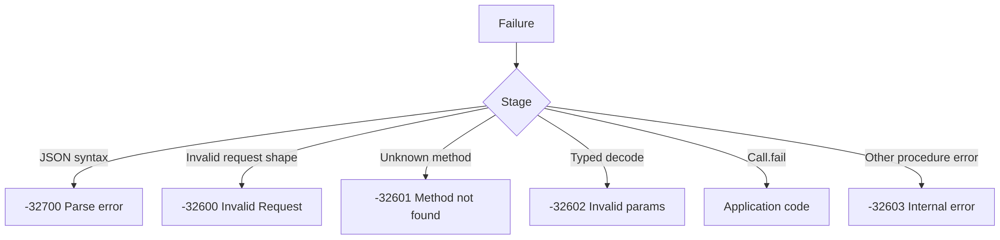

JSON-RPC error là protocol response, không phải HTTP failure. Adapter trả
`200 OK` với object `error` cho parse error, unknown method, invalid parameter
hoặc application fault. HTTP status được dành cho transport boundary: media type,
response buffer cạn và server failure.

## Object lỗi

```json
{
  "jsonrpc": "2.0",
  "error": { "code": -32601, "message": "Method not found" },
  "id": 7
}
```

Khối này được format cho dễ đọc; dispatcher gửi JSON compact trên wire.

Request hợp lệ echo raw id byte trong member `id`. Mọi request bị đánh dấu không
hợp lệ ghi `"id": null`, kể cả khi có id đúng cú pháp. Điều này gồm member `id`,
`method`, `params` hoặc `jsonrpc` trùng lặp và member value sai kiểu.

## Mã chuẩn

| Constant                         | Code     | Message            | Nguyên nhân                              |
| -------------------------------- | -------- | ------------------ | ---------------------------------------- |
| `StandardError.parse_error`      | `-32700` | `Parse error`      | Body không phải JSON hợp lệ              |
| `StandardError.invalid_request`  | `-32600` | `Invalid Request`  | Document shape hoặc member không hợp lệ  |
| `StandardError.method_not_found` | `-32601` | `Method not found` | Không có procedure cho tên đó            |
| `StandardError.invalid_params`   | `-32602` | `Invalid params`   | `HandlerError.InvalidParams` được trả về |
| `StandardError.internal_error`   | `-32603` | `Internal error`   | Procedure fail vì lý do khác             |

Dispatcher ghi chính xác các message này. Test có thể snapshot toàn bộ object mà
không cần normalize.

## Lỗi procedure

| `HandlerError`         | JSON-RPC result                                   |
| ---------------------- | ------------------------------------------------- |
| `InvalidParams`        | `-32602 Invalid params`                           |
| `ApplicationError`     | Code và message từ `Call.fail`                    |
| `Aborted`              | Không có response; request hoặc connection đã mất |
| `InternalError`        | `-32603 Internal error`                           |
| `OutOfMemory`          | `-32603 Internal error`                           |
| `ResultAlreadyWritten` | `-32603 Internal error`                           |
| `ResultTooLarge`       | `-32603 Internal error` khi error vẫn vừa         |

`Call.fail` là cách duy nhất để chọn application code:

```zig
fn withdraw(call: *uz.json_rpc.Call) uz.json_rpc.HandlerError!void {
    return call.fail(-32001, "insufficient funds");
}
```

Dispatcher không validate code range. Dùng `-32000` đến `-32099` cho
implementation-defined server error, theo range JSON-RPC 2.0 dành riêng. Application
trả `error.ApplicationError` mà không gọi `Call.fail` sẽ nhận `-32603`.

## Lỗi protocol



Batch sai định dạng được validate trước khi procedure nào chạy. Syntax failure trả
một object `-32700`, không phải array. Batch hợp lệ về syntax nhưng có phần tử
không hợp lệ trả array chứa error object cho phần tử đó và result cho các phần tử
hợp lệ.

## Ánh xạ HTTP

| Điều kiện                             | HTTP status | Body                              |
| ------------------------------------- | ----------- | --------------------------------- |
| Thiếu, trùng hoặc sai `Content-Type`  | `415`       | Rỗng; `Accept: application/json`  |
| Response được yêu cầu                 | `200`       | Result hoặc error object          |
| Không yêu cầu response                | `204`       | Rỗng                              |
| Dispatch trả `error.Aborted`          | `500`       | Rỗng, trừ khi response đã bắt đầu |
| Dispatch trả `error.ResponseTooLarge` | `500`       | Rỗng, trừ khi response đã bắt đầu |
| Adapter gặp failure không mong đợi    | `500`       | Rỗng                              |

Adapter không bao giờ map JSON-RPC error thành HTTP 400. Client coi `200` là thành
công phải kiểm tra member `error`. Monitoring chỉ đếm HTTP 5xx sẽ bỏ sót mọi
protocol error.

## Lỗi đăng ký

`register`, `register_typed`, `register_context` và `register_typed_context` trả
`RegistrationError`:

| Error                          | Nguyên nhân                                                |
| ------------------------------ | ---------------------------------------------------------- |
| `DuplicateProcedure`           | Method name đã được đăng ký                                |
| `InvalidMethodName`            | Rỗng, quá 255 byte, UTF-8 không hợp lệ hoặc bắt đầu `rpc.` |
| `MethodStorageCapacityReached` | Method name được copy vượt storage capacity                |
| `ProcedureCapacityReached`     | Số procedure chạm maximum đã cấu hình                      |
| `RegistryLocked`               | Đăng ký sau `seal` hoặc sau `app.rpc`                      |

Đây là startup error. Chúng không phải JSON-RPC response vì không có request.

## Lỗi dispatch

| Error                            | Ý nghĩa                                     |
| -------------------------------- | ------------------------------------------- |
| `DispatchError.Aborted`          | Abort signal phát trước hoặc trong dispatch |
| `DispatchError.ResponseTooLarge` | Output buffer không chứa nổi document       |

`dispatch` trả `?[]const u8`: `null` nghĩa là document không yêu cầu response, nên
HTTP adapter gửi `204`. `dispatch_with_signal` nhận cùng input cộng abort signal.

## Tiếp theo

- [Batches và notifications](/docs/json-rpc/batches-and-notifications) trình bày
  document shape tạo ra từng kết quả.
- [JSON-RPC capacities](/docs/json-rpc/capacities) giải thích response buffer giới
  hạn error và result document.
- [Testing một JSON-RPC service](/docs/json-rpc/testing) biến các object này thành
  assertion.
