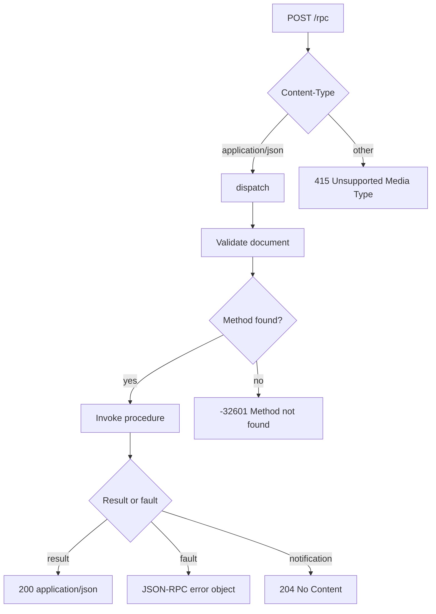

`uz.json_rpc.Service` là một registry JSON-RPC 2.0 có capacity cố định. Nó decode
named parameter thành kiểu Zig, serialize kết quả theo type đã khai báo vào response buffer có
giới hạn, và mount trên một POST route bằng `app.rpc`. Dispatcher không phụ thuộc
request hay response HTTP; nó chỉ cần abort signal. Bạn có thể gọi nó từ một
transport khác khi HTTP adapter không phù hợp.

Phần này trình bày typed API, protocol rule, error model và ownership rule để một
service an toàn trên một event loop.

## Bắt đầu

<CardGroup cols={2}>
  <Card title="JSON-RPC quickstart" href="/docs/json-rpc/quickstart" icon="play">
    Đăng ký một typed procedure, mount lên route và kiểm tra một call bằng curl.
  </Card>
  <Card title="Typed procedures" href="/docs/json-rpc/typed-procedures" icon="braces">
    Decode named parameter và serialize result bằng adapter lúc compile.
  </Card>
  <Card title="Context và custom decoding" href="/docs/json-rpc/context-and-decoding" icon="layers">
    Mang state do caller sở hữu và tự quyết định allocation cho parameter.
  </Card>
  <Card title="JSON-RPC errors" href="/docs/json-rpc/errors" icon="shield-alert">
    Map standard code, application fault và HTTP status không mơ hồ.
  </Card>
</CardGroup>

## Hành vi protocol

<CardGroup cols={2}>
  <Card
    title="Batches và notifications"
    href="/docs/json-rpc/batches-and-notifications"
    icon="list"
  >
    Phân loại single call, notification, batch và phần tử không hợp lệ.
  </Card>
  <Card title="JSON-RPC capacities" href="/docs/json-rpc/capacities" icon="ruler">
    Đọc giới hạn procedure, method storage, scratch và response.
  </Card>
  <Card title="Transports và raw dispatch" href="/docs/json-rpc/transports" icon="network">
    So sánh HTTP adapter với gọi `dispatch` trực tiếp và custom transport.
  </Card>
  <Card title="JSON-RPC trong cluster" href="/docs/json-rpc/cluster-deployment" icon="server">
    Tạo một service cho mỗi worker và mount trong configure callback.
  </Card>
</CardGroup>

## Vận hành

<CardGroup cols={1}>
  <Card title="Testing một JSON-RPC service" href="/docs/json-rpc/testing" icon="flask-conical">
    Test dispatcher như một pure function, sau đó kiểm tra route bằng curl và load tool.
  </Card>
</CardGroup>

## Đường request



Adapter kiểm tra media type trước khi chạm vào body. Dispatcher sau đó validate
JSON syntax, resolve method và ghi result hoặc error vào response buffer do
service sở hữu.

## Service tối thiểu

```zig
const std = @import("std");
const uz = @import("uWebZockets");

const AddParams = struct { left: i64, right: i64 };
const AddResult = struct { sum: i64 };

fn add(params: AddParams) uz.json_rpc.HandlerError!AddResult {
    return .{ .sum = params.left + params.right };
}

pub fn main(init: std.process.Init) !void {
    var app = try uz.App(128).init(init.io);
    defer app.deinit();

    var rpc = uz.json_rpc.Service{};
    try rpc.register_typed("math.add", AddParams, AddResult, add);
    _ = try app.rpc("/rpc", &rpc);

    try app.catch_shutdown_signals();
    try app.listen("0.0.0.0", 3000);
    try app.run();
}
```

## Bề mặt được hỗ trợ

| Surface                         | Trạng thái                                                 |
| ------------------------------- | ---------------------------------------------------------- |
| Single call                     | Được hỗ trợ                                                |
| Notification                    | Được hỗ trợ; HTTP 204 khi không cần response               |
| Batch                           | Được hỗ trợ; validate trước procedure đầu tiên             |
| Typed procedure                 | Được hỗ trợ với parameter scratch 4 KiB                    |
| Custom parameter decoding       | Được hỗ trợ qua `register` và `Call.parse_params`          |
| Application error fault         | Được hỗ trợ qua `Call.fail`                                |
| HTTP adapter                    | Được hỗ trợ; một POST route                                |
| Direct dispatch                 | Được hỗ trợ; caller sở hữu input và output buffer          |
| JSON-RPC qua WebSocket          | Không được tích hợp sẵn; application tự dispatch raw frame |
| JSON-RPC qua HTTP/2 hoặc HTTP/3 | Được hỗ trợ qua POST route thông thường                    |

:::warning[Một service cho một event loop]
Service sở hữu một response buffer. Không chia sẻ service giữa các cluster worker
và không gọi nó từ hai thread. Xem
[JSON-RPC trong cluster](/docs/json-rpc/cluster-deployment).
:::

## Tiếp theo

Đọc [JSON-RPC quickstart](/docs/json-rpc/quickstart) để build và kiểm tra service,
sau đó xem [capacities](/docs/json-rpc/capacities) trước khi chọn kích thước một deployment
production.
