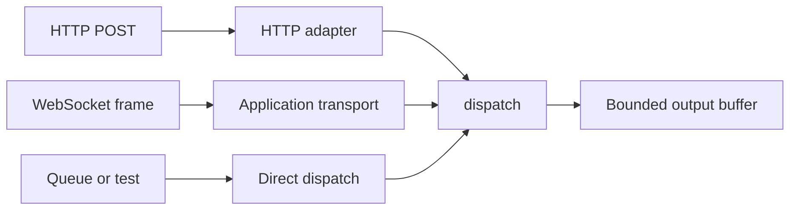

JSON-RPC dispatcher không phụ thuộc transport. Nó nhận byte slice, ghi byte slice
và trả `null` khi document không yêu cầu response. HTTP adapter là một caller của
contract đó; WebSocket route, queue consumer hoặc test có thể là caller khác.

## Dispatch không cần HTTP

```zig
fn handle_document(
    service: *uz.json_rpc.Service,
    input: []const u8,
    output: []u8,
) uz.json_rpc.DispatchError!?[]const u8 {
    return service.dispatch(input, output);
}
```

Caller sở hữu `input` và `output`. Slice trả về trỏ vào `output` và có hiệu lực cho tới
khi caller dùng lại buffer. Trả `null` nghĩa là document là notification hoặc
batch chỉ có notification, nên transport không gửi gì.

Để cancellation, truyền abort signal của transport:

```zig
const body = try service.dispatch_with_signal(signal, input, &output);
```

`AbortSignal` là type framework duy nhất mà dispatcher import. Protocol layer không
import `Request`, `Response`, socket hay HTTP parser.

## Tùy chọn transport



| Transport          | Entry point          | Output buffer          | Response shape                |
| ------------------ | -------------------- | ---------------------- | ----------------------------- |
| HTTP POST          | `app.rpc`            | Service sở hữu         | HTTP 200, 204, 415 hoặc 500   |
| Direct dispatch    | `service.dispatch`   | Caller sở hữu          | `?[]const u8`                 |
| Custom WebSocket   | Application code     | Caller sở hữu, rồi gửi | Text frame chứa JSON document |
| HTTP/2 hoặc HTTP/3 | Cùng HTTP POST route | Service sở hữu         | Như HTTP/1.1                  |

HTTP/2 và HTTP/3 không cần JSON-RPC path riêng. Route là POST route bình thường,
nên transport adapter giao toàn bộ request body và service ghi một response có
giới hạn.

## Quy tắc HTTP adapter

Adapter nằm trong `src/rpc/http.zig` và enforce transport boundary:

| Check                             | Kết quả                                       |
| --------------------------------- | --------------------------------------------- |
| Đúng một header `Content-Type`    | Nếu không, `415 Unsupported Media Type`       |
| Media type `application/json`     | Chấp nhận, có hoặc không có parameter         |
| Media type `application/json-rpc` | Chấp nhận, có hoặc không có parameter         |
| Case và whitespace                | So sánh media type không phân biệt hoa thường |
| Dispatch trả body                 | `200` với `application/json; charset=utf-8`   |
| Dispatch trả `null`               | `204 No Content`                              |
| Adapter fail trước response       | `500 Internal Server Error`                   |

Adapter đọc `request.bytes()` và ghi qua `service.response_buffer()`. Nó không
stream, chunk hay parse partial document. Request body vượt
`ServerConfig.max_body_size` bị HTTP parser từ chối trước khi adapter chạy.

## Tự build custom transport

Custom transport sở hữu bốn bước:

1. Nhận một document hoàn chỉnh.
2. Gọi `dispatch` với buffer sống tới khi response được gửi.
3. Gửi slice trả về, hoặc không gửi gì với `null`.
4. Giữ service trên cùng event loop và thread với mọi caller khác.

Output buffer do transport sở hữu và không được dùng lại trước khi send xong.
`WebSocket.send` copy byte vào connection write queue trước khi trả về, nên
WebSocket transport có thể dùng lại buffer sau call đó. Transport khác cần copy
tương đương hoặc await.

:::warning[Không có WebSocket transport built in]
µWebZockets không ship JSON-RPC-over-WebSocket transport. Callback của route `ws`
nhận `*WebSocket` và message; application phải tự gọi `dispatch`. Không mô tả
WebSocket JSON-RPC là framework feature.
:::

## Một service, một loop

`dispatch` ghi vào output buffer của caller, nhưng service đã mount còn cung cấp
một `response_buffer`, và procedure context không được synchronize. Hai thread
chia sẻ một trong hai storage đó sẽ race. Giữ mọi call cho một service trên
event loop sở hữu.

| Caller               | Cần cùng loop | Lý do                             |
| -------------------- | ------------- | --------------------------------- |
| HTTP route           | Có            | Dùng service response buffer      |
| WebSocket message    | Có            | Cùng buffer, cùng loop            |
| Background job       | Có            | Không có internal synchronization |
| Cluster worker riêng | Service riêng | Mô hình shared-nothing worker     |

## Tiếp theo

- [JSON-RPC trong cluster](/docs/json-rpc/cluster-deployment) áp dụng rule một
  service cho một loop vào worker.
- [JSON-RPC capacities](/docs/json-rpc/capacities) chọn kích thước output buffer.
- [WebSocket messages](/docs/websocket/messages) trình bày frame callback mà
  transport này sẽ đứng sau.
