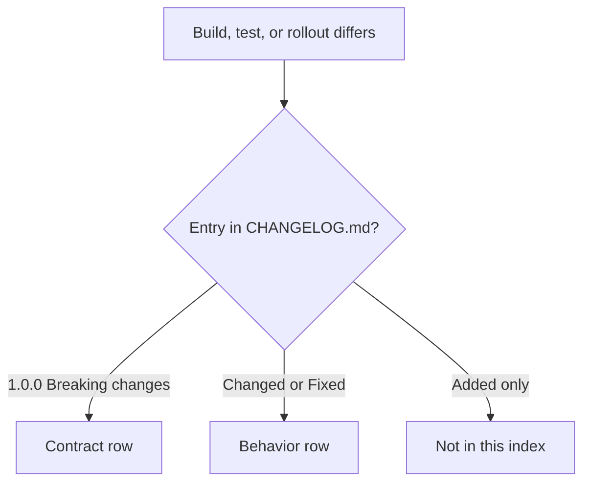

Trang này index những thay đổi có thể làm hỏng build, test hoặc một giả định vận
hành. Nó gồm các mục `Breaking changes` của 1.0.0 và các behavior change mà
release sau ghi dưới `Changed` hoặc `Fixed`. Trang không liệt kê performance-only
work hay additive API, trừ khi addition đó đổi behavior hiện có.

Mọi dòng trong index link tới changelog section của nó. Nếu một entry không có trong
[CHANGELOG.md](https://github.com/farbenbuilds/uWebZockets/blob/main/CHANGELOG.md),
nó không có trong index này. Dòng 2.2.0 chưa release và không có dòng nào.

## Đọc index này thế nào [#how-to-read-this-index]

| Label             | Ý nghĩa                                                                                                        |
| ----------------- | -------------------------------------------------------------------------------------------------------------- |
| Contract change   | Entry 1.0.0 từ heading `Breaking changes`; source hoặc một public promise đã đổi                               |
| Behavior change   | Entry `Changed` hoặc `Fixed` sau này; không remove public signature, nhưng test hoặc deployment có thể nhận ra |
| Source adjustment | Entry sau này đổi call site mà không remove feature                                                            |

| Release | Index entries                                           |
| ------- | ------------------------------------------------------- |
| 1.0.0   | 8 contract change                                       |
| 1.7.1   | 4 behavior change và 1 source adjustment                |
| 1.8.5   | 1 behavior change                                       |
| 1.9.0   | 1 behavior change                                       |
| 2.0.0   | 2 behavior change                                       |
| 2.0.5   | 2 behavior change                                       |
| 2.1.0   | 1 footprint change                                      |
| 2.1.5   | 5 behavior change và 1 source adjustment                |
| 2.1.6   | Không có entry; patch release không đổi public contract |
| 2.2.0   | Không có entry; chưa release                            |

Những dòng dễ bỏ sót:

- Một minor release có thể đổi callback signature (2.1.5).
- Một minor release có thể đổi default footprint (2.1.0).
- Một security fix có thể reject input từng pass (2.0.5).

## Contract change từ 1.0.0 [#contract-changes-from-100]

| Version                                                                                      | Area                            | Behavior cũ                                                                                 | Behavior mới                                                                                        | Action                                                                   |
| -------------------------------------------------------------------------------------------- | ------------------------------- | ------------------------------------------------------------------------------------------- | --------------------------------------------------------------------------------------------------- | ------------------------------------------------------------------------ |
| [1.0.0](https://github.com/farbenbuilds/uWebZockets/blob/main/CHANGELOG.md#breaking-changes) | Route và WebSocket registration | Registration không yêu cầu xử lý error union                                                | Trả về error union; xử lý bằng `try`, `catch` hoặc tương đương                                      | `_ = try app.get("/", handler);` và `_ = try app.ws("/chat", behavior);` |
| [1.0.0](https://github.com/farbenbuilds/uWebZockets/blob/main/CHANGELOG.md#breaking-changes) | Route mutation sau listen       | Route mutation không được guard bởi listener lock                                           | Trả `error.RoutesLocked` sau khi `listen` hoặc `listen_udp` thành công                              | Đăng ký mọi route trước lần gọi listener thành công đầu tiên             |
| [1.0.0](https://github.com/farbenbuilds/uWebZockets/blob/main/CHANGELOG.md#breaking-changes) | WebSocket message size          | `App(N)` mặc định có ceiling 16 KiB                                                         | Message trên 16 KiB cần `ConfiguredApp` và limit `WsBehavior` khớp                                  | Đặt `max_frame_size <= max_message_size <= message capacity`             |
| [1.0.0](https://github.com/farbenbuilds/uWebZockets/blob/main/CHANGELOG.md#breaking-changes) | Output và backpressure          | Output không có bounded-queue failure để báo                                                | Response writer và `WebSocket.send` có thể trả `error.WouldBlock`                                   | Coi `WouldBlock` là bình thường; resume từ `drain` callback              |
| [1.0.0](https://github.com/farbenbuilds/uWebZockets/blob/main/CHANGELOG.md#breaking-changes) | WebSocket send và close         | Continuation chưa được document là bị reject; close path chưa có split drain-then-terminate | `send` từ chối `.continuation` với `error.InvalidOpcode`; `send_close` drain, `terminate` immediate | Gửi message final hoàn chỉnh; dùng `terminate` cho close immediate       |
| [1.0.0](https://github.com/farbenbuilds/uWebZockets/blob/main/CHANGELOG.md#breaking-changes) | HTTP/3 availability             | `http3_available` là false; HTTP/3 không phải live listener                                 | `http3_available` báo QUIC backend được compile; `listen_udp` mở live path                          | Thêm `listen_udp` trước `run`; gate listener trên `uz.http3_available`   |
| [1.0.0](https://github.com/farbenbuilds/uWebZockets/blob/main/CHANGELOG.md#breaking-changes) | RFC 7692 compression            | `WsBehavior` không có compression switch public                                             | `WsBehavior.compression` tồn tại và mặc định `.disabled`                                            | Opt in bằng `.permessage_deflate` cho từng route                         |
| [1.0.0](https://github.com/farbenbuilds/uWebZockets/blob/main/CHANGELOG.md#breaking-changes) | Request target field            | Route matching dùng một target string                                                       | `path` là match path, `target` là target gốc kèm query, `query` không có `?`                        | Dùng `path` cho routing, `target` và `query` cho logging và parsing      |

## Behavior change sau 1.0.0 [#behavior-changes-after-100]

| Version                                                                                      | Area                                    | Behavior cũ                                                                                                | Behavior mới                                                                                       | Action                                                                    |
| -------------------------------------------------------------------------------------------- | --------------------------------------- | ---------------------------------------------------------------------------------------------------------- | -------------------------------------------------------------------------------------------------- | ------------------------------------------------------------------------- |
| [1.7.1](https://github.com/farbenbuilds/uWebZockets/blob/main/CHANGELOG.md#171---2026-10-06) | Route pattern conflict                  | Pattern parameterized có segment skeleton chỉ khác capture name khiến pattern sau âm thầm unreachable      | Registration trả `error.RoutePatternConflicts`                                                     | Rename hoặc remove skeleton trùng trước khi upgrade                       |
| [1.7.1](https://github.com/farbenbuilds/uWebZockets/blob/main/CHANGELOG.md#171---2026-10-06) | Phạm vi `App.shutdown`                  | `App.shutdown` không có loop-thread restriction được document                                              | `App.shutdown` chỉ dùng trên loop thread; dùng `App.request_shutdown` từ thread khác hoặc callback | Thay call `shutdown` cross-thread bằng `request_shutdown`                 |
| [1.7.1](https://github.com/farbenbuilds/uWebZockets/blob/main/CHANGELOG.md#171---2026-10-06) | `max_h3_response_header_count`          | Giá trị trên 4096 được configuration chấp nhận                                                             | Validation cap giá trị ở 4096                                                                      | Hạ mọi giá trị trên 4096; QUIC framing không thể size stack frame lớn hơn |
| [1.7.1](https://github.com/farbenbuilds/uWebZockets/blob/main/CHANGELOG.md#171---2026-10-06) | mTLS early data                         | TLS 1.3 early data có thể tới route trước khi client certificate được verify                               | Early data bị disable ở mode mTLS `optional` và `required`                                         | Chuẩn bị cho full handshake; không xây 0-RTT path phụ thuộc mTLS          |
| [1.8.5](https://github.com/farbenbuilds/uWebZockets/blob/main/CHANGELOG.md#185---2026-10-18) | `Cluster.listen` sau release            | Cluster đã release có thể báo success mà không bind worker nào                                             | Trả `error.ClusterDeinitialized`                                                                   | Kiểm tra lifecycle trước listen; rebuild sau `deinit`                     |
| [1.9.0](https://github.com/farbenbuilds/uWebZockets/blob/main/CHANGELOG.md#190---2026-10-20) | `Cluster.request_shutdown` sau `deinit` | No-op sau `deinit` không được document                                                                     | Trả về ngay như một no-op đã được document                                                         | Rebuild cluster thay vì dựa vào shutdown để báo release                   |
| [2.0.0](https://github.com/farbenbuilds/uWebZockets/blob/main/CHANGELOG.md#200---2026-10-20) | HTTP/1.1 pipelining batching            | Mỗi pipelined response đi qua write path riêng                                                             | Nhiều complete request trong một read append response vào bounded ring và flush một lần            | Cập nhật test đang assert một write cho mỗi response                      |
| [2.0.0](https://github.com/farbenbuilds/uWebZockets/blob/main/CHANGELOG.md#200---2026-10-20) | WebSocket batching                      | Mỗi buffered frame arm một completion và write riêng                                                       | Các frame liên tiếp từ một read share một write flush; AVX2 dùng unmasking 256-bit                 | Chạy lại echo và backpressure test                                        |
| [2.0.5](https://github.com/farbenbuilds/uWebZockets/blob/main/CHANGELOG.md#205---2026-10-22) | WebSocket upgrade duplicate             | Duplicate security-sensitive field trong extra header slot có thể bị coi là absent                         | Upgrade bị reject                                                                                  | Remove duplicate handshake field ở client hoặc proxy                      |
| [2.0.5](https://github.com/farbenbuilds/uWebZockets/blob/main/CHANGELOG.md#205---2026-10-22) | HTTP/3 `max_header_size`                | `max_header_size` trên 65535 có thể tới activation                                                         | Bị reject với `error.InvalidHttp3Capacity` trước khi QUIC slab được allocate                       | Đặt HTTP/3 request header size từ 65535 trở xuống                         |
| [2.1.0](https://github.com/farbenbuilds/uWebZockets/blob/main/CHANGELOG.md#210---2026-10-24) | Default application slab                | Default slab total là `681_752_192` byte                                                                   | Default slab total là `683_382_400` byte; configured limit không đổi                               | Kiểm tra lại memory budget hoặc gọi `slab_bytes()` trước deployment       |
| [2.1.5](https://github.com/farbenbuilds/uWebZockets/blob/main/CHANGELOG.md#215---2026-10-25) | `Cluster.publish` sau `run`             | Publish sau `run` có thể queue vào loop không còn consume                                                  | Trả `error.ClusterStopped`                                                                         | Ngừng publish trước khi `run` return; dùng `publish_report` khi đang chạy |
| [2.1.5](https://github.com/farbenbuilds/uWebZockets/blob/main/CHANGELOG.md#215---2026-10-25) | `Cluster.run` error shape               | Worker event-loop hoặc cleanup failure không được phân biệt ở call site                                    | Trả original spawn error, hoặc `error.ClusterWorkerFailed` cho event-loop hoặc cleanup failure     | Branch theo error và đọc `first_failure()` để lấy worker và phase         |
| [2.1.5](https://github.com/farbenbuilds/uWebZockets/blob/main/CHANGELOG.md#215---2026-10-25) | Cluster lifecycle misuse                | Lifecycle misuse có thể chạm drained worker storage                                                        | Trả `ClusterRunning`, `ClusterStopped` hoặc `ClusterDeinitialized`                                 | Xử lý named error thay vì retry mù                                        |
| [2.1.5](https://github.com/farbenbuilds/uWebZockets/blob/main/CHANGELOG.md#215---2026-10-25) | `message_queue.pop_copy`                | Caller buffer quá nhỏ có thể gây release-build out-of-bounds copy hoặc mất message                         | Copy kiểm tra actual length và để message trong queue khi không fit                                | Size destination buffer hoặc dùng `pop_scratch`                           |
| [2.1.5](https://github.com/farbenbuilds/uWebZockets/blob/main/CHANGELOG.md#215---2026-10-25) | Best-effort response ending             | Best-effort write fail có thể để request không được trả lời hoặc append response thứ hai vào partial frame | TCP connection hoặc HTTP/2 hay HTTP/3 stream bị abort                                              | Rà soát caller coi best-effort call là infallible                         |

## Source adjustment trong minor release [#source-adjustments-in-minor-releases]

| Version                                                                                      | Area                | Call site cũ                                               | Yêu cầu mới                                                                                                    | Action                                                  |
| -------------------------------------------------------------------------------------------- | ------------------- | ---------------------------------------------------------- | -------------------------------------------------------------------------------------------------------------- | ------------------------------------------------------- |
| [1.7.1](https://github.com/farbenbuilds/uWebZockets/blob/main/CHANGELOG.md#171---2026-10-06) | `AesGcmError`       | Residual seal failure bị gắn nhãn là caller sizing mistake | `SealFailed` là error variant riêng                                                                            | Xử lý `SealFailed` riêng nếu match trên error set       |
| [2.1.5](https://github.com/farbenbuilds/uWebZockets/blob/main/CHANGELOG.md#215---2026-10-25) | `Cluster.configure` | Nhận tham số callback `anytype`                            | Nhận named `Cluster.ConfigureCallback`; generic route function phải được specialize cho concrete `Worker` type | Dùng concrete function hoặc specialize generic function |

## Những gì không phải breaking change [#not-breaking]

Các release sau không ghi nhận removal hay rename public name trong changelog
section của chúng. Danh sách này để một major version number hoặc patch release
không bị hiểu thành thay đổi lớn hơn record. Một source adjustment đổi call site
được liệt kê ở trên, không nằm trong bảng này.

| Release | Recorded scope                                                                                                                     |
| ------- | ---------------------------------------------------------------------------------------------------------------------------------- |
| 1.8.0   | Không đổi exported function signature, wire behavior hay default capacity semantic                                                 |
| 1.8.9   | Không đổi exported Zig hoặc C API                                                                                                  |
| 1.9.0   | Không đổi exported Zig hoặc C API signature                                                                                        |
| 2.0.0   | Không có removal hay rename giữa 1.9.0 và 2.0.0; cluster API và C struct layout không đổi; C enum addition duy nhất là append-only |
| 2.0.6   | Public API, C ABI layout, route capacity, runtime behavior và wire format không đổi                                                |
| 2.1.5   | Không đổi wire protocol, TLS, capacity hay request path                                                                            |
| 2.1.6   | Không đổi public API, C ABI layout, capacity, wire format hay TLS policy                                                           |
| 2.2.0   | Chưa release; không có dòng nào lấy từ changelog section                                                                           |

Additive work được index ở trang migration thay vì bảng này: các option 2.0.0 nằm
trong [v1 lên v2](/docs/migration/v1-to-v2#the-200-additive-changes), còn surface
2.1.x nằm trong
[2.1 lên 2.2](/docs/migration/v2-1-to-v2-2#what-21x-added).

## Check một bản upgrade [#check-an-upgrade]

1. Recompile với Zig 0.16.0 trước khi sửa code.
2. Chạy route registration test, gồm một route thêm sau `listen`.
3. Chạy lại WebSocket test với message trên 16 KiB, write queue đầy và một close
   cần drain.
4. Xác nhận C enum value không bị renumber và `UWZ_HTTP_TRACE = 9` là giá trị mới.
5. Dùng [v1 lên v2](/docs/migration/v1-to-v2) cho checklist đầy đủ và
   [2.1 lên 2.2](/docs/migration/v2-1-to-v2-2) cho baseline hiện tại.

## Liên quan [#related]

- [v1 lên v2](/docs/migration/v1-to-v2) áp dụng contract 1.0.0 cho application
  1.x.
- [2.1 lên 2.2](/docs/migration/v2-1-to-v2-2) tách surface 2.1.6 đã ship khỏi
  planning target 2.2.0.
- [Errors](/reference/errors) liệt kê named error và nguyên nhân.
- [Compatibility](/reference/compatibility) liệt kê toolchain và platform được
  hỗ trợ.
