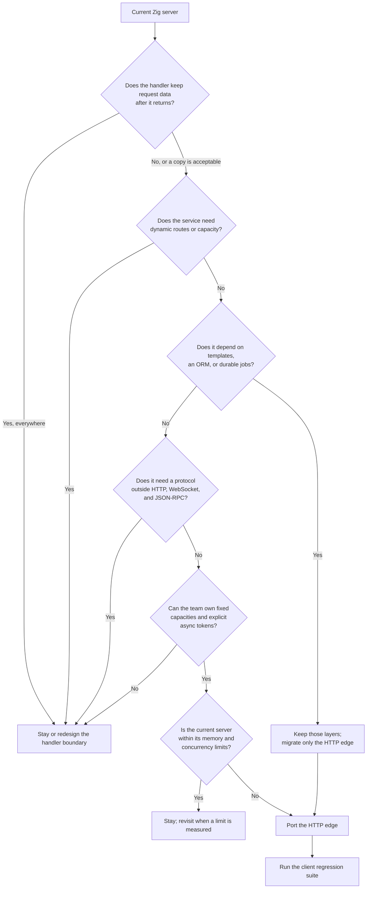

Trang này là công cụ ra quyết định, không phải API mapping. Nó mô tả hình dạng
của một migration từ một framework HTTP Zig khác: trách nhiệm nào chuyển được,
trách nhiệm nào bị thay thế, và khi nào port tốn hơn lợi ích. Trang không đưa ra
claim về API của một framework cụ thể.

## Bắt đầu từ hình dạng handler [#start-with-the-handler-shape]

Một framework migrate sạch khi handler là hàm từ request borrow sang một response
có giới hạn. Nó migrate kém khi handler sở hữu future, connection object, socket
do framework quản lý, hoặc allocator sống theo request.

| Hình dạng handler hiện tại                        | Hợp với µWebZockets | Hệ quả                                                  |
| ------------------------------------------------- | ------------------- | ------------------------------------------------------- |
| `fn (*Request, *Response) void` với slice borrow  | Có                  | Viết lại trực tiếp thành handler có tên                 |
| Hàm trả về response value                         | Có                  | Gọi response helper trong handler                       |
| Hàm `async` hoặc future được runtime await        | Không               | Complete công việc qua `AsyncResponse` trên owning loop |
| Handler giữ request sau khi trả về                | Không               | Copy dữ liệu hoặc dùng `req.clone(allocator)`           |
| Handler allocate theo từng request                | Không               | Chuyển allocation về startup hoặc dùng fixed buffer     |
| Handler mutate shared state sau lock              | Không               | Chuyển state theo worker hoặc dùng bounded message path |
| Handler stream request body không giới hạn        | Không               | Tăng `max_body_size` hoặc thiết kế lại endpoint         |
| Handler stream response theo nhịp transport drain | Có                  | Dùng `begin_stream` và `StreamProducer`                 |

## Fit matrix [#fit-matrix]

Chấm ứng dụng hiện tại theo các chiều sau. Một dòng "stay" không tự động là veto,
nhưng hai hoặc ba dòng thường là vậy.

| Chiều            | Hợp khi                                                           | Ở lại khi                                                                                          |
| ---------------- | ----------------------------------------------------------------- | -------------------------------------------------------------------------------------------------- |
| Response model   | Một response cho mỗi request, complete một lần                    | Framework hỗ trợ nhiều response, long polling theo socket, hoặc response object sống ngoài handler |
| Request memory   | Request field borrow là đủ, hoặc bounded copy chấp nhận được      | Handler giữ request data vô thời hạn mà không copy                                                 |
| Capacity         | Connection, body, header và route count cố định được lúc startup  | Service cần capacity động hoặc per-tenant limit đổi lúc runtime                                    |
| Routing          | Route tĩnh, `:param` và terminal `*wildcard` đăng ký trước listen | Route được thêm hoặc thay thế trong lúc đang serve                                                 |
| Middleware       | Global middleware theo thứ tự là đủ, tối đa 32 callback           | Framework compose per-route stack với context riêng                                                |
| Protocol surface | HTTP/1.1, HTTP/2, HTTP/3, WebSocket và TLS 1.3 phủ được client    | Service phụ thuộc protocol khác hoặc TLS thấp hơn 1.3                                              |
| WebSocket state  | Pub/sub topic hoặc application-owned record là đủ                 | Framework cung cấp per-socket user data mà code dựa vào                                            |
| Rendering        | Application trả text, bytes, JSON, file hoặc stream               | Framework sở hữu HTML template engine hoặc component renderer                                      |
| Data access      | Application tự có database client                                 | Framework có ORM, migration và query builder mà code dùng                                          |
| Background work  | Công việc ngắn, hẹn trên loop hoặc qua external queue             | Framework sở hữu durable job, retry và scheduler                                                   |
| Platform         | Target là host Linux hoặc macOS được hỗ trợ                       | Deployment cần platform ngoài support matrix                                                       |
| Team và schedule | Team nhận được fixed capacity và lifetime rõ ràng                 | Migration không có owner hoặc không có client regression suite                                     |

Kiểm tra [Compatibility](/reference/compatibility) và
[Feature matrix](/reference/feature-matrix) trước khi coi một dòng protocol hoặc
platform là có sẵn.

## Những gì map trực tiếp [#what-maps-directly]

| Trách nhiệm hiện tại | Đích trong µWebZockets                       | Ghi chú                                 |
| -------------------- | -------------------------------------------- | --------------------------------------- |
| Request router       | `app.get`, `app.post` và các helper khác     | Đăng ký trước `listen`                  |
| Path parameter       | `:name` cùng `req.get_param`                 | Tối đa 16 capture borrow                |
| Global middleware    | `app.use`                                    | Tối đa 32 callback, theo thứ tự đăng ký |
| JSON response        | `res.json`, `res.json_buf`                   | `json_buf` dùng storage của caller      |
| JSON request         | `req.json(T, allocator)`                     | Allocator call rõ ràng                  |
| Static directory     | `app.static(prefix, root, options)`          | Có path confinement và range            |
| WebSocket route      | `app.ws(path, .{ .open, .message, .close })` | Một WebSocket registration cho mỗi path |
| JSON-RPC service     | `app.rpc(path, &service)`                    | Procedure có kiểu và batch              |
| Per-worker startup   | `build_cluster` và `configure`               | Một callback cho mỗi worker             |
| Server-sent events   | `res.sse()`                                  | Không cần package thêm                  |

## Những gì không map [#what-does-not-map]

| Hành vi hiện tại                            | Thay đổi bắt buộc                                                          |
| ------------------------------------------- | -------------------------------------------------------------------------- |
| `await` trong handler                       | Trả `AsyncResponse` token hoặc hoàn tất công việc trên loop                |
| Request-local arena do framework free       | Dùng stack buffer, startup slab hoặc bounded application allocator         |
| Response ghi từ background thread           | Marshal kết quả về owning loop trước                                       |
| Connection registry do framework quản lý    | Giữ application table cố định, key theo identity bạn gán                   |
| Middleware mutate framework request context | Chuyển giá trị vào context rõ ràng truyền cho handler                      |
| Upload body không giới hạn                  | Đặt `max_body_size`; parser từ chối phần vượt limit                        |
| Runtime route hot reload                    | Rebuild và restart, hoặc route qua proxy đổi upstream                      |
| HTML template rendering                     | Render trước response helper, hoặc giữ template engine ở application layer |
| ORM và migration                            | Giữ database layer; chỉ HTTP edge chuyển                                   |
| Durable job queue                           | Giữ queue; HTTP handler chỉ enqueue                                        |
| Brotli hoặc codec response khác             | Chỉ có gzip response compression và WebSocket deflate                      |
| WebSocket user-data slot                    | Giữ application state trong context rõ ràng hoặc bounded table             |
| HTTP/3 clustering                           | HTTP/3 listener vẫn single-application; cluster listener là TCP/TLS        |

## Decision flow [#decision-flow]

Câu trả lời "migrate only the HTTP edge" rất phổ biến. Giữ template engine,
database layer và job queue, để µWebZockets sở hữu listener, routing, protocol
negotiation và response writer.

## Migration checklist [#migration-checklist]

| Bước | Kiểm tra                                                 | Bằng chứng                                      |
| ---- | -------------------------------------------------------- | ----------------------------------------------- |
| 1    | Kiểm kê mọi route, method và tên capture                 | Route table với pattern cũ và mới               |
| 2    | Phân loại handler là synchronous, deferred hay streaming | Danh sách handler cùng registration helper đích |
| 3    | Đo peak concurrent connection và body size               | Load test hoặc production metric                |
| 4    | Đếm middleware và xác nhận thứ tự                        | Danh sách có thứ tự, không quá 32               |
| 5    | Xác định mọi nơi request data sống ngoài callback        | Quyết định copy hoặc clone cho từng vị trí      |
| 6    | Xác định shared mutable state và gán owner               | Bảng state theo worker                          |
| 7    | Port pure function và response formatting trước          | Unit test không đổi                             |
| 8    | Port route và chạy bộ client cũ                          | Cùng assertion status và body                   |
| 9    | Thêm shutdown, TLS và cluster behavior                   | Signal test, TLS handshake, worker failure test |
| 10   | Rollout sau proxy hoặc từng worker group                 | So sánh error rate và latency                   |

Bước 7 là bằng chứng rẻ nhất rằng bản port giữ nguyên hành vi. Nếu response
formatting chuyển được mà không cần framework, phần còn lại chỉ là transport.

## Khi nào không nên migrate [#when-not-to-migrate]

- Framework hiện tại cung cấp một feature mà application phụ thuộc và
  µWebZockets không có: ORM, template engine, durable job, plugin system hoặc
  protocol ngoài tập được hỗ trợ.
- Mọi handler đều giữ request data hoặc await future, nên bản port sẽ viết lại
  application thay vì chỉ viết lại edge.
- Service cần route hoặc capacity thay đổi mà không restart.
- Deployment target nằm ngoài platform matrix được hỗ trợ.
- Không có client regression suite và không có owner cho cutover.

Trong những trường hợp đó, giữ server hiện tại và dùng µWebZockets cho một service
mới với request path có giới hạn. Một bản viết lại dở dang, chia application thành
hai state model không tương thích, còn tệ hơn việc chọn một trong hai server.

## Kiểm tra quyết định [#verify-the-decision]

Trước khi viết handler, chứng minh target trên một route:

1. Thêm dependency bằng `zig fetch --save` như mô tả trong
   [Quickstart](/docs/getting-started/quickstart).
2. Serve một route với cùng status và body như server hiện tại.
3. Chạy client test hiện có với cả hai server.
4. Đo slab size bằng `slab_bytes()` và xác nhận nó vừa host.
5. Dừng server bằng `SIGTERM` và xác nhận drain path.

Nếu một route không giữ được contract, dừng lại và quay về decision flow trước
khi port phần còn lại.

## Tiếp theo [#next]

- [Application model](/docs/concepts/application-model) giải thích slab và
  lifecycle.
- [Capacity model](/docs/concepts/capacity-model) giải thích những gì phải cố
  định lúc startup.
- [Ownership and lifetimes](/docs/concepts/ownership-and-lifetimes) liệt kê mọi
  giá trị borrow.
- [Testing](/docs/guides/testing) hướng dẫn giữ nguyên assertion của client cũ.
- [CHANGELOG](https://github.com/farbenbuilds/uWebZockets/blob/main/CHANGELOG.md)
  liệt kê release chứa từng public API.
