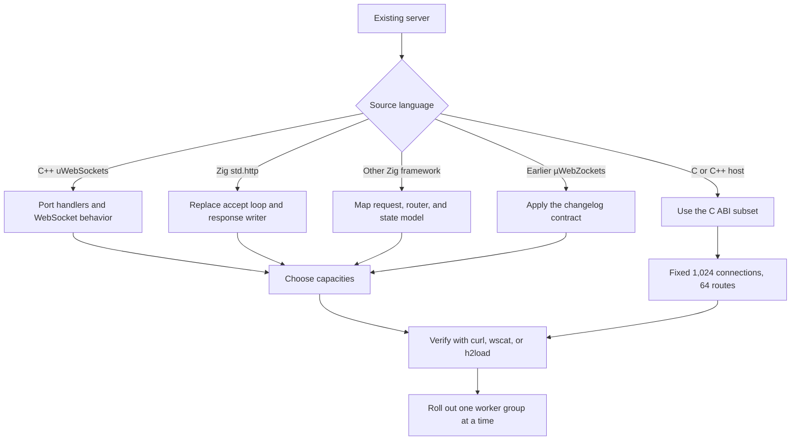

Phần này map một server hiện có sang application model của µWebZockets. Mỗi
trang bắt đầu từ một chương trình đang chạy, gọi tên source và target API, và nêu
rõ behavior nào không mang sang được.

Migration là port, không phải đổi dependency. µWebZockets cố định capacity lúc
khởi động, mượn request memory từ connection, và biểu diễn deferred work bằng
một one-shot token. Project giữ thiết kế allocator-per-request sẽ chống lại
runtime thay vì dùng nó.

## Choose your starting point [#choose-your-starting-point]

<CardGroup cols={2}>
  <Card title="From uWebSockets" href="/docs/migration/from-uwebsockets" icon="git-compare">
    Chuyển service C++ event-loop sang Zig value, explicit error và bounded response writer.
  </Card>
  <Card title="From std.http" href="/docs/migration/from-std-http" icon="arrow-right-left">
    Thay accept loop và response writer tự viết bằng router, slab và helper.
  </Card>
  <Card
    title="From another Zig framework"
    href="/docs/migration/from-other-zig-frameworks"
    icon="boxes"
  >
    Quyết định cái gì map được, cái gì không, và khi nào giữ framework hiện tại rẻ hơn.
  </Card>
  <Card title="From C servers" href="/docs/migration/from-c" icon="file-code">
    Dùng opaque handle ABI, fixed capacity và borrowed view chỉ sống trong callback.
  </Card>
  <Card title="v1 to v2" href="/docs/migration/v1-to-v2" icon="arrow-up-right">
    Áp dụng thay đổi route, response, WebSocket và HTTP/3 từ changelog.
  </Card>
  <Card title="2.1 to 2.2" href="/docs/migration/v2-1-to-v2-2" icon="clock">
    Theo dõi carried work và baseline 2.1.6 hiện tại trước khi 2.2.0 phát hành.
  </Card>
</CardGroup>

## Decide the path [#decide-the-path]

Nhánh đầu tiên là source language, không phải wire protocol. Service C++ đã nói
HTTP/2 vẫn port qua cùng boundary `Request` và `Response` như service HTTP/1.1.

## What changes in every migration [#what-changes-in-every-migration]

| Area                | Before migration                                      | After migration                                               |
| ------------------- | ----------------------------------------------------- | ------------------------------------------------------------- |
| Memory              | Per-request allocation hoặc general-purpose allocator | Một startup slab; request slice được mượn                     |
| Error handling      | Exception, bỏ qua return value hoặc thoát process     | Named Zig error union và `try` tường minh                     |
| Concurrency         | Shared state sau lock, hoặc một loop mỗi process      | Một loop và một slab mỗi worker; shared-nothing mặc định      |
| Routing             | Đăng ký lúc runtime hoặc pattern riêng của framework  | Đăng ký lúc startup; static, `:param` và terminal `*wildcard` |
| Response completion | Ghi theo thứ tự tùy ý                                 | Một response cho mỗi request, hoàn tất đúng một lần           |
| Deferred work       | Future, promise hoặc callback chain                   | Copyable `AsyncResponse` token trên owning loop               |

## Common migration checklist [#common-migration-checklist]

| Step | Check                                                 | Evidence                                      |
| ---- | ----------------------------------------------------- | --------------------------------------------- |
| 1    | Pin Zig 0.16.0 và µWebZockets 2.1.6                   | `zig version` và `build.zig.zon`              |
| 2    | Thêm package bằng `zig fetch --save`                  | Consumer `build.zig.zon`                      |
| 3    | Map mọi route, method và parameter                    | Route table trong `main` đã migrate           |
| 4    | Thay response helper và status string                 | `res.text`, `res.json`, `res.end` hoặc stream |
| 5    | Chuyển request data cần giữ sang owned storage        | `req.clone(allocator)` hoặc bounded copy      |
| 6    | Chọn connections, body, write queue và protocol limit | Bảng `ServerConfig` và `slab_bytes()`         |
| 7    | Chạy server cũ và mới với cùng client test            | `curl`, `wscat`, `h2load` hoặc service test   |
| 8    | Roll out với drain trên `SIGTERM`                     | `catch_shutdown_signals` và shutdown log      |

## What this section does not promise [#what-this-section-does-not-promise]

- Source compatibility với framework khác. Trang migration map concept và API;
  không cung cấp transpiler.
- Dynamic capacity growth. Capacity quá nhỏ là configuration error, không phải
  runtime resize.
- Feature mà target framework không expose. Kiểm tra
  [feature matrix](/reference/feature-matrix) trước khi lên kế hoạch port.
- Benchmark result. Throughput claim cần evidence contract trong
  [Benchmarking](/docs/guides/benchmarking).

## Related [#related]

- [Compatibility](/reference/compatibility) liệt kê Zig, platform và dependency
  version được hỗ trợ.
- [Feature matrix](/reference/feature-matrix) phân tách supported, helper-only,
  experimental và unsupported surface.
- [Breaking changes](/docs/migration/breaking-changes) là bảng action theo version.
