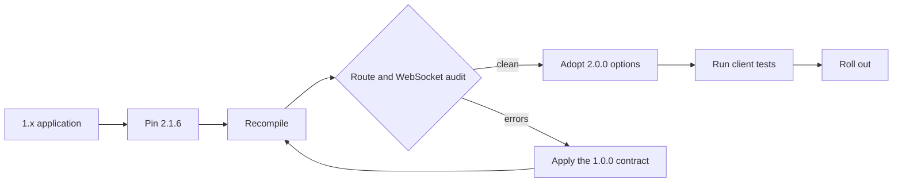

Trang này dành cho application đang pin một tag µWebZockets 1.x, đặc biệt là
bản 1.x cuối cùng, 1.9.0. Target ở đây là dòng 2.x; pin 2.1.6 cho patch baseline hiện
tại. Changelog không ghi nhận removal hay rename nào giữa 1.9.0 và 2.0.0. Mục
2.0.0 nói rõ cluster API và C struct layout không đổi, và addition duy nhất ở C
enum chỉ là append-only.

Mục 1.0.0 là contract định nghĩa API line của v1. Nếu bạn port code từ một tag trước
1.0.0, áp dụng những thay đổi đó trước. Nếu bạn đã ở 1.9.0, chúng đã có hiệu lực;
chúng được liệt kê ở đây vì mô tả API mà dòng 2.x kế thừa. Mục 2.0.0 là additive
và tập trung vào performance, với các behavior change được nêu bên dưới.

## Ai cần đọc trang này [#who-this-applies-to]

| Điểm bắt đầu    | Việc cần làm                                                                                      |
| --------------- | ------------------------------------------------------------------------------------------------- |
| Tag trước 1.0.0 | Áp dụng contract 1.0.0, sau đó các addition của 2.0.0                                             |
| 1.9.0           | Recompile trên 2.1.6; không có removal hay rename, nhưng xem lại adjustment `configure` của 2.1.5 |
| C ABI consumer  | Rebuild với header; layout không đổi và `UWZ_HTTP_TRACE = 9` được append                          |
| 2.x             | Không cần việc v1-to-v2; đọc [2.1 lên 2.2](/docs/migration/v2-1-to-v2-2)                          |

## Compatibility tổng quan [#compatibility-at-a-glance]

| Area               | Behavior ở v1                                               | Behavior ở v2                                                                                                 | Action                                                                              |
| ------------------ | ----------------------------------------------------------- | ------------------------------------------------------------------------------------------------------------- | ----------------------------------------------------------------------------------- |
| Route registration | Error union, lock sau `listen` hoặc `listen_udp`            | Cùng rule; `trace` được thêm và `listen_all` có thể bắt đầu lock                                              | Xử lý mọi registration result; đăng ký trước listener                               |
| Request target     | `path`, `target` và `query` là các field riêng              | Cùng field và ý nghĩa                                                                                         | Match trên `path`; log `target`; parse `query`                                      |
| WebSocket          | Send có giới hạn, `WouldBlock`, `send_close` và `terminate` | Cùng API; frame từ một lần read share một flush và compression codec được mở trước                            | Không đổi source; chạy lại test frame và backpressure                               |
| HTTP/3             | `init_http3` tạo hai context; `listen_udp` trước `run`      | Cùng startup; Linux transmit dùng UDP GSO                                                                     | Giữ `listen_udp` trước `run`; GSO không cần đổi source                              |
| Cluster            | `build_cluster`, `publish` và public lifecycle field        | Cùng signature `build_cluster` và `publish`; option `worker_count` ở 2.0.0, typed lifecycle và report ở 2.1.5 | Không đổi với `build_cluster` và `publish`; specialize callback `configure` generic |
| C ABI              | Opaque handle có version và fixed capacity                  | Struct layout không đổi; `UWZ_HTTP_TRACE = 9` được append, không renumber                                     | Recompile và giữ nguyên enum value                                                  |
| Compression        | RFC 7692 qua `WsBehavior.compression`                       | Cùng switch; HTTP gzip là pool opt-in riêng                                                                   | Giữ RFC 7692 off mặc định; opt-in gzip tường minh                                   |

Dòng C ABI quan trọng với shared library và binding được generate. Rebuild từ
header 2.1.6 thay vì copy enum value từ header local.



## Các contract change của 1.0.0 [#the-100-contract-changes]

Đây là các mục dưới heading `Breaking changes` của 1.0.0. Chúng không mới ở
2.0.0; chúng là contract mà dòng v1 thiết lập và dòng v2 giữ nguyên.

| Area                        | Behavior cũ                                                                                 | Behavior mới                                                                                        | Action                                                                   |
| --------------------------- | ------------------------------------------------------------------------------------------- | --------------------------------------------------------------------------------------------------- | ------------------------------------------------------------------------ |
| Route registration          | Registration không yêu cầu xử lý error union                                                | Trả về error union; xử lý bằng `try`, `catch` hoặc tương đương                                      | `_ = try app.get("/", handler);` và `_ = try app.ws("/chat", behavior);` |
| Route mutation after listen | Route mutation không được guard bởi listener lock                                           | Trả `error.RoutesLocked` sau khi `listen` hoặc `listen_udp` thành công                              | Đăng ký mọi route trước lần gọi listener thành công đầu tiên             |
| WebSocket message size      | `App(N)` mặc định có ceiling 16 KiB                                                         | Message trên 16 KiB cần `ConfiguredApp` và limit `WsBehavior` khớp                                  | Đặt `max_frame_size <= max_message_size <= message capacity`             |
| Output and backpressure     | Output không có bounded-queue failure để báo                                                | Response writer và `WebSocket.send` có thể trả `error.WouldBlock`                                   | Coi `WouldBlock` là bình thường; resume từ `drain` callback              |
| WebSocket send and close    | Continuation chưa được document là bị reject; close path chưa có split drain-then-terminate | `send` từ chối `.continuation` với `error.InvalidOpcode`; `send_close` drain, `terminate` immediate | Gửi message final hoàn chỉnh; chỉ dùng `terminate` cho close immediate   |
| HTTP/3 availability         | `http3_available` là false; HTTP/3 không phải live listener                                 | `http3_available` báo QUIC backend được compile; `listen_udp` mở live path                          | Thêm `listen_udp` trước `run`; gate listener trên `uz.http3_available`   |
| RFC 7692 compression        | `WsBehavior` không có compression switch public                                             | `WsBehavior.compression` tồn tại và mặc định `.disabled`                                            | Opt in bằng `.permessage_deflate` cho từng route                         |
| Request target fields       | Route matching dùng một target string                                                       | `path` là match path, `target` là target gốc kèm query, `query` không có `?`                        | Dùng `path` cho routing, `target` và `query` cho logging và parsing      |

WebSocket limit được kiểm tra trước upgrade. Message capacity lớn hơn connection
storage đã compile sẽ fail registration với `error.InvalidWebSocketLimits` thay vì
truncate message lúc runtime:

```zig
var app = try uz.ConfiguredApp(512, 32 * 1024, 32 * 1024).init(init.io);
defer app.deinit();

_ = try app.get("/", hello_handler);
_ = try app.ws("/chat", .{
    .message = on_message,
    .max_frame_size = 32 * 1024,
    .max_message_size = 32 * 1024,
    .compression = .permessage_deflate,
});
```

`ConfiguredApp` nhận connection count, WebSocket message capacity và write queue
size. Cùng message capacity đó phải cover `WsBehavior.max_message_size`; frame
ceiling không được vượt quá nó.

HTTP/3 startup có hai listener từ 1.0.0 trở đi. `init_http3` chuẩn bị TLS context
cho TCP và QUIC, còn `listen_udp` bind QUIC endpoint:

```zig
var server = try uz.App(128).init_http3_ephemeral(init.io);
defer server.deinit();

_ = try server.get("/", index);
try server.listen_udp("0.0.0.0", 8443);
try server.run();
```

`App` value phải ở địa chỉ ổn định sau `listen_udp`; QUIC engine giữ pointer tới
nó. `uz.http3_available` báo build có hỗ trợ listener hay không; source 2.1.6 bật
nó. Kiểm tra giá trị này trước khi document một HTTP/3 endpoint.

## Các addition của 2.0.0 [#the-200-additive-changes]

Mục 2.0.0 thêm behavior mà không remove surface v1. Mọi dòng bên dưới không cần
đổi source hoặc là opt-in tường minh, trừ C enum value có thể cần rebuild và thêm
một switch case.

| Addition                         | Behavior                                                                                                                              | Action                                                                                                                      |
| -------------------------------- | ------------------------------------------------------------------------------------------------------------------------------------- | --------------------------------------------------------------------------------------------------------------------------- |
| `listen_all`                     | Bind tối đa bốn TCP endpoint, verify mọi local port, rồi mới arm accept; bind fail thì route vẫn unlocked                             | Adopt khi một process bind nhiều port; `listen` vẫn là wrapper một endpoint                                                 |
| `ClusterOptions.worker_count`    | Chọn active worker count tường minh, tối đa bằng compiled capacity; chỉ worker active allocate slab, inbox và thread                  | Đặt khi biết CPU hoặc cgroup limit lúc startup                                                                              |
| `build_cluster_from_environment` | Resolve option tường minh, rồi `UWEBZOCKETS_WORKERS`, rồi CPU count của platform                                                      | Dùng cho container; option tường minh thắng                                                                                 |
| HTTP gzip pool                   | `with_http_compression(true)` mở một compressor cho mỗi active worker; `Response.end_gzip` tránh allocation trên request path         | Opt in theo server; RFC 7692 WebSocket compression là riêng                                                                 |
| TRACE                            | Method opt-in trên `HttpMethod`, `Router.trace`, `App.trace`, client, C ABI `UWZ_HTTP_TRACE`, HTTP/2, HTTP/3 replay safety và OpenAPI | Chỉ đăng ký khi cần; redact `Authorization`, `Cookie`, `Proxy-Authorization` và application secret; bound byte được reflect |
| Linux UDP GSO                    | Packet lsquic cùng size cho một destination dùng một `sendmsg` với `UDP_SEGMENT`; trường hợp khác fallback                            | Không đổi source; đây là transport-internal                                                                                 |
| HTTP/1.1 pipelining batch        | Nhiều request hoàn chỉnh từ một lần read append response vào bounded ring và flush một lần                                            | Không đổi source; kiểm tra test giả định một write cho mỗi response                                                         |
| WebSocket batching               | Frame liên tiếp từ một lần read share một write flush; AVX2 dùng unmasking 256-bit với scalar tail                                    | Không đổi source; chạy lại test echo và backpressure                                                                        |
| Cluster active slice             | `Cluster.worker(index)` và mọi loop dùng active worker slice; compiled capacity không dùng sẽ không reserve inbox                     | Không đổi source; `worker_count()` báo active count                                                                         |
| C enum append                    | `UWZ_HTTP_TRACE = 9` nối sau `UWZ_HTTP_QUERY = 8`; không giá trị nào bị renumber                                                      | Recompile; không renumber bản local; chỉ thêm case TRACE nếu switch của bạn exhaustive                                      |

Changelog 2.0.0 không công bố throughput number nào nếu chưa rerun trên quiet
host. Coi implementation là đã ship và performance claim là chưa đo cho tới khi
evidence được ghi lại.

## Checklist upgrade [#upgrade-checklist]

1. Pin Zig 0.16.0 và µWebZockets 2.1.6 trong project của bạn.
2. Fetch release tag và xác nhận package entry `uWebZockets`:

   ```sh
   zig fetch --save 'https://github.com/farbenbuilds/uWebZockets/archive/refs/tags/v2.1.6.tar.gz'
   ```

3. Recompile trước khi sửa code. Một lần compile sạch là tín hiệu đầu tiên vì
   changelog không ghi nhận removal hay rename nào giữa 1.9.0 và 2.0.0.
4. Rà soát mọi call `get`, `post`, `ws` và `trace`. Mọi result được xử lý, và
   không route nào được đăng ký sau khi listener thành công.
5. Rà soát WebSocket limit. Dùng `ConfiguredApp` cho message trên 16 KiB, giữ
   frame ceiling bằng hoặc thấp hơn message ceiling, và chỉ opt in
   `.permessage_deflate` khi cần.
6. Rà soát backpressure. `WouldBlock` là bình thường, producer resume từ `drain`,
   và không retry loop nào spin trong callback.
7. Rà soát HTTP/3 startup. `init_http3` và `listen_udp` đứng trước `run`, và
   listener được gate trên `uz.http3_available`.
8. Quyết định từng option 2.0.0 một: `listen_all`, `worker_count`, HTTP gzip và
   TRACE. Mỗi cái đều opt-in.
9. Chạy verification bên dưới với cùng client test như server 1.x.

## Verify [#verification]

```sh
zig build
```

```sh
curl -i http://127.0.0.1:3000/
```

```sh
wscat -c ws://127.0.0.1:3000/chat
```

```sh
curl --http3-only -k -i https://127.0.0.1:8443/
```

| Check             | Điều kiện pass                                                                             |
| ----------------- | ------------------------------------------------------------------------------------------ |
| HTTP/1.1 route    | Status và body khớp contract trước upgrade                                                 |
| WebSocket message | Message trên 16 KiB round-trip sau `ConfiguredApp`; message nhỏ hơn vẫn chạy               |
| Backpressure      | Producer bị pause bởi `WouldBlock` resume từ `drain` mà không duplicate hay truncate frame |
| HTTP/3 listener   | `uz.http3_available` là true, `listen_udp` đứng trước `run`, và QUIC endpoint trả lời      |
| Route lock        | Route thêm sau `listen` trả `error.RoutesLocked`, và tập route đã đăng ký vẫn phục vụ      |
| C ABI             | Header rebuild giữ nguyên enum value và định nghĩa `UWZ_HTTP_TRACE` là 9                   |

Assert status và body, không assert header order. Header order và casing chính
xác của field là transport detail. Xem [HTTP limits](/docs/http/limits) cho
capacity mặc định và [WebSocket](/docs/websocket) cho contract frame và drain.

## Liên quan [#related]

- [Breaking changes](/docs/migration/breaking-changes) là action index theo
  version.
- [2.1 lên 2.2](/docs/migration/v2-1-to-v2-2) tách baseline 2.1.6 đã ship khỏi
  planning target 2.2.0.
- [Compatibility](/reference/compatibility) liệt kê Zig, platform và dependency
  version được hỗ trợ.
- [ServerConfig](/reference/server-config) liệt kê mọi capacity và default.
- [CHANGELOG 1.0.0](https://github.com/farbenbuilds/uWebZockets/blob/main/CHANGELOG.md#100---2026-09-01)
  là nguồn của contract change.
- [CHANGELOG 2.0.0](https://github.com/farbenbuilds/uWebZockets/blob/main/CHANGELOG.md#200---2026-10-20)
  là nguồn của additive change.
