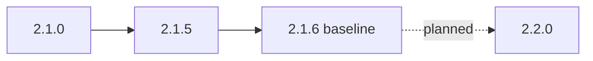

µWebZockets 2.1.6 là baseline hiện tại. 2.2.0 là một planning target: ở baseline
này chưa có tag 2.2.0, chưa có ngày phát hành, và roadmap không promise một API.
Trang này tách phần đã ship trong 2.1.x khỏi phần đang được carry cho 2.2.0, để
bạn có thể pin một release hôm nay mà không code against một cái tên tương lai.

:::note[2.2.0 chưa phát hành]
Không coi một carried item là API. Một capability chỉ available khi có release tag
và một mục `CHANGELOG.md` có ngày. Roadmap ghi intent và thứ tự, không phải
contract.
:::

Dùng bảng trạng thái như một planning boundary. Một dòng `Shipped in 2.1.x` dựa
trên release và changelog entry có ngày; một dòng `Carried for 2.2.0` chỉ là
roadmap candidate. Candidate có thể bị reorder hoặc drop mà không có changelog
entry, và không candidate nào available trước release tag của nó.

## Baseline hiện tại [#current-baseline]

| Version | Ngày         | Trạng thái      | Public surface                                                               |
| ------- | ------------ | --------------- | ---------------------------------------------------------------------------- |
| 2.1.6   | 2026-10-26   | Patch hiện tại  | Không đổi public API, C ABI layout, capacity, wire format hay TLS policy     |
| 2.1.5   | 2026-10-25   | Minor trước đó  | Cluster lifecycle, failure và publish reporting; best-effort response ending |
| 2.1.0   | 2026-10-24   | Minor trước đó  | Timing wheel, sleep parking, header read deadline, indexed rate limiting     |
| 2.2.0   | Chưa có ngày | Planning target | Chưa có API nào được ship; mọi dòng bên dưới là carry                        |

Release 2.1.0 đổi default slab total từ `681_752_192` sang `683_382_400` byte,
tăng `1_630_208` byte cho một idle timer node và chín parking slot trên mỗi
default connection. Các limit được cấu hình không đổi. Đây là thay đổi footprint,
không phải thay đổi capacity model.



## 2.1.x đã thêm gì [#what-21x-added]

### 2.1.0 [#what-210-added]

| Area          | Addition                                                                     | Effect                                                                      |
| ------------- | ---------------------------------------------------------------------------- | --------------------------------------------------------------------------- |
| Deadlines     | Four-level timing wheel; `AsyncResponse.sleep` và `sleep_complete`           | Response bị delay park mà không block loop                                  |
| Header timing | `ServerConfig.header_read_timeout_ms`; `Builder.with_header_read_timeout_ms` | Head hoặc body chưa hoàn chỉnh có deadline riêng, tách khỏi idle keep-alive |
| Rate limiting | `middleware.RateLimitTable`; `rate_limit_indexed`                            | O(1) expected lookup và insert với index và LRU storage do caller sở hữu    |
| Client        | Monotonic scan cursor                                                        | Response parsing tuyến tính qua các lần read                                |
| Pub/sub       | Stable topic id và per-topic subscriber list                                 | Publish work scale theo live subscriber của topic                           |

### 2.1.5 [#what-215-added]

| Area      | Addition                                                                                                                         |
| --------- | -------------------------------------------------------------------------------------------------------------------------------- |
| Lifecycle | `ClusterState` với `configured`, `running`, `stopped`, `releasing`, `released`; `state()`, `worker_count()`, `worker_capacity()` |
| Failures  | `FailurePhase`, `WorkerFailure { index, phase, err }`, `first_failure()`, `failure_count()`                                      |
| Publish   | `PublishReport { queued, dropped, notify_failed, first_dropped_worker }`, `attempted()`, `all_delivered()`, `publish_report()`   |
| Callback  | `Cluster.ConfigureCallback` thay tham số `anytype`                                                                               |
| Errors    | Named `RunError` và `PublishError` qua `uz.cluster`; `deinit_checked()`                                                          |
| Responses | `Response.end_best_effort` và `Response.end_with_headers_best_effort`                                                            |
| Safety    | Cluster wakeup dùng queue-owned scratch; `message_queue.pop_copy` kiểm tra message length trước khi copy                         |

Release 2.1.5 là API hardening, không phải release wire hay capacity. Nó thêm
typed surface mà supervisor cần, không đổi shared-nothing request path.

### 2.1.6 [#what-216-added]

Release 2.1.6 là patch. Nó disarm và re-arm timer scheduler thay vì replay
absolute timeout đã hết hạn, pin libxev `c49f6dfb` với XEV-003 tới XEV-005, giữ
`TCP_NODELAY` best effort sau khi peer reset, đồng thời làm HTTP và HTTP/2 benchmark
harness fail closed. Public API, C ABI layout, capacity, wire format và TLS
policy không đổi.

## Trạng thái cho 2.2.0 [#status-for-220]

| Item                                                                                      | Status            | Ghi chú                                                                           |
| ----------------------------------------------------------------------------------------- | ----------------- | --------------------------------------------------------------------------------- |
| `ClusterState`, `state()`, `worker_count()`, `worker_capacity()`                          | Shipped in 2.1.x  | 2.1.5                                                                             |
| `FailurePhase`, `WorkerFailure`, `first_failure()`, `failure_count()`                     | Shipped in 2.1.x  | 2.1.5                                                                             |
| `PublishReport`, `publish_report()`, `attempted()`, `all_delivered()`                     | Shipped in 2.1.x  | 2.1.5                                                                             |
| `Cluster.ConfigureCallback`, named `RunError` và `PublishError`, `deinit_checked()`       | Shipped in 2.1.x  | 2.1.5                                                                             |
| `Response.end_best_effort`, `end_with_headers_best_effort`                                | Shipped in 2.1.x  | 2.1.5                                                                             |
| `AsyncResponse.sleep`, `sleep_complete` và timing wheel                                   | Shipped in 2.1.x  | 2.1.0                                                                             |
| `header_read_timeout_ms`, `RateLimitTable`, `rate_limit_indexed`                          | Shipped in 2.1.x  | 2.1.0                                                                             |
| Timer scheduler fix, best-effort `TCP_NODELAY`, fail-closed benchmark                     | Shipped in 2.1.x  | 2.1.6                                                                             |
| Quiet-host evidence cho pipeline v2.0.0 và v2.1.0, WebSocket, `json-comp` và `latency-1m` | Carried for 2.2.0 | Chưa có performance number trước khi rerun                                        |
| Receive-side `UDP_GRO`                                                                    | Carried for 2.2.0 | Transmit GSO ship ở 2.0.0; receive GRO chờ ancillary size                         |
| HttpArena `async` adapter cho `/delay/:ms` đã ship                                        | Carried for 2.2.0 | Route surface ship ở 2.1.0; adapter thì chưa                                      |
| Cross-process `SO_REUSEPORT` hoặc systemd socket activation handoff                       | Carried for 2.2.0 | `listen_all` chỉ là in-process all-or-nothing barrier                             |
| Quyết định về per-listener certificate                                                    | Carried for 2.2.0 | Mọi TLS listener share application certificate ở 2.1.6                            |
| Ví dụ TRACE reflection có bound                                                           | Carried for 2.2.0 | TRACE là opt-in; library không synthesize echo                                    |
| Optional `uwz_app_listen_all` C entry point                                               | Carried for 2.2.0 | C ABI chưa có entry point `listen_all` hôm nay                                    |
| Retained fork archive và second-machine resolution cho libxev, lsquic và h1spec           | Carried for 2.2.0 | Dependency provenance và native Windows runtime gate còn mở                       |
| Fresh lsquic và h1spec fork gate evidence                                                 | Carried for 2.2.0 | Pin đã ghi; compliance artifact vẫn cần rerun                                     |
| HTTP/3 datagram và WebTransport qua maintained lsquic fork                                | Carried for 2.2.0 | Live path vẫn capability-gated tới compliance gate                                |
| Extract nested `Cluster` runtime khỏi `src/router/app.zig`                                | Carried for 2.2.0 | Internal ownership work; 2.1.5 đã chuyển lifecycle policy sang `worker_group.zig` |

Mọi dòng `Carried for 2.2.0` đến từ carried list của roadmap. Roadmap là plan,
không phải changelog section. Một dòng shipped dựa trên version đã release và
changelog entry có ngày.

## Việc cần làm hôm nay [#what-to-do-today]

- Không cần migration cho kế hoạch 2.2.0. Patch 2.1.6 không đổi public API,
  C ABI layout, capacity, wire format hay TLS policy.
- Nếu bạn đang ở 2.1.0, xem lại source adjustment `Cluster.configure` của 2.1.5,
  các named lifecycle error và lỗi `publish` sau `run` trước khi pin 2.1.6. Từ
  2.1.5, patch này source-compatible.
- Pin 2.1.6. Không pin `main`, và không viết code against một cái tên chỉ xuất
  hiện trong roadmap.
- Giữ Zig 0.16.0. Đây là toolchain duy nhất được hỗ trợ cho baseline này.
- Không bật WebTransport, per-listener certificate hay HTTP/3 cluster. Không cái
  nào available ở 2.1.6.
- Nếu cần một carried capability, giữ fallback và theo dõi `CHANGELOG.md` đã
  release, không chỉ roadmap.

```sh
zig fetch --save 'https://github.com/farbenbuilds/uWebZockets/archive/refs/tags/v2.1.6.tar.gz'
```

## Các boundary không đổi [#boundaries-that-do-not-move]

| Boundary               | Trạng thái 2.1.6 | Ý nghĩa cho kế hoạch 2.2.0                                                          |
| ---------------------- | ---------------- | ----------------------------------------------------------------------------------- |
| Fixed startup slab     | Fixed            | Size bằng `ServerConfig` hoặc preset; exhaustion trả structured error, không resize |
| TLS 1.3 only           | Fixed            | TLS 1.2 và cipher suite cũ vẫn không được hỗ trợ                                    |
| HTTP/3 clustering      | Not supported    | `init_http3` và `listen_udp` là single-application; cluster listener chỉ TCP/TLS    |
| WebTransport live path | Not live         | CONNECT nhận `501` ở 2.1.6; carried implementation phụ thuộc compliance gate        |

Roadmap carry implementation work cho WebTransport, không phải API đã ship. Coi
live path là unavailable cho tới khi một release ghi nhận gate đã pass.
[HTTP/3](/docs/http3) liệt kê trạng thái listener hiện tại, và
[Shared-nothing cluster](/examples/shared-nothing-cluster) nói về TCP cluster boundary.

## Liên quan [#related]

- [v1 lên v2](/docs/migration/v1-to-v2) áp dụng các contract change trước đó.
- [Breaking changes](/docs/migration/breaking-changes) index mọi contract và
  behavior change đã được ghi nhận.
- [Compatibility](/reference/compatibility) liệt kê toolchain và platform được
  hỗ trợ.
- [Limits](/reference/limits) là capacity lookup cho baseline 2.1.6.
- [CHANGELOG 2.1.0](https://github.com/farbenbuilds/uWebZockets/blob/main/CHANGELOG.md#210---2026-10-24)
  là nguồn của timing-wheel và header-deadline addition.
- [CHANGELOG 2.1.5](https://github.com/farbenbuilds/uWebZockets/blob/main/CHANGELOG.md#215---2026-10-25)
  là nguồn của lifecycle và publish-report surface.
- [CHANGELOG 2.1.6](https://github.com/farbenbuilds/uWebZockets/blob/main/CHANGELOG.md#216---2026-10-26)
  là patch baseline.
